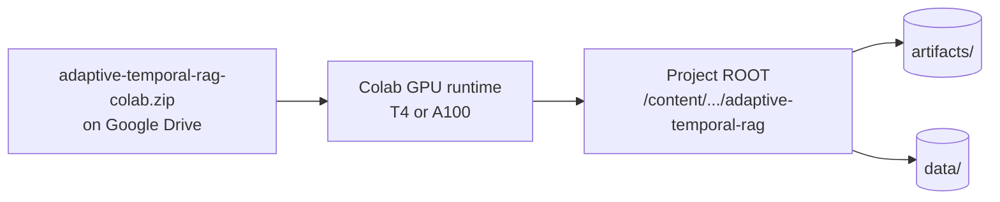
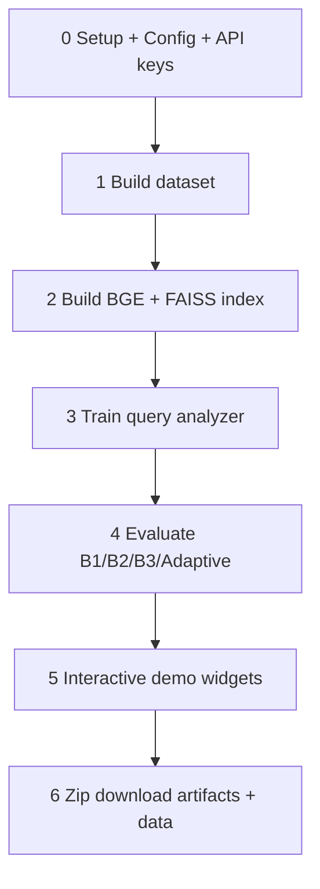
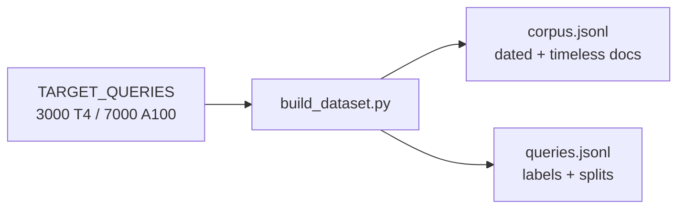
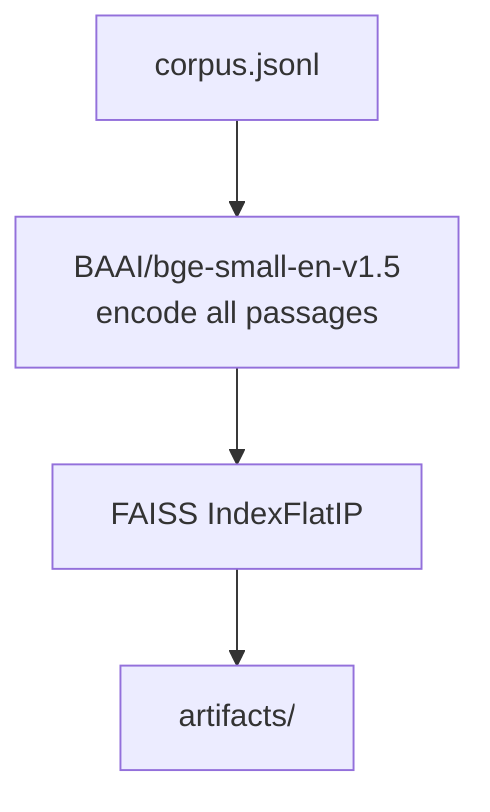
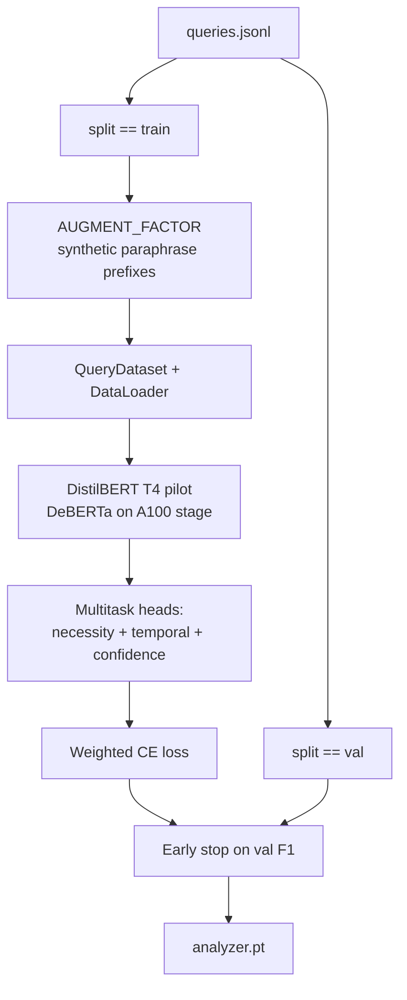
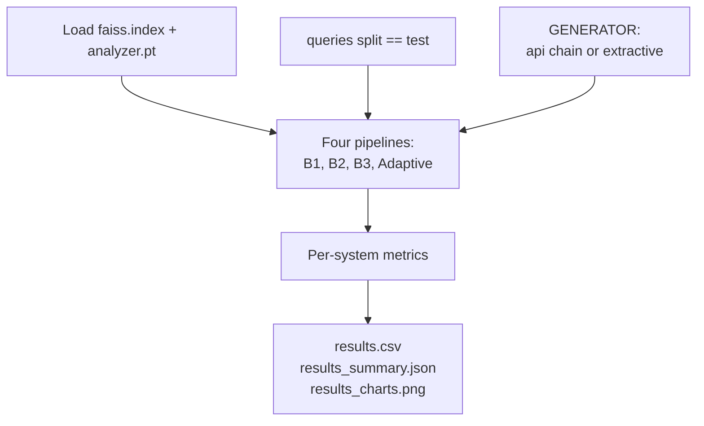
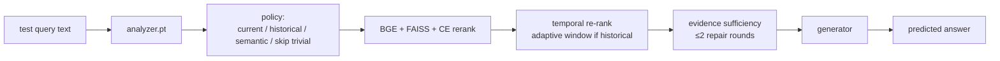

# Colab pipeline architecture

Single end-to-end path: **`notebooks/00_colab_e2e.ipynb`** on a GPU runtime (T4 pilot or A100 large).  
Upload **`adaptive-temporal-rag-colab.zip`** to Drive (or upload the zip in the setup cell), then run cells top to bottom.

---

## 0 — Runtime layout

| Path | Purpose |
|------|---------|
| `ROOT/` | Unzipped project (`src/`, `scripts/`, notebook) |
| `ROOT/data/` | `corpus.jsonl`, `queries.jsonl` (section 1) |
| `ROOT/artifacts/` | Index, trained analyzer, eval outputs (sections 2–6) |

**Setup cell:** find `ROOT`, `pip install`, check `torch.cuda`, `os.chdir(ROOT)`.

---

## Colab stages (notebook order)

| Section | What runs | Main outputs |
|---------|-----------|----------------|
| **Config** | `RUN_STAGE` (`t4_pilot` / `a100_large`), `TARGET_QUERIES`, `AUGMENT_FACTOR`, `EPOCHS`, `BATCH_SIZE`, `GENERATOR`, `TOP_K`, `ALPHA`, `CANDIDATE_K` | Console config + GPU name |
| **API keys** | Groq → OpenRouter → OpenCode; if none → `GENERATOR = extractive` | Provider chain healthcheck |
| **1 — Dataset** | `python scripts/build_dataset.py --target-queries … --out-dir data/` | `data/corpus.jsonl`, `data/queries.jsonl` |
| **2 — Index** | `build_index_from_corpus(corpus.jsonl, artifacts/)` | `faiss.index`, `embeddings.npy`, snapshot meta |
| **3 — Train** | `train_analyzer(...)` on train/val splits from `queries.jsonl` | `analyzer.pt`, `analyzer_meta.json` |
| **4 — Eval** | `evaluate.py --split test` + `plot_results.py` | `results.csv`, `results_summary.json`, charts, comparative report |
| **5 — Demo** | ipywidgets: pick B1/B2/B3/Adaptive, run one query | Answer + analyzer + retrieved docs in notebook |
| **6 — Download** | Zip `artifacts/` + `data/` → `files.download` | `atr_colab_artifacts_*.zip` |
| **8 — Inference trace** | `src/inference_trace.py` — B1–B4 + step log | `artifacts/inference_walkthrough.json` |

---

## Section 1 — Dataset (inside Colab)

- **Splits:** train / val / test (stratified on seed templates; paraphrases extend train size).
- **Labels** (for training analyzer + eval metrics only): `needs_retrieval`, `temporal_class`, `time_hint`, `gold_answer`, `gold_doc_ids`.
- **Inference** (sections 4–5) does **not** read gold labels.

---

## Section 2 — Index (no neural training)

Used by B2, B3, and Adaptive at eval/demo time. Cross-encoder rerank loads later at inference (not a separate Colab section).

---

## Section 3 — Train analyzer (only learned weights in Colab)

| `RUN_STAGE` | Typical encoder | `TARGET_QUERIES` | Notes |
|-------------|-----------------|------------------|--------|
| `t4_pilot` | `distilbert-base-uncased` | 3000 | ~2–3h target on T4 |
| `a100_large` | larger preset in `model_config` | 7000 | ~6h final-quality run |

After training, the notebook runs a few **smoke predictions** (current PM, 2018 president, define term, arithmetic).

---

## Section 4 — Eval (batch inference on test split)

**Adaptive path in eval** (same as demo, no gold at `run()`):

| System | Colab behavior |
|--------|----------------|
| **B1** | Generator only, no retrieval |
| **B2** | FAISS + CE rerank → generator |
| **B3** | Fixed temporal window + α blend → generator |
| **Adaptive** | Analyzer routing + adaptive historical window + sufficiency loop → generator |

---

## Inference diagrams (PNG for report / slides)

Ready-made PNGs (regenerate: `.\scripts\render_diagram_pngs.ps1`):

| PNG | Use |
|-----|-----|
| [01_adaptive_inference_full.png](docs/diagrams/01_adaptive_inference_full.png) | Full Adaptive inference path |
| [02_policy_router.png](docs/diagrams/02_policy_router.png) | Policy router detail |
| [03_colab_four_systems_eval.png](docs/diagrams/03_colab_four_systems_eval.png) | B1–B4 eval in Colab §4 |

Sources: `docs/diagrams/*.mmd`  
**Node-by-node guide:** [docs/diagrams/INFERENCE_NODES.md](docs/diagrams/INFERENCE_NODES.md)

---

## Section 5 — Demo (single-query inference)

Same four systems as section 4, driven by widgets (`system_dd`, `query_box`).  
Shows **answer**, **analyzer fields**, **policy / window / sufficiency meta**, and **retrieved passages**.

---

## Section 6 — Artifact bundle

Download zip includes at minimum:

- `artifacts/analyzer.pt`, `faiss.index`, `embeddings.npy`
- `artifacts/results.csv`, `results_charts.png` (after section 4)
- `data/corpus.jsonl`, `data/queries.jsonl`

---

## Models touched in Colab (summary)

| Step | Model | Trained in Colab? |
|------|--------|-------------------|
| Index | BGE-small + FAISS | No — encode once |
| Rerank | `cross-encoder/ms-marco-MiniLM-L-6-v2` | No — used at eval/demo |
| Analyzer | DistilBERT (T4) / DeBERTa (A100) | **Yes** — section 3 |
| Answers | API failover or extractive | No |

Routing is **learned analyzer only** (no rule-based router).

---

## Viva one-liner (Colab only)

On Colab we **build data → index with BGE → fine-tune the multitask analyzer → run the same test queries through four pipelines → demo interactively → download the artifact zip** for the report.
