<!-- COVER -->
GURU GOBIND SINGH INDRAPRASTHA UNIVERSITY
UNIVERSITY SCHOOL OF AUTOMATION AND ROBOTICS
EAST DELHI CAMPUS, SURAJMAL VIHAR, DELHI - 110032
Minor Project Report
on
When and What to Retrieve: Adaptive Temporal Retrieval-Augmented Generation for Time-Aware Question Answering (Adaptive Temporal RAG)
Submitted in partial fulfilment of B.Tech. (7th Semester)
In
AI-ML
Name: Daksh Agarwal
Enrollment Number: 10819051623
Under the supervision of
Dr. Annu Priya
Assistant Professor, USAR
November 2026

# CERTIFICATE

This is to certify that the Minor Project Report entitled “When and What to Retrieve: Adaptive Temporal Retrieval-Augmented Generation for Time-Aware Question Answering (Adaptive Temporal RAG)” is a record of bona fide work carried out by Daksh Agarwal, Enrollment Number 10819051623, a student of B.Tech. (7th Semester), Artificial Intelligence and Machine Learning, University School of Automation and Robotics, Guru Gobind Singh Indraprastha University, East Delhi Campus, in partial fulfilment of the requirements of Minor Project (ARP 455).

The work was completed under my supervision during the seventh semester and is submitted for evaluation on 25 November 2026. The report describes the frozen Checkpoint B pipeline for time-aware question answering, and the measurements it quotes are those saved at commit 44938a7, including negative findings. The matter embodied in this report has not, to the best of my knowledge, been submitted for the award of any other degree or diploma.

Signature: _______________________________

Name: Dr. Annu Priya

Designation: Assistant Professor, University School of Automation and Robotics

Date: _______________________________

# DECLARATION

I hereby declare that the Report entitled (When and What to Retrieve: Adaptive Temporal Retrieval-Augmented Generation for Time-Aware Question Answering) is an authentic record of work completed as requirements of Minor Project (ARP 455) under the supervision of Dr. Annu Priya, Assistant Professor, University School of Automation and Robotics, GGSIPU.

(Signature of student) ____

(Name of Student) Daksh Agarwal

(Enrollment Number) 10819051623

Date: ____

(Signature of Supervisor)

(Name of Supervisor) Dr. Annu Priya

Date: ____

# ACKNOWLEDGEMENT

The author is grateful to Dr. Annu Priya, Assistant Professor, University School of Automation and Robotics, for supervision of this minor project (ARP 455). Her guidance on problem formulation, on the discipline of a single frozen configuration, and on reporting a negative result with the same care as a positive one shaped both the experiments and this report. Checkpoint B in `configs/final.yaml`, the shared extractive reader and answer projection, and the decision to leave the sufficiency-loop outcome visible beside the full system follow that standard.

The author thanks Prof. Arvinder Kaur, Dean, University School of Automation and Robotics, and the faculty and staff of the School at the East Delhi Campus, Surajmal Vihar, for the academic setting of the seventh-semester project and for the formal requirements that bring the work to evaluation on 25 November 2026. The frozen measurements were obtained on a laptop central processing unit, which made a bounded per-question budget a practical constraint as well as a scientific one.

Project partner Shashank Kumar (Enrollment Number 08619051623) collaborated throughout the design of Adaptive Temporal RAG. Joint work on the pipeline, on the reading of the frozen tables, and on the companion paper draft is acknowledged with thanks. The October pilot, the TimeQA transfer, and the Checkpoint B freeze of 23 November 2026 were shared technical work. Responsibility for the wording of this report, and for copying numbers only from the verified record at commit 44938a7, rests with the author.

The author thanks his family for their patience during the October pilot, the November evaluation runs, and the final days in which this report was written for the 25 November 2026 evaluation.

Daksh Agarwal (10819051623)

# ABBREVIATIONS AND NOMENCLATURE

**Table 0.1:** Abbreviations used in this report, in alphabetical order.

| Abbreviation | Meaning |
|---|---|
| AMP | Automatic mixed precision; the October pilot left an AMP binary-cross-entropy path after a crash. |
| API | Application programming interface; optional generators exist, and the frozen reader is extractive. |
| ARP | Course identifier ARP 455, the USAR minor project. |
| B1 | No-retrieval baseline: empty document list, hardcoded trivia replies (`LLMOnlyPipeline`). |
| B2 | Standard dense retrieval: always retrieve, no date window, no sufficiency loop (`StandardRAGPipeline`). |
| B3 | Fixed ±2 year baseline when a year is found (`FixedTemporalRAGPipeline`). |
| B4 | Dense union BM25 with exponential year decay; no cross-encoder (`TempRALMDecayPipeline`). |
| BCE | Binary cross-entropy, the loss family implicated in the October AMP crash. |
| BGE | Dense encoder `BAAI/bge-small-en-v1.5` (Xiao et al., 2024). |
| BM25 | Okapi BM25 lexical ranker (`BM25Index`); used only by B4 in the frozen comparison. |
| CE | Cross-encoder score from `cross-encoder/ms-marco-MiniLM-L-6-v2`; also the symbol for cross-entropy in the router loss. |
| CI | Paired bootstrap percentile interval, 10,000 resamples, seed 0. |
| CPU | Central processing unit; every frozen evaluation ran on a laptop CPU. |
| DFD | Data-flow diagram (Chapter 5). |
| DPR | Dense passage retrieval (Karpukhin et al., 2020). |
| E-R | Entity–relationship diagram of documents, queries, evidence, and evaluation records. |
| ECE | Expected calibration error; implemented for the large router, and unreported because that run has no metrics. |
| EM | Exact match after SQuAD-style normalisation (`exact_match`). |
| F1 | Token-level F1, the harmonic mean of token precision and token recall. |
| FAISS | Similarity search; the frozen index is exact `IndexFlatIP` (Johnson, Douze, & Jégou, 2019). |
| FiD | Fusion-in-Decoder (Izacard & Grave, 2021); cited for context and not run here. |
| fp32 | 32-bit floating point, the precision specified for the queued DeBERTa router run. |
| GBM | Gradient boosting machine (Friedman, 2001); experimental learned ranker only. |
| GGSIPU | Guru Gobind Singh Indraprastha University. |
| GPU | Graphics processing unit; unused for the frozen evaluations. |
| IR | Information retrieval. |
| JSON | JavaScript Object Notation, used for results, significance, and router statistics. |
| JSONL | JSON Lines, the row format for corpus documents and queries. |
| LLM | Large language model; the frozen reader does not call one. |
| McNemar | Exact two-sided test on discordant answer pairs. |
| MiniLM | Distilled transformer (Wang et al., 2020) used as the MS MARCO cross-encoder. |
| NLP | Natural language processing. |
| P@5 | Precision at 5 against stored gold document identifiers. |
| QA | Question answering. |
| R@5 | Recall at 5 against stored gold document identifiers. |
| RAG | Retrieval-augmented generation (Lewis et al., 2020). |
| SQuAD | Stanford Question Answering Dataset; normalisation follows SQuAD (Rajpurkar, Jia, & Liang, 2018). |
| T4 | NVIDIA T4 used in the October Colab pilot and specified for the Kaggle router run. |
| UI | User interface: Streamlit, and the Next.js application at https://adaptive-temporal-rag.vercel.app. |
| USAR | University School of Automation and Robotics, GGSIPU. |
| YAML | Configuration language of `configs/final.yaml`. |

**Table 0.2:** Principal symbols, following the project paper. Where one letter is reused, both roles are stated.

| Symbol | Meaning |
|---|---|
| $q$ | The input question. |
| $\mathcal{D}$ | The corpus, a set of dated documents. |
| $d_i$ | The $i$-th document (passage or chunk). |
| $\tau_i$ | Index timestamp of $d_i$. On the templated corpus this is the fact date; on TimeQA it is the first date found, or 1 January 1970 if none is found. |
| $t$ | Target date implied by the question. |
| $\delta(d,t)$ | Distance from $t$ to $d$: zero inside a stated interval, otherwise the minimum absolute deviation to an endpoint or a point date. |
| $h$ | Half-width of the historical window, in years. |
| $h_{\max}$ | Maximum half-width for the cue that produced the window. |
| $w$ | Window width in years used to scale the historical temporal score. |
| $\Delta y$ | Absolute year gap. B4 multiplies its blend by $\exp(-\lvert\Delta y\rvert/2)$. |
| $\gamma$ | Policy confidence: half the untrained sigmoid plus half the larger maximum class probability, when blending is on. |
| $\alpha$ | Weight on the min–max semantic score in the default gate. Frozen value $0.6$. |
| $s_i$ | Blended first-stage score: $0.35$ times min–max FAISS plus $0.65$ times the raw cross-encoder score. |
| $\tilde{s}_i$ | Min–max normalised semantic score inside the surviving pool. |
| $g^{\mathrm{cur}}_i$ | Current-mode recency of document $i$ relative to the reference date. |
| $g^{\mathrm{hist}}_i$ | Historical temporal score of document $i$, decreasing in $\delta(d_i,t)$. |
| $b_i$ | Lexical boost $\min(0.25, 0.05H)$, where $H$ is the count of remaining query tokens found in the document. |
| $S$ | Sufficiency score. Evidence is accepted during retrieval when the subject check passes and $S \ge 0.55$. |
| $C$ | Fraction of content query tokens found in the retrieved text. |
| $T$ | In the sufficiency score, temporal fit in $[0,1]$. In the router, the softmax temperature. The two uses are distinct. |
| $k$ | Documents passed to the reader. Frozen value $k = 5$. |
| $\mathcal{W}(q)$ | Cue-dependent historical window for question $q$. |
| $\lambda$ | Weight on the temporal cross-entropy. Frozen value $1.75$. The confidence head is outside this loss. |
| $p^{\mathrm{nec}}$ | Softmax distribution of the two-way necessity head. |
| $p^{\mathrm{tmp}}$ | Softmax distribution of the three-way temporal head (current, historical, timeless). |
| $\hat{y}$ | Answer string returned by the system. |

# ABSTRACT

Adaptive Temporal RAG asks when retrieval should run and which dated evidence should be read. Checkpoint B (`configs/final.yaml`) embeds text with `BAAI/bge-small-en-v1.5` and searches it by exact FAISS `IndexFlatIP`. The cross-encoder `cross-encoder/ms-marco-MiniLM-L-6-v2` reranks 80 candidates and keeps 40. The blend is 0.35 times the min–max dense score plus 0.65 times the raw cross-encoder score, and five documents reach a shared extractive reader. BM25 is used only by baseline B4. The analyser `distilbert-base-uncased` has a necessity head and a temporal head. Its confidence head lies outside the loss; the October 2026 pilot observed a near-constant 0.75. Retrieval is skipped only when necessity is 0 and `is_trivial_query` matches a fixed trivia list. The reference date is 1 October 2025. Every frozen evaluation ran on a laptop CPU.

On 193 questions about six entities, Adaptive exact match is 0.762 and the fixed ±2 year filter (B3) is 0.684. The difference is +0.078, the 95% bootstrap interval is [+0.041, +0.119], and exact McNemar $p = 6.10\mathrm{e}{-05}$. Containment differs by +0.052 ($p = 0.002$). Versus B4, dense retrieval union BM25 with exponential year decay and no cross-encoder, the exact-match difference is +0.404. On 77 templated questions containment is tied at 0.987, and exact match differs by one question ($p = 1.000$). On 500 TimeQA questions containment is 0.296, compared with 0.260 for standard retrieval ($p = 0.006$), 0.270 for the fixed window ($p = 0.117$; the interval includes zero), and 0.234 for B4 ($p = 5.39\mathrm{e}{-04}$). TimeQA containment scores a selected sentence; exact match extracts a span and stays near zero. Stored timestamps are often a birth year or 1970-01-01, so B3 is a weak control and temporal accuracy is undefined. Removing the sentence selector lowers TimeQA containment by 0.128 ($p = 2.89\mathrm{e}{-08}$). The sufficiency loop leaves answer scores unchanged. On the held-out file, Adaptive-Fast mean latency is 0.663 s where full Adaptive is 2.584 s, on a later Adaptive-only run. The probe “Janet Frame received which award in 1990?” fell from 20,974.8 s to 8.184 s. A 100,000-row leak-free router corpus is prepared for `microsoft/deberta-v3-base`. That Kaggle T4 run is in progress and has no accuracy, macro-F1, or calibration figure.

Keywords: adaptive retrieval; temporal question answering; retrieval-augmented generation; date-window ranking; cross-encoder reranking; evidence sufficiency; exact match; TimeQA.

# CHAPTER 1: INTRODUCTION

## 1.1 Background and Evolution of Retrieval-Augmented Generation

Open-domain question answering asks for a short answer drawn from a large body of text. Neural readers first assumed that a relevant passage had already been chosen. The selection problem was then attacked with sparse lexical rankers and, later, with dense dual encoders. Karpukhin et al. (2020) showed that a question encoder and a passage encoder, compared by inner product, can replace a sparse first stage. The passages still have to be read. Lewis et al. (2020) join the two stages: a dense index proposes passages, and a generator is conditioned on them. That pattern is retrieval-augmented generation. The index can be edited when a fact changes, which is attractive precisely when the fact is an office, a statute, or a title that holds only on an interval.

Later work changed how much of the stack is trained and how many passages the reader sees. Izacard et al. (2023) train the retriever and the reader together in Atlas, so neighbour search is no longer a frozen module under an unrelated decoder. Izacard and Grave (2021) fuse many retrieved passages inside the decoder. Neither design is the system frozen here. The frozen reader is extractive and offline. It scores sentences, shortens some of them by pattern, and, on TimeQA, extracts a span before exact match. The choice is deliberate. A comparison of retrieval policies is difficult to read if each policy also brings its own answer stringer. This project holds the reader fixed and varies the decision to retrieve, the time window, and the sufficiency loop.

A parallel line asks whether retrieval should happen at all. Asai et al. (2024) learn tokens that decide to retrieve and tokens that critique a draft. Jeong et al. (2024) route a question to no retrieval, one retrieval, or several retrievals according to complexity. Jiang et al. (2023) retrieve again during generation when the draft looks uncertain. Those systems treat retrieval as a budget that follows the question. They do not, in the accounts used here, score whether a passage date matches the time the question asks about. The project title splits that budget into two questions. “When” asks whether the index should be called. “What” asks which dates, which subject, and which sentence should survive. The implementation answers the second question with a window, a distance over intervals, a subject cut, and a date-aware sentence selector. The first question, in the frozen code, is a whitelist guarded by a classifier.

The corpus side of the problem is older than retrieval-augmented generation. Li and Croft (2003) put document age into a language model so that a recency-seeking query would not depend only on a hand-tuned boost. Kanhabua and Nørvåg (2011) compared mixtures of textual similarity and temporal similarity. Question-answering benchmarks then made the same point with explicit answers: a question can be about “now”, about a named year, or about a fact that does not depend on time (Jia et al., 2018; Chen, Wang, & Wang, 2021; Zhang & Choi, 2021). This project sits between those traditions. It keeps a modern dense index and a cross-encoder, and it places an explicit temporal policy on top, with the constants written down and the reader shared.

## 1.2 The Temporal Staleness and Multi-Period Retrieval Challenge

Three questions, all answered by the frozen Streamlit demonstration on 24 November 2026, show the taxonomy used throughout the report.

“Who is the current Prime Minister of India?” has no meaning until a reference day is fixed. A semantically similar passage about an earlier prime minister is a true sentence and the wrong answer. The demonstration marks the question current, with confidence 0.746 and current-class probability 0.999. The policy name is `current`. The returned string is Narendra Modi. Sufficiency is 0.905 and latency is 0.621 s. The recency score uses 1 October 2025, the day the templated examination was built against. A deployment clock and this examination clock are different objects. The project does not treat the demonstration as a live news evaluation.

“Who was the President of the United States in 2018?” meets several true passages about the same office. Embedding neighbourhood is a weak guide to the year. The demonstration marks the question historical, with `needs_retrieval` 1, necessity probability 0.999, and confidence 0.751. The policy is `historical_adaptive_window`. The cue is a bare year, so the target date is the midpoint 2018-06-15, the initial half-width is 1 year, the maximum is 4 years, and the run expands the window zero times. The top evidence passage is dated 2018-04-16, score 1.046, document `doc_e8b1e7947d`, and the sentence names Donald Trump. Sufficiency is 0.98, above the threshold 0.55, and latency is 2.629 s. The answer string is Donald Trump. This is the behaviour the historical branch is built to produce when the index date is the fact date.

“What is 2 + 2?” does not depend on the corpus. Calling the index spends time and can attach an irrelevant passage to a stable fact. The demonstration sets `needs_retrieval` to 0, temporal class timeless, confidence 0.75, and policy `no_retrieval`. The answer is 4, no evidence is retrieved, and latency is 0.065 s. The skip fires because the necessity class is 0 and the string contains a marker listed in `is_trivial_query` in `src/generate.py`. A necessity prediction of 0 on any other question still retrieves. There is no parametric memory underneath the skip. The closed-book control is the same extractive reader with an empty document list, plus a few hardcoded replies. A skip can be scored only as “the index was not called.”

Real corpora add failure modes that these three questions only suggest. A passage may state a range rather than a point. A biography may open with a birth year, and a chunk with no parsed date may be stored as 1 January 1970. A fixed window on that stored timestamp then drops the paragraph that names the asked year. A repair loop without a cap can spend hours on one question, as the Janet Frame probe did before the guardrails. The measurements that follow show that the components aimed at these modes do not all succeed. The held-out exact-match gain over a fixed window is stable. Templated containment is a tie. The TimeQA comparison with that window is unstable. The sufficiency loop does not buy answers.

## 1.3 Motivation

### 1.3.1 Practical

Office holders, chief executives, competition winners, awards, and statutes change, and a passage that was correct in one year remains in the index afterwards. A system that always returns the nearest passage will sometimes recite the wrong holder. A system that always retrieves, including for arithmetic that the reader resolves by a shortcut, pays the cross-encoder on every question. On the evaluation machine, a Dell Latitude 5420 with an Intel Core i7-1165G7 and 32 GB of memory, that cost is visible: held-out Adaptive mean latency is 2.584 s, and TimeQA Adaptive mean latency is 8.736 s, both on CPU. The practical motive is a policy that can name the time it is aiming at, can refuse a small trivia list, and can stop. The stop has two parts. One is a sufficiency score. Turning its repair loop off does not lower exact match or containment, and the later Adaptive-Fast means are lower: 0.663 s on the held-out file and 3.184 s on TimeQA. The other is a hard budget of three retrieves and 60 seconds, which brought the probe “Janet Frame received which award in 1990?” from 20,974.8 s to 8.184 s. The budget is required even when the score does not improve the answer.

A reader outside the development loop should be able to inspect the decision. The Streamlit application exposes the frozen checkpoint, the analyser label, the policy name, the window, the sufficiency breakdown, and the dated evidence. A hosted Next.js interface at https://adaptive-temporal-rag.vercel.app offers Ask and Results tabs over an 803-document dated corpus, using a lexical retrieval port and the extractive reader. Those interfaces illustrate the policy. They are not a second evaluation, and the hosted confidence figures are not the DistilBERT $\gamma$ of the frozen tables.

### 1.3.2 Research

The research motive is a comparison that does not confound retrieval with answer formatting. An audit on 17 November 2026 found that an earlier pass applied `project_answer` only on the adaptive path, so exact-match gaps mixed a shorter string with a different ranking. Checkpoint B, frozen on 23 November 2026 in commit 0db77f6, shares the reader, the projection, the sentence selector, and the entity or surname cut across B1, B2, B3, and Adaptive. Commit 44938a7 on 24 November 2026 adds B4 and the paired tests. What remains free to vary is the retrieval decision, the time window, and the sufficiency loop. B4 is an additional decay ranker and does not run the cross-encoder, so its latency is not matched to B2 or B3. Under that protocol the project can say, with a $p$-value, where an adaptive window is ahead of a fixed ±2 year filter and where it is not. It can also say that $\exp(-\lvert\Delta y\rvert/2)$ on a dense-plus-BM25 pool does not replace either window on these files. The sufficiency loop, introduced to decide when context is enough, does not raise the saved answer metrics. Adaptive-Fast is reported beside Adaptive so that this negative result stays visible.

The same motive limits claims about published systems. TempRALM re-ranks with a temporal score and can mask text dated after the query time (Gade & Jetcheva, 2024). B4 takes the decay idea only. Adaptive-RAG is the closest system in name and is not reimplemented (Jeong et al., 2024). Chen, Wang, and Wang (2021) report Fusion-in-Decoder exact match of 60.5 on the easy TimeQA test and 46.8 on the hard test, with human exact match 87.0 on the hard test. The 500-question file here is a subset of chunks from `hugosousa/TimeQA`, 5,931 chunks in all, and is not that leaderboard. Exact match on it stays between 0.000 and 0.010 for every frozen system.

### 1.3.3 Pedagogical

The pedagogical motive is to carry a retrieval stack from a pilot to a frozen comparison inside one semester, and to write down where the measurement stops. The stack includes a dense index, a cross-encoder, a small classifier with three heads, a rule-based date tagger, a subject filter, an extractive reader, a paired test, and a leakage filter for a larger router corpus. Each piece is a standard tool with a local rule: FAISS inner product (Johnson, Douze, & Jégou, 2019), a MiniLM cross-encoder in the MS MARCO setting (Wang et al., 2020; Nguyen et al., 2016; Nogueira & Cho, 2019), DistilBERT (Sanh et al., 2019; Devlin et al., 2019), and SQuAD normalisation (Rajpurkar, Jia, & Liang, 2018). The pedagogical value is in the assembly and in the audit. Validation necessity accuracy and temporal accuracy of the templated analyser are both 1.0. The label on that split is often the word “current” or a written year, so the figure says the classifier fits those cues. It does not say the classifier reads time in Wikipedia prose. No real-text test of the frozen router is reported. A 100,000-row corpus was built so that a stronger encoder could be trained without copying the evaluation questions. At the time of writing that training has no test metrics. Leaving the cell blank is part of the exercise.

## 1.4 Scope and Overview of Adaptive Temporal RAG

The system under evaluation is `checkpoint_b_final`. Documents are embedded with `BAAI/bge-small-en-v1.5`. Search is exact `IndexFlatIP`. Evaluation asks for 80 candidates, min–max normalises their FAISS scores inside the pool, leaves the cross-encoder score raw, and blends the two at 0.35 / 0.65. The top 40 blended values are kept, and temporal policy then selects $k = 5$ documents. The blend terms do not share a scale, and the weights were not chosen on a development split. The analyser is `MultitaskQueryAnalyzer` over `distilbert-base-uncased`, with `necessity_head`, `temporal_head`, and `confidence_head`. Training minimises necessity cross-entropy plus $\lambda = 1.75$ times temporal cross-entropy. The confidence head is absent from that loss. `resolve_adaptive_routing` in `src/adaptive_policy.py` skips retrieval only for the trivia whitelist. Otherwise it selects a current, historical, or semantic mode, and it falls back to semantic mode when $\gamma < 0.55$.

Dates are read by `extract_dates`, `parse_temporal`, and `extract_intervals` in `src/temporal_tagger.py`. A bare year is placed on 15 June. Intervals cover year–year ranges, “from … to …”, “until” or “through”, two-digit seasons, and “for $n$ years beginning in $y$” with $n \le 40$. A span longer than 45 years is discarded, which is aimed at birth–death pairs and will also discard a long reign. Distance $\delta(d, t)$ is zero when the asked date falls inside a stated range. Historical half-widths depend on the cue: 0.35 to 1.5 years for an exact calendar date, 1.5 to 3.5 for early, mid, or late in a year, 1.0 to 4.0 for a bare year, 5.0 to 8.0 for a decade, and 3.0 to 8.0 when the question is historical and names no year. While no survivor lies inside the window, the half-width grows by $h \leftarrow \min(h_{\max},\, 1.5h + 0.25)$. Current questions use a recency score against 1 October 2025 with denominator 3650, about ten years, and then sort a lexical tie by timestamp. Sufficiency $S$ mixes coverage, the top score, the mean score, temporal fit, and the lexical boost, and accepts evidence at $S \ge 0.55$ when the subject check passes. At most two repair rounds run. A budget of 60 seconds stops the loop and keeps the best evidence so far.

The frozen comparison covers three test files and six system rows. The templated corpus has 803 passages and 3,000 questions: 2,849 train, 74 validation, and 77 test. The held-out rebuild targets 1,200 questions and places every question that names one of six entities into a test split of 193. The names are Academy Award for Best Picture, CEO of Apple, CEO of Twitter/X, GDPR, President of Brazil, and UEFA Champions League winners. The TimeQA subset has 5,931 chunks and 900 questions, 400 train and 500 test. The rows are B1 (no retrieval), B2 (standard dense retrieval), B3 (fixed ±2 year filter), B4 (dense union BM25 with exponential decay), Adaptive (router, window, and sufficiency loop), and Adaptive-Fast (the saved sufficiency-off ablation, with latency from that later Adaptive-only run). A learned path, with gradient boosting and `deepset/tinyroberta-squad2`, remains behind the flag `learned_experimental` and is not a row in the frozen tables. The experimental router `microsoft/deberta-v3-base` is being trained on the 100,000-row leak-free set. This report states the data construction and the training specification. It states no quality metric for that model.

The scope has a short documented history. On 7–8 October 2026 a Colab T4 pilot locked B1, B2, B3, and Adaptive, with DistilBERT multitask heads. An automatic-mixed-precision binary-cross-entropy crash was removed by moving to a logits-safe loss. The same pilot found that the confidence head was outside the loss and emitted a near-constant 0.75. The first mid-term evaluation was on 8 October 2026. From 25 October to 17 November 2026 the pipeline was transferred onto TimeQA: surname-aware pooling, richer interval parsing, date-aware sentence selection, candidate caching, and a fix for SQuAD-reader abstention under the installed transformers version. The 17 November audit is the projection finding already noted. Commit 0db77f6 on 23 November froze Checkpoint B, including the shared reader, a maximum of three retrieves, and the 60-second timeout. Commit 44938a7 on 24 November added B4 and the paired tests. A router dataset of 50,001 rows was expanded to the 100,000-row set in `data/router_large/stats.json`. The report covers that frozen system and the unfinished router. It does not cover a live clock, a reimplementation of Adaptive-RAG, or a reproduction of published TempRALM.

## 1.5 Summary of Contributions

The contributions are stated at the strength the frozen tables support.

1. One Checkpoint B pipeline, loaded from `configs/final.yaml`, that separates a retrieval decision, a cue-dependent window, and a bounded sufficiency loop, while B1–B3 and Adaptive share `extractive_answer`, `project_answer`, the sentence selector, and `filter_subject`.
2. A date model in which stored timestamps and in-text intervals both enter $\delta(d, t)$, with hand-set half-widths, a 15 June midpoint, a 45-year lifespan discard, and explicit handling of ranges, seasons, and “before”.
3. A held-out result under that shared reader: exact match 0.762 versus 0.684 for B3, difference +0.078, interval [+0.041, +0.119], McNemar $p = 6.10\mathrm{e}{-05}$. Containment differs by +0.052, $p = 0.002$.
4. A null reading of the other two files, reported at the same rank: templated containment tied at 0.987 and exact match one question apart ($p = 1.000$); TimeQA containment versus B3 equal to +0.026 with interval [−0.004, +0.056] and $p = 0.117$.
5. A decay baseline, B4, showing that a smooth year penalty without a cutoff and without the cross-encoder stays behind the windowed systems on the templated and held-out exact-match scores (held-out difference +0.404, $p = 3.06\mathrm{e}{-15}$) and behind Adaptive on TimeQA containment (+0.062, $p = 5.39\mathrm{e}{-04}$). B4 latency is a different stack.
6. An ablation account. Removing the sentence selector lowers TimeQA containment by 0.128 ($p = 2.89\mathrm{e}{-08}$). Removing the entity cut lowers held-out exact match by 0.062 ($p = 4.88\mathrm{e}{-04}$). Removing the sufficiency loop does not lower answer scores, and Adaptive-Fast records the lower latency on its own later run.
7. An execution bound: the Janet Frame probe fell from 20,974.8 s to 8.184 s.
8. A 100,000-row router corpus with residual leakage 0 against 6,117 forbidden questions, 226 forbidden entities, and 335 forbidden templates, and with synthetic fraction 0.0. Training of DeBERTa-v3-base on that corpus is in progress and is not a measured contribution.
9. Two demonstration interfaces, which expose the policy on the three question types and do not replace the frozen tables.

The project does not claim a new state of the art on TimeQA, does not claim that the adaptive window beats a fixed window on every file, and does not claim a learned skip beyond the trivia whitelist.

## 1.6 Organisation of the Report

The report follows the minor-project structure expected for ARP 455 (Guru Gobind Singh Indraprastha University, 2026). Chapter 2 surveys retrieval-augmented generation, temporal retrieval and question answering, selective retrieval, dense and cross-encoder ranking, and the evaluation issues of calibration and leakage. It closes with a comparative matrix and with gaps tied to components of the frozen system. Chapter 3 states the limits of a query-agnostic pipeline and of a single fixed window, tabulates temporal failure modes, writes the distance and the answer metrics as they are computed, and records the anti-leakage rules. Chapter 4 describes the modules in `src/`, `scripts/`, and `app/`. Chapter 5 records the experimental design, the hardware and software, the data-flow and entity-relationship views, and the algorithms. Chapter 6 presents the snapshots, the master table, the ablations, and the paired tests. Chapter 7 summarises findings, limitations, and the unfinished DeBERTa router, for which no accuracy is yet available. Chapter 8 lists the references in APA 7th edition.

# CHAPTER 2: LITERATURE SURVEY

## 2.1 Foundational Retrieval-Augmented Generation

Lewis et al. (2020) formulate retrieval-augmented generation for knowledge-intensive tasks. A retriever proposes passages from a non-parametric index, and a parametric generator produces the output conditioned on those passages. The division matters for facts that change: the index can be rebuilt while the generator stays fixed. The usual pipeline that follows has one retrieval step, a fixed number of passages, and no variable for the time the question is about. A question about the present and a question about 2016 enter the same neighbour search. This project keeps the non-parametric index and the conditioning idea, and it adds the time variable outside the generator. Because the frozen generator is extractive, conditioning means that the reader may use only the documents the policy passes to it, or an empty list when the whitelist skip fires.

Karpukhin et al. (2020) replace a sparse first stage with dense passage retrieval. Question and passage encoders are trained so that inner product ranks a relevant passage above irrelevant ones. The frozen system is in that family only in a narrow sense. Passages are embedded once with a published checkpoint, the question is embedded at query time, and FAISS computes an exact inner product. No passage encoder is fine-tuned on the 803 templated passages or on the TimeQA chunks. Dense retrieval therefore supplies a semantic shortlist. It does not, by itself, know that 2018 and 2020 are different answers to the question of who held an office.

Izacard et al. (2023) take the opposite fork with Atlas. Retriever and reader are trained together, including in few-shot regimes, so a change in retrieval changes the reader. That design can absorb some errors of a hand-built ranker, and it makes an ablation harder to attribute. The present project freezes the reader, builds the ranker from published models plus hand-set gates, and keeps the experimental learned ranker out of the main table. The cost is that a bad constant stays bad. The blend weights, $\lambda$, $\alpha$, the window table, and the 0.55 threshold were set by hand. The benefit is that a difference between Adaptive and B3 can be read as a difference of window and loop, once the reader, the projection, and the entity cut are shared.

Izacard and Grave (2021) move the bottleneck to the reader. Fusion-in-Decoder encodes each retrieved passage with the question and lets the decoder attend across those encodings. Chen, Wang, and Wang (2021) evaluate that style of reader on TimeQA and report 60.5 exact match on the easy test and 46.8 on the hard test, with a human hard-test figure of 87.0. Those three numbers belong to that published evaluation. They are cited so that the 0.008 exact match of the frozen extractive reader on a 500-question chunk subset is not mistaken for a comparison with Fusion-in-Decoder. The local lesson is narrower. How the passages are read dominates exact match on time-sensitive prose, which is why the sentence selector is ablated on its own and why its removal moves TimeQA containment by 0.128. The gap this project works on is the missing time argument between the proposal of passages and the reader.

## 2.2 Temporal and Freshness-Aware Information Retrieval and Question Answering

Before retrieval-augmented generation, information retrieval already treated time as part of relevance. Li and Croft (2003) incorporate document age into a language model so that queries which seek recent documents do not depend only on a manually chosen boost. Their setting is recency: a document is more or less suitable because it is newer. Kanhabua and Nørvåg (2011) compare rankings that mix textual similarity with temporal similarity, on a news archive whose judgements are themselves scoped in time. The question they pose is the one this project inherits in heuristic form. What time is relevant, and how should that time combine with text match? The adaptive window is a descendant of that question. It is not an implementation of those mixture models, and this project does not evaluate on their collections.

The local descendant of that mixture is a gate, written in Chapter 3, and it is not one formula on every file. Tagged questions, untagged prose, and current questions take different branches. Temporal question answering then made the same issue visible at the level of answers. Jia et al. (2018) introduce TempQuestions, evaluated against a knowledge graph in which time can be stored as a qualifier. A prose corpus stores time as strings inside sentences and as one index timestamp that may not be the fact date. The tagger in `src/temporal_tagger.py` tries to recover a little of that structure: point dates, intervals, seasons, and a small set of relative phrases. It does not ground questions in a knowledge graph.

Chen, Wang, and Wang (2021) construct TimeQA by aligning time-evolving Wikidata facts with Wikipedia. Exact match is their metric, and the Fusion-in-Decoder figures above locate the difficulty of the published task. This project loads a subset from `hugosousa/TimeQA`: 5,931 chunks and 900 questions, 500 of them test. Whether an easy/hard field was present was not recorded, so the report claims neither an easy nor a hard split. Chunks are pieces of the sampled page, an easier target than open Wikipedia. Adaptive containment on that file is 0.296. The paired gain over B3 ($p = 0.117$) is unstable, the gain over B2 ($p = 0.006$) and over B4 ($p = 5.39\mathrm{e}{-04}$) is not, and recall at 5 is 0.488 against 0.392 for B3. A birth year or 1 January 1970 fails a ±2 test even when the sentence names the asked year, which is why B3 is a weak control and why the sentence selector matters on this file.

Zhang and Choi (2021) show with SituatedQA that one question string can have different answers once a time or another extra-linguistic context is supplied. The router’s three-way head is a coarse version of the time half of that idea: current, historical, or timeless. It does not represent place, and it does not predict an answer under a counterfactual date. SituatedQA enters this project as a source in the 100,000-row router corpus, 6,699 rows in the saved set, under a written labelling policy. It is not one of the three frozen question-answering tests.

Two further benchmarks study adaptation as text arrives over time. Liška et al. (2022) introduce StreamingQA. Kasai et al. (2023) introduce RealTime QA, which asks for the answer at the time of the question against a moving evidence stream. Both assume a clock that advances and a corpus that grows. The frozen evaluation uses a fixed corpus and the fixed reference day 1 October 2025. Current-question behaviour is measured on the templated examination built against that day. FreshQA, which includes fast-changing facts and false premises (Vu et al., 2023), was not run. Dhingra et al. (2022) take a closed-book route: a language model conditioned on a timestamp recalls a changing fact differently in different years. That result shows temporal knowledge can sit in parameters. The skip path here cannot be read as the same result. There is no timestamp-conditioned language model underneath `no_retrieval`. The timeless control is an empty document list plus hardcoded trivia.

Gade and Jetcheva (2024) bring temporality into retrieval-augmented models directly. TempRALM re-ranks retrieved passages with a temporal score and can mask passages dated after the query time. Masking is a hard constraint against the future of the question. Re-ranking is a soft preference for temporal agreement. B4 takes only the decay idea: the union of dense and BM25 candidates, an equal min–max blend, and a factor $\exp(-\lvert\Delta y\rvert/2)$, with no hard cutoff, no sufficiency loop, and no cross-encoder. The published TempRALM system is not in the tables. On these files the decay ranker sits near B2 (templated exact match 0.662 beside 0.649) and behind both windows on the held-out file (exact match 0.358 beside 0.762 and 0.684). A smooth penalty that never drops a candidate does not reproduce a year band. B4’s lower latency is partly the missing cross-encoder, so the speed is not a matched comparison.

The temporal literature therefore supplies the problem, the benchmarks, and two mechanisms this project simplifies: a mixture of text and time, and a decay or mask around the query time. The local mechanisms are a window on a parsed date, a recency score for “current”, and a sentence scorer that prefers date agreement. The simplifications are measured later, including where they fail.

## 2.3 Adaptive, Selective and Self-Reflective Retrieval

Always retrieving is a policy. It is the policy of B2 and of B3. On a test set where almost every question is about a dated fact, it is also nearly optimal as a binary decision. Adaptive retrieval rate is 1.000 on the held-out file and 1.000 on TimeQA. The only frozen file on which the router skips is the templated test, where the rate is 0.870, that is 67 of 77 questions. The other ten are the whitelist. Mean latency on that file does not fall below B3: 1.690 s for Adaptive and 1.555 s for B3. The literature on selective retrieval remains the right literature for the “when” half of the title, because the project asked the question even though the skip, as implemented, answers it only for trivia.

Asai et al. (2024) propose Self-RAG. The model learns reflection tokens that decide whether to retrieve, whether a passage is relevant and supportive, and whether a draft is useful. A skip in that framework can mean that the parameters already carry the answer, or that the passage does not support the sentence. A skip in the frozen pipeline means only that `needs_retrieval` is 0 and `is_trivial_query` returned true. Markers include “2 + 2”, “H2O”, “days are in a week”, “spell ”, and a few similar items. Self-RAG is not reimplemented. The shared phrase “retrieve or not” should not be read as a comparison of quality. The engineering reason for the whitelist is the shared reader: a reflection-token generator would have broken the comparison the freeze was built to protect.

Jeong et al. (2024) propose Adaptive-RAG, which classifies question complexity and chooses among no retrieval, a single retrieval, and iterative multi-step retrieval. The routing label is complexity, not time. A question about 2018 and a question about the current office-holder may have the same complexity and opposite temporal needs. Adaptive-RAG is the closest system in name. It is not a temporal ranker, and this project does not run it. The sufficiency loop is the local feature that most resembles iterative retrieval. If $S < 0.55$, the loop may enlarge the candidate pool, raise $k$, widen the window, or fall back toward semantic ranking. The resemblance ends at the measurement. On TimeQA, sufficiency off has containment 0.298 and the full system has 0.296, with exact match unchanged at 0.008 and McNemar $p = 1.000$. On the templated and held-out files the answer metrics match. The loop adds a slow tail. Held-out mean latency is 2.584 s and the median is 1.715 s; the gap is the loop on a minority of questions. That tail is not a complexity schedule, and it does not buy the answers such a schedule would be asked to justify.

Jiang et al. (2023) study active retrieval during generation. Low-confidence fragments of a draft trigger a further retrieval, after which generation continues. The decision is token-level and sits inside decoding. The sufficiency loop repairs a retrieval-level score before the extractive reader finishes, and it is capped at three retrieves. Both ideas say “retrieve again if unsure”, and they are unsure about different objects. Active retrieval of that kind does not consult $\delta(d, t)$. The local loop can widen $\mathcal{W}(q)$, which is a temporal repair, and the evaluation finds that this repair leaves the scored answers unchanged. That negative result belongs in the literature comparison. An active-retrieval idea, once instantiated as this score and these repairs, is not supported on the three frozen tests.

The selective-retrieval literature and this project meet at one implemented behaviour. `MultitaskQueryAnalyzer` produces a three-way temporal label and a binary necessity label, and the confidence head is left untrained. Learned critique, a complexity schedule, token-level active retrieval, and a skip that fires because a model knows the fact are all unimplemented. The 100,000-row corpus is an attempt to give the temporal and necessity labels a broader distribution than the 17,094 templated rows. Until the DeBERTa run finishes, that attempt is a dataset with an empty metric column.

## 2.4 Dense Embeddings, Lexical-Semantic Fusion and Cross-Encoder Reranking

The first-stage encoder is `BAAI/bge-small-en-v1.5` from C-Pack (Xiao et al., 2024). It is small enough that an exact index of 803 passages, or of 5,931 TimeQA chunks, fits the laptop evaluation. Queries use the prefix the model requires. The index type is FAISS `IndexFlatIP`, an exact inner-product scan (Johnson, Douze, & Jégou, 2019). At this scale an approximate index would add a recall error unrelated to time. A miss at rank 80 is a miss of the embedding. The depth 80 is a constant, not a tuned operating point.

A bi-encoder score is cheap and, on short office-holder passages, often ties documents that share an office name. Cross-encoders score the question and the passage together. Nogueira and Cho (2019) showed that a BERT cross-encoder is a strong passage reranker. The model used here is the MiniLM distillation (Wang et al., 2020) released as `cross-encoder/ms-marco-MiniLM-L-6-v2`, in the line of MS MARCO (Nguyen et al., 2016) and of sentence-level transformer embeddings (Reimers & Gurevych, 2019). `CrossEncoderReranker` scores the 80 candidates. The frozen blend is

$$
s_i = 0.35\,\tilde{s}^{\mathrm{f}}_i + 0.65\,s^{\mathrm{ce}}_i .
$$

The FAISS term is min–max normalised to $[0,1]$ inside the pool. The cross-encoder term is left raw. The coefficients 0.35 and 0.65 are therefore not the weights of a mixture of comparable quantities. A large positive cross-encoder score dominates the unit-interval dense score. The reported runs neither normalise the cross-encoder term nor choose the weights on a development split. The top 40 values of $s_i$ enter the temporal policy. B2, B3, and Adaptive use this blend. B4 does not. Any accuracy gap between B4 and B3 mixes a different temporal formula with a missing reranker. Templated B4 mean latency of 0.031 s and held-out mean latency of 0.040 s are real measurements of that lighter stack.

Lexical match remains, in two different forms that must not be collapsed. `BM25Index` is the lexical arm of B4 only. Inside B2, B3, and Adaptive the lexical signal is a boost. After a stop list, if $H$ remaining query tokens occur in the document, $b = \min(0.25,\, 0.05H)$. The stop list includes months, years, and words such as “between”, “held”, and “team”, because those tokens were matching the wrong passage. The boost is added inside the temporal gate and is an input to sufficiency. It is not BM25. Calling Adaptive a hybrid dense-plus-BM25 retriever would mis-state the frozen system.

The analyser beside this retriever is DistilBERT (Sanh et al., 2019), a distilled BERT (Devlin et al., 2019), identifier `distilbert-base-uncased`. Distillation matters here as the reason a small encoder was stable on the October T4 pilot. The heads are linear maps from the classification-token state: two necessity logits, three temporal logits, and one confidence logit. The experimental router replaces the encoder with DeBERTa-v3-base (He, Liu, Gao, & Chen, 2021), trained in fp32. Disentangled attention is the architectural reason to try a stronger encoder on prose less templated than the 17,094-row set. No accuracy, macro-F1, or expected calibration error from that run is available, and none is inferred. A smaller experimental ranker, used only on the learned path, is a gradient boosting machine (Friedman, 2001): 80 trees of depth 3, fit on 357 rows of which 143 are positive. The project paper records that a hand-built temporal prior, not the trees, carries most of the weight on that path, and that the path is excluded from the frozen tables. Its reader is `deepset/tinyroberta-squad2`. The main numbers belong to published bi-encoders and cross-encoders, plus rules.

## 2.5 Calibration, Leakage Control and Evaluation Methodology in Temporal QA

Rajpurkar, Jia, and Liang (2018) define SQuAD 2.0 so that a reader must extract a span and must also abstain when the passage does not contain an answer. The frozen metrics inherit the normalisation implemented as `normalize_text`: lower case, punctuation removed, whitespace collapsed. Exact match is 1 when the normalised strings are equal. Token F1 is the harmonic mean of token precision and token recall, taking the best gold string when several are listed. Containment is local to this project:

$$
\mathrm{Cont}(\hat{y}, y) =
\begin{cases}
1 & \text{if } y \subseteq \hat{y} \text{ or } \hat{y} \subseteq y,\\
0 & \text{otherwise.}
\end{cases}
$$

A short prediction inside a long gold string scores 1, and so does a sentence of up to 400 characters that merely contains the gold span. On TimeQA the heuristic answers are sentences, so containment mostly asks whether the selected sentence contains the gold text. Exact match is reported beside it for that reason. Unanswerable questions, or empty gold strings, replace the three scores by abstention accuracy. Abstention is an empty string or a short refusal such as “insufficient evidence”. The November transfer included a fix so that the experimental SQuAD reader’s abstention behaviour remained coherent under transformers 5.20.2. The frozen tables use the extractive reader.

Calibration enters because the policy trusts $\gamma$. The training loss is necessity cross-entropy plus $\lambda = 1.75$ times temporal cross-entropy, with class weights. The confidence logit is computed and then ignored. Nothing trains its weights. At inference, class logits are divided by a temperature before the softmax, and the blended scalar is half the sigmoid of the untrained logit plus half the larger maximum class probability. If $\gamma < 0.55$, the policy retrieves in semantic mode. An untrained head can therefore change which ranker runs. The project did not count how often $\gamma$ falls below 0.55 on the test sets. The pilot’s near-constant 0.75, and the demonstration values 0.751, 0.746, and 0.75, are consistent with a head of little input-dependent range. Expected calibration error is implemented on the large-router path and is not a number in this report.

Leakage control for the router corpus is fully measured. `LeakageIndex` drops questions that collide with the evaluation material: 6,117 forbidden questions, 226 entities, and 335 templates. The funnel labelled 313,314 rows, dropped 2,337 duplicates, then dropped 10,647 template collisions, 1,227 entity collisions, and 87 exact collisions, leaving 299,016. Class targets then selected 100,000 rows: 1,729 current, 49,135 historical, and 49,136 timeless, with synthetic fraction 0.0. The split is 79,982 train, 10,077 validation, and 9,941 test, seed 42. Residual leaks are 0. That statement is about the router file. The question-answering analyser was trained on the main templated file, 17,094 rows after six augmentations, batch size 8, with 7 of 15 configured epochs present in the log. The main file contains the six held-out names. Train and validation of the rebuilt held-out file do not. The split holds the names out of a question file while the router that runs at test time has already seen them. Almost every other component is a rule and was not trained on question labels.

Comparisons are paired. An exact two-sided McNemar test uses discordant questions. A 95% interval is a paired bootstrap percentile interval of Adaptive minus the other system, 10,000 resamples, seed 0. Questions with an empty gold-identifier list are omitted from precision and recall. Temporal accuracy looks only at the top timestamp: within three years of 1 October 2025 for a current question, and within two years of a year written in the question for a historical question. It does not read $\hat{y}$. It is undefined on TimeQA. For B3 the metric largely restates the filter, because every survivor of a non-empty ±2 band lies inside the band the metric checks. A temporal accuracy of 1.000 for B3, and the same figure for Adaptive, on the templated and held-out files is not answer quality.

Two further choices affect every later number. Constants were set by hand, and some TimeQA rules were chosen while looking at development failures, so there is no untouched development split for those choices. All frozen runs are on CPU. Latency that crosses the four-system run and the later ablation run is labelled as two clocks. Adaptive-Fast means come from the ablation run. The protocol is built to make answer metrics comparable, and to keep latency claims inside the run that produced them.

## 2.6 Comparative Literature Review Matrix

**Table 2.1:** Qualitative placement of fourteen related works. Cells describe mechanisms. They do not import numerical results. The TimeQA exact-match figures discussed above are cited only from Chen, Wang, and Wang (2021).

| Work (Year) | Venue | Core Mechanism | Temporal Awareness | Adaptive Routing | Calibration/Repair | Limitation w.r.t. this project |
|---|---|---|---|---|---|---|
| Lewis et al. (2020) | NeurIPS | Generator conditioned on retrieved passages | No time variable in the base pipeline | Retrieve as the default step | None in the base model | A nearest passage can be about another year |
| Karpukhin et al. (2020) | EMNLP | Dual-encoder dense passage retrieval | None | First stage only | None | This project does not fine-tune a dual encoder |
| Izacard et al. (2023) | JMLR | Joint training of retriever and reader (Atlas) | None | Few-shot retrieval | Training absorbs retriever error | The frozen reader is shared and is not trained with the index |
| Izacard and Grave (2021) | EACL | Fusion-in-Decoder over many passages | None | Fixed retrieval set | None | The extractive reader is not that decoder |
| Asai et al. (2024) | ICLR | Reflection tokens for retrieve and critique | None | Learned retrieve-or-skip and critique | Self-critique of drafts | The local skip is a trivia whitelist |
| Jeong et al. (2024) | NAACL | Route by question complexity | None | No retrieval, one retrieval, or several | Iterative retrieval | Not a temporal ranker, and not reimplemented |
| Jiang et al. (2023) | EMNLP | Active retrieval during generation | None | Retrieve when a span looks uncertain | Mid-generation repair | The local loop repairs a retrieval score and leaves answers unchanged |
| Li and Croft (2003) | CIKM | Document age inside a language model | Recency for time-seeking queries | None | None | Recency is not an arbitrary historical window |
| Kanhabua and Nørvåg (2011) | SIGIR | Mixture of text similarity and temporal similarity | Time-scoped rankings | None | None | The local window is a heuristic descendant, not those mixtures |
| Chen, Wang, and Wang (2021) | NeurIPS D&B | Time-evolving facts aligned to Wikipedia | Answers that change with time | None | None | The 500-question chunk subset is not their leaderboard |
| Zhang and Choi (2021) | EMNLP | Extra-linguistic context changes the answer | One string, different answers at different times | None | None | Router-corpus source, not a frozen test |
| Dhingra et al. (2022) | TACL | Language model conditioned on a timestamp | Closed-book recall depends on the year | None | None | The no-retrieval path has no such model |
| Vu et al. (2023) | arXiv | Search augmentation for fast-changing facts | Freshness, including false premises | Search when the evidence must be current | None | FreshQA was not run; the reference day is frozen |
| Gade and Jetcheva (2024) | arXiv | Temporal re-rank and masking of future text | Query-time temporal score | Re-rank rather than skip | Masking as a hard repair | B4 copies a decay formula only and omits the cross-encoder |

Temporal awareness and adaptive routing rarely appear in the same row. Where time is central, the system is a ranker, a benchmark, or a closed-book model. Where routing is central, the label is complexity, reflection, or token uncertainty, and the passage date is unscored. The frozen pipeline puts a small mark in both columns, and it leaves the calibration column weak on the evidence: the confidence head is untrained, and the repair loop does not improve the saved metrics.

## 2.7 Identified Research Gaps

Each gap below is tied to a component. Naming the component does not mean the gap is closed. Several components address a gap only in part, and the evaluation says so.

1. Standard retrieval-augmented generation has no argument for the time the question denotes (Lewis et al., 2020; Karpukhin et al., 2020). The components aimed at this gap are the three-way temporal head, $\mathcal{W}(q)$, and $\delta(d, t)$. On the held-out file the adaptive window is ahead of a fixed band. On the templated file, once the reader is shared, containment is tied. The gap is reduced on one file and remains open as a general claim.

2. Adaptive routers choose a budget from complexity or from self-critique, not from a date (Asai et al., 2024; Jeong et al., 2024; Jiang et al., 2023). `resolve_adaptive_routing` fires a skip on 10 of 77 templated questions and on none of the other tests. Learned abstention remains open. The 100,000-row corpus prepares a later measurement and is not that measurement.

3. Recency models and a single fixed band do not follow the specificity of the cue (Li & Croft, 2003). `infer_adaptive_window` uses the half-width table of Chapter 3. The widths were set by hand. Replacing the adaptive window by ±2 years leaves templated and held-out exact match unchanged and lowers TimeQA containment to 0.272, with paired $p = 0.134$. Cue-dependent width is a plausible mechanism whose answer-level effect, alone, is not a significant paired result.

4. A single stored timestamp is a poor proxy for the dates inside a document. TimeQA chunks often carry a birth year or 1970-01-01. `extract_intervals` and the sentence selector are the components aimed at this gap. B3, which filters on the stored year, is a weak control on that corpus. Temporal accuracy is left undefined there so that the metric cannot treat the index date as the fact date.

5. Iterative retrieval without a bound, and an unbounded fuzzy date parse, can dominate wall-clock time. `max_sufficiency_rounds = 2`, `query_timeout_s = 60`, and the long-passage cap in the tagger address the operational gap: the Janet Frame probe fell from 20,974.8 s to 8.184 s. They do not address answer quality. The sufficiency ablation is a negative result.

6. A confidence scalar that the policy trusts ought to be trained and checked. The frozen head is outside the loss. Expected calibration error is defined in the large-router code and has no reported value. DeBERTa-v3-base training on the leak-free corpus is the planned attack on this gap and, at the date of this report, is unfinished.

7. Answer-string post-processing can impersonate a retrieval gain. The shared call to `project_answer` and `extract_factoid_span`, after the 17 November audit, is what makes the frozen exact-match table a comparison of retrieval. Earlier comparisons that projected only Adaptive answers are not used.

8. Router training data can repeat evaluation questions by string, by entity, or by template. `LeakageIndex` leaves residual leaks at 0 on the 100,000-row file. On the question-answering side the six entity names are absent from the rebuilt train and validation questions and present in the analyser training file. The ranker is mostly rules, which were not fit to those labels. The held-out split is not described as a pure test of an unseen-entity neural retriever.

These eight gaps organise the problem statement and the later module descriptions. A component introduced against a gap is also the component whose ablation is read when the gap stays open.

# CHAPTER 3: PROBLEM STATEMENT

## 3.1 Limitations of Query-Agnostic and Fixed-Window RAG

A query-agnostic retriever scores a question against a document and ignores the time the question denotes. In the frozen stack that retriever is B2: always retrieve, rank by the dense-plus-cross-encoder blend, and pass $k = 5$ documents to the shared reader. The sentence selector is shared, so the reader may still prefer a sentence whose date agrees with the question, but the pool itself was not cut by a window. On the templated test this costs a large exact-match gap. B2 exact match is 0.649 and containment is 0.727; Adaptive is at 0.948 and 0.987. On the held-out file the gap is larger. B2 exact match is 0.332 and containment is 0.409; Adaptive is at 0.762 on both. Precision at 5 moves with the same pattern: 0.411 versus 0.668 on the templated test, and 0.346 versus 0.682 on the held-out test. Many passages concern the same entity in different years, so the semantic neighbourhood is full of true sentences about the wrong year. A query-agnostic pool can hand the sentence selector a list that does not contain the right year.

A fixed window is a strong correction when the stored timestamp is the fact date. B3 always retrieves. If a year is found, it keeps candidates whose stored year lies within ±2, and if that set is empty it keeps the unfiltered pool. It then calls the shared ranker without the time-first flag, and it runs no sufficiency loop. On the templated test B3 containment equals Adaptive at 0.987, that is 76 of 77 questions, and exact match is 0.935 against 0.948. The paired tests give $p = 1.000$ for both. Precision at 5 is 0.608 for B3 and 0.668 for Adaptive, so the pools differ, and the answer stage does not turn that difference into a stable exact-match gain. A ±2 year band is enough for this generator, which writes a fact date into $\tau_i$ and usually asks with a bare year. The fixed window is less adequate when the cue is finer or coarser than ±2, and when $\tau_i$ is the wrong date. An exact calendar date does not need a four-year band. A decade cue is a different request. A chunk whose index date is a birth year is harmed by ±2. On TimeQA, B3 recall at 5 is 0.392, B2 reaches 0.468, and Adaptive reaches 0.488. Containment is 0.270 for B3 and 0.296 for Adaptive, and the paired interval includes zero. The fixed window is the right baseline and, on noisy timestamps, a weak one.

B4 shows a third limitation. A smooth penalty $\exp(-\lvert\Delta y\rvert/2)$ on an equal dense-plus-BM25 blend, with no hard drop and no cross-encoder, does not recover the windowed answers. Templated exact match is 0.662. Held-out exact match is 0.358. TimeQA containment is 0.234, below B2. A penalty that never discards still spends the reader on distant years, and the missing cross-encoder removes a semantic filter the other retrieving systems have. Adding time in an arbitrary functional form does not solve the problem. The form has to be able to discard, and the discard has to be applied to a date that means the fact.

Two further limitations sit beside the ranker. B2 and B3 call the index on every question, including trivia whose answers are hardcoded. On the 77-question file the retrieval rate is 1 for those baselines and 0.870 for Adaptive, and the skip does not make Adaptive faster, because ten skipped questions do not offset the cross-encoder on the rest. Separately, a repair loop that may retrieve again, and a fuzzy date parser on a long passage, will eventually meet a question that keeps them busy. Before the cap, the Janet Frame probe took 20,974.8 s. The problem therefore includes a resource constraint. A policy that is slightly more accurate and occasionally unbounded is not an acceptable solution on this machine, and it is not a fair neighbour in a latency table.

## 3.2 Taxonomy of Temporal Failure Modes with Concrete Examples

The modes below are those the frozen system was built to recognise. The last column names the responsible component. Later chapters record whether the component succeeds. The sufficiency row is included because an unbounded repair is itself a failure, even though the repair does not improve answer metrics.

**Table 3.1:** Temporal failure modes, an example, the mechanism, and the component responsible for that mechanism.

| Failure mode | Example | Root cause | Component that addresses it |
|---|---|---|---|
| Recency error | “Who is the current Prime Minister of India?” | Semantic neighbours include earlier holders. “Current” needs a reference day. | $g^{\mathrm{cur}}$ with reference date 1 October 2025, then a latest-timestamp sort inside a lexical tie. Policy `current`. |
| Historical mismatch | “Who was the President of the United States in 2018?” | The same office has many true passages. Inner product does not read the year. | `infer_adaptive_window`: bare-year half-width 1.0 to 4.0, target 15 June, together with $\delta(d, t)$. |
| Over-retrieval | “What is 2 + 2?” | Always-retrieve calls the index for a stable fact. | `resolve_adaptive_routing` with `is_trivial_query`. The skip needs necessity 0 and a whitelist hit. B1 is the empty-context control. |
| Entity drift | A pool mixing several offices or people who share content words | Overlap on “president” or “award” keeps the wrong subject. | `filter_subject`. Templated documents with an entity field are cut to overlap within 0.01 of the best. Empty TimeQA fields use a surname rule. |
| Date-format and interval error | “2004–05”, “from 2014 to 2019”, “before March 2016”, “(born 1934)” | A year token is not an interval, and a birth year is not the asked fact. | `parse_temporal` and `extract_intervals`: seasons, from–to, until/through, $n \le 40$, a 45-year discard, and stripping of “(born …)”. |
| Timestamp noise | A TimeQA chunk stored as a birth year or as 1970-01-01 | A ±2 filter on $\tau$ drops the paragraph that names the asked year in the text. | $\delta$ consults in-text intervals and point dates as well as a usable timestamp. Temporal accuracy is undefined. B3 is a weak control. |
| Unbounded repair | “Janet Frame received which award in 1990?” | Repeated retrieval, or fuzzy parsing of a long passage, fails to terminate usefully. | At most three retrieves, a 60-second timeout, and the long-passage cap. The probe fell from 20,974.8 s to 8.184 s. |

The rows co-occur. The wrong person and the wrong year are often both in the shortlist. The entity cut runs on the historical branch before the window test, and in the frozen comparison it also runs for B2 and B3, so a precision gap is not an exclusive property of an Adaptive-only entity field. On TimeQA the field is empty. A document is kept when lexical overlap is at least 0.05 and the text contains a surname, unless overlap is within 0.01 of the best document. The surname is the last capitalised token of the first person-like span, ignoring months and question words, and it must be at least three characters. The rule is English-specific and was added while TimeQA failures were being inspected. Removing it drops held-out exact match from 0.762 to 0.699 and TimeQA containment from 0.296 to 0.252. The failure mode is real on these files. The rule was also shaped by development inspection, which Chapter 6 treats as a threat to validity.

The interval rules have a sharp edge chosen on purpose. A span longer than 45 years is discarded so that a birth–death pair does not contain every asked date in a long life. The same rule discards a long reign or a long career. “Before month year” becomes the interval from three years earlier through that month. `parse_temporal` handles “last year” and “since”, while a separate target is not given to every relative phrase a ranker might imagine. A decade cue is recognised when the tagger emits one. There is no general ordinal logic. The patterns written in the tagger are covered. The patterns that were not written remain open.

One templated miss is a property of $\mathcal{D}$. A test question asks who was president of Brazil in 2016, and the corpus has no passage for the holder in that year. Every ranker that stays inside 2016 misses it. A perfect window cannot retrieve a document that was never written. The hole is one reason templated containment is 0.987 rather than 1.

## 3.3 Formal Problem Formulation

The corpus is a finite set of dated documents

$$
\mathcal{D} = \{(d_i, \tau_i)\}.
$$

The timestamp $\tau_i$ is the value stored in the index. It is not the only date in $d_i$. On the templated corpus it is the fact date. On the TimeQA subset it is the first date the tagger finds, or 1 January 1970 when it finds none. A question $q$ may name a target date $t$. The system returns a string $\hat{y}$ and a bit recording whether retrieval ran.

The temporal class and the necessity bit are

$$
c \in \{\text{timeless}, \text{current}, \text{historical}\}, \qquad r \in \{0, 1\}.
$$

They are predictions of the analyser in the adaptive system and fields of the question item in the data. Retrieval is omitted only when $r = 0$ and `is_trivial_query`($q$) is true. In every other case the index is called, including a necessity prediction of 0 on a non-trivia question and the case $\gamma < 0.55$, which selects semantic mode. The historical window $\mathcal{W}(q)$ is the band of half-width $h$ about $t$. The half-width grows by

$$
h \leftarrow \min(h_{\max},\; 1.5h + 0.25)
$$

until a survivor satisfies $\delta(d, t) \le 365.25\, h$, or until $h$ reaches $h_{\max}$. An exact calendar date starts at 0.35 and stops at 1.5. Early, mid, or late in a year starts at 1.5 and stops at 3.5. A bare year starts at 1.0 and stops at 4.0. A decade starts at 5.0 and stops at 8.0. A historical question with no year starts at 3.0 and stops at 8.0. Current questions use, with reference date $r_{\mathrm{ref}}$ equal to 1 October 2025,

$$
g^{\mathrm{cur}}_i = \max\left(0,\; 1 - \frac{\max(r_{\mathrm{ref}}-\tau_i,\, 0)}{3650}\right).
$$

Let $I(d)$ be the intervals in a passage and $U(d)$ the point dates, including a usable timestamp. The distance is exactly

$$
\delta(d, t) =
\begin{cases}
0 & \text{if } t \in [u,v] \text{ for some } [u,v]\in I(d),\\[0.25em]
\min\limits_{x \in \partial I(d)\cup U(d)} |x-t| & \text{otherwise,}
\end{cases}
$$

where $\partial I(d)$ is the set of endpoints. Distance zero means the asked date falls inside a stated range. The historical score decreases with that distance,

$$
g^{\mathrm{hist}}_i
= \max\left(0,\;
1 - \frac{\delta(d_i, t)}{\max(90,\; 365.25\,w)}
\right),
$$

with $w$ the window width in years. The default gate, with lexical boost $b_i$ and $\alpha = 0.6$, is

$$
f_i = \alpha \tilde{s}_i + (1-\alpha)\,g_i\tilde{s}_i + b_i .
$$

For every system except B4 the pool is scored by

$$
s_i = 0.35\,\tilde{s}^{\mathrm{f}}_i + 0.65\,s^{\mathrm{ce}}_i
$$

from 80 candidates, of which 40 are kept and of which $k = 5$ are read. B4 replaces the blend by an equal min–max mixture of a dense score and a BM25 score, multiplied by $\exp(-\lvert\Delta y\rvert/2)$. Sufficiency, accepted at $0.55$ when the subject check passes, is

$$
\begin{aligned}
S =\;& 0.35\,C + 0.25\,\min(1, s_{(1)}) + 0.15\,\overline{s}\\
&+ 0.15\,T + 0.10\,\min(1, b_{(1)}/0.25).
\end{aligned}
$$

These formulae define the policy. They are not the output of a fit. The coefficients are constants.

Answer strings are normalised as in SQuAD. Exact match is 1 when the normalised prediction equals the normalised gold. Token F1 is the harmonic mean $2PR/(P+R)$ on token multisets, taking the best gold when several are listed. Containment is the bidirectional inclusion of Chapter 2. Precision at 5 and recall at 5 use stored gold document identifiers. On the templated data those identifiers are up to three passages of the named entity, preferring those nearest the asked date. On TimeQA a gold identifier is a chunk that contains an answer string, at most eight, and questions with an empty gold list are omitted from the average.

The evaluation objective, which this problem statement adopts, is to maximise answer correctness under a fairness constraint and a latency bound:

$$
\begin{aligned}
\text{maximise } & \mathrm{EM}(\hat{y}, y),\ \text{and secondarily containment and token F1}, \\
\text{subject to } & \text{one extractive reader, } \texttt{project\_answer},\ \text{one sentence selector, and one entity cut}, \\
& \text{at most three retrieves and 60 seconds per question}, \\
& \text{the skip rule stated above}.
\end{aligned}
$$

The maximisation is not a numerical search over the hand-set constants. It is the criterion by which B1, B2, B3, B4, Adaptive, and Adaptive-Fast are compared on three fixed tests, with paired intervals. Secondary reports are P@5, R@5, retrieval rate, and mean and median latency, each inside the run that produced it. Temporal accuracy is reported only where $\tau$ is a fact date, and even there it is not a substitute for exact match. A policy that raises exact match by changing the reader, or by running past the timeout, lies outside the feasible set.

The router’s training objective is narrower. It minimises the weighted sum of necessity and temporal cross-entropies, with $\lambda = 1.75$, and it does not include exact match. The confidence head is outside that loss. A high class probability on the word “current” can coexist with an untrained $\gamma$. The analyser is a labelling front-end. The quantity the evaluation claims to care about is the answer, under the constraints just listed.

## 3.4 Operational and Research Objectives

The objectives are numbered so that later chapters can refer to them. Where a measurement fails an objective, the result is attached in the same item.

1. Run B1, B2, B3, B4, and Adaptive from `checkpoint_b_final`, and recover Adaptive-Fast from the sufficiency-off ablation.
2. Skip retrieval only when necessity is 0 and `is_trivial_query` matches; otherwise retrieve. The measured skip is 10 of 77 templated questions, and the retrieval rate is 1 on the other two tests.
3. Choose $\mathcal{W}(q)$ from the cue table and the growth rule, and score documents with $\delta$, $g^{\mathrm{cur}}$, or $g^{\mathrm{hist}}$ as the class requires.
4. Keep the answer stage fair: one extractive `Generator`, one `project_answer`, one sentence selector, and one `filter_subject` for B1, B2, B3, and Adaptive.
5. Bound every question by three retrieves and 60 seconds, and bound fuzzy date parsing on long passages. The acceptance check is the Janet Frame probe at 8.184 s, against 20,974.8 s before the guard.
6. Measure exact match, token F1, containment, P@5, R@5, temporal accuracy where it is defined, retrieval rate, and mean and median latency on the full tests of 77, 193, and 500 questions.
7. Compare systems with exact McNemar tests and 10,000-resample bootstrap intervals, seed 0, and report intervals that include zero with the same prominence as intervals that exclude it. This item is what requires the TimeQA-versus-B3 containment result ($p = 0.117$) to be described as unstable.
8. Ablate the router, the adaptive window, the sufficiency loop, the entity cut, and the sentence selector, one at a time, on all three tests, and publish a null sufficiency result if that is what the rows show.
9. Build a leak-free router corpus of 100,000 rows, synthetic fraction 0, residual leaks 0, as training material for `microsoft/deberta-v3-base`. Training may be started. Accuracy, macro-F1, and ECE are not reported before a finished run.
10. Expose the frozen policy in a local demonstration and a hosted interface, for a current question, a historical question, and a timeless question. The interfaces are operational. They are not an extra test set.

Objectives 2 and 8 deserve a special reading. The title asks when to retrieve, and objective 2 is implemented. Objective 8 shows that, once trivia items are set aside, turning the router off does not change exact match, because the retrieval rate was already 1. The scientific objective is to measure the router where it skips, and to avoid crediting it where it does not.

## 3.5 Fair-Evaluation Protocol and Anti-Leakage Constraints

The protocol has three layers: a shared answer stage, a frozen file of switches, and two different ways of holding data out.

The shared answer stage is what makes exact match comparable. `scripts/evaluate.py` builds one extractive `Generator` and reads `enable_sentence_selector`, `enable_entity_cut`, and `enable_answer_projection` from `configs/final.yaml`. In the frozen file all three are true. B1 differs from Adaptive by receiving no documents, not by shortening its string with a different function. B2 and B3 differ by the window and by the absence of the sufficiency loop. The 17 November 2026 audit is why this layer exists. Before it, only Adaptive applied `src/answer_projection.py`. Those earlier files are not the tables used here. On TimeQA, `span_extract_timeqa` is true as well: exact match and token F1 use `extract_factoid_span` on the selected sentence, while containment still uses the sentence. The split is uniform. It is why exact match can sit at 0.008 while containment sits at 0.296 without either figure being an aggregator error.

The switches that may differ are in the same YAML file. `always_retrieve` is false for Adaptive, so the router is on. `enable_adaptive_window` and `enable_sufficiency_loop` are true. `candidate_k` is 80, `ce_rerank_keep` is 40, `top_k` is 5, `alpha` is 0.6, both thresholds are 0.55, `max_sufficiency_rounds` is 2, and `query_timeout_s` is 60. An ablation flips one flag. It does not rebuild the index or change the reader. Latency from an ablation run is reported as Adaptive-Fast or as an ablation mean. It is not substituted for the four-system mean. B4 is `TempRALMDecayPipeline`, a different first stage, so the fairness claim for B4 is weaker and is restated whenever B4 is discussed: the same reader and projection, a different retrieval stack, and no cross-encoder.

The held-out question file rebuilds the templated generator with a target of 1,200 questions. Every fifth entity in a sorted list is withheld from that file’s train and validation splits, and every question naming one of those entities is placed in test. The six names are Academy Award for Best Picture, CEO of Apple, CEO of Twitter/X, GDPR, President of Brazil, and UEFA Champions League winners. Test size is 193 because those questions are dumped into test, not because a 15% sample was drawn. This construction stops the rule-based ranker from being scored only on entities that the same file used while patterns were drafted. It does not retrain the analyser. The analyser remains the one fit on the main file, which contains the six names. Validation necessity and temporal accuracy of 1.0 say that the cues in the templated validation split are fitted. They do not say that the six names were unseen to the encoder. The components that move held-out exact match in the ablations are the entity cut and the windowed retrieval, not a freshly trained dual encoder.

The router corpus uses a stricter filter because it will train a labeller. The forbidden material comprises 6,117 questions, 226 entities, and 335 templates, including 6,075 official TimeQA test questions added to the forbidden list. After deduplication and the three leak drops, residual leaks on the 100,000 selected rows are 0, and synthetic rows selected are 0. The labelling policy is part of the constraint. An explicit year maps to historical when the latest year is before reference year 2026 minus one, and to current otherwise. Explicit current cues, present-tense changing offices, original temporally dependent SituatedQA questions, and fresh or realtime sources map to current. TimeQA and other temporal sets default to historical. General sources without a time cue, including Natural Questions, TriviaQA, SQuAD v2, ARC, CommonsenseQA, OpenBookQA, SciQ, and QASC, map to timeless with `needs_retrieval` 0. Current and historical labels use `needs_retrieval` 1. Only 1,729 current rows are available, so current is the scarce class, while historical and timeless are downsampled to 49,135 and 49,136. A model trained on this file would see far fewer current questions than timeless or historical ones. That imbalance is a property of the sources after the rules, and it will matter when metrics exist. They do not exist yet. The Kaggle specification, fp32 on one device, five epochs, patience 2, learning rate $2\times 10^{-5}$, batch size 16, and maximum length 128, is recorded so the run can be finished. It is not a placeholder accuracy.

Two smaller constraints keep the metrics from leaking a false conclusion. Temporal accuracy is not computed on TimeQA. Containment is not presented as exact match. The missing 2016 Brazil passage is treated as a hole in $\mathcal{D}$, so a miss on that question is not charged to the window as if the document had been ranked away. Under those constraints the rest of the report asks for better exact match where the index date means the fact, an honest interval where it does not, a shared reader throughout, and a hard stop at three retrieves or 60 seconds.

# CHAPTER 4: DESCRIPTION OF VARIOUS MODULES

The system evaluated in this report is the frozen Checkpoint B build named `checkpoint_b_final`. Code under `src/`, `scripts/`, `configs/final.yaml`, and `app/streamlit_app.py` implements it. A separate lexical demonstration lives in `web/`. One dense index, one cross-encoder, one extractive reader, one projection stage, and one entity or surname cut are shared. Systems differ in the retrieval decision, the time window, and the sufficiency loop. Frozen Adaptive retrieval is FAISS `IndexFlatIP` over `BAAI/bge-small-en-v1.5`, then `cross-encoder/ms-marco-MiniLM-L-6-v2`. BM25 exists only inside `TempRALMDecayPipeline` (`src/bm25.py`). The frozen analyser is `distilbert-base-uncased` (`MultitaskQueryAnalyzer`, `QueryAnalyzerService`). A `microsoft/deberta-v3-base` router on a 100,000-row leak-free set is experimental: its Kaggle T4 run had produced no accuracy, macro-F1, or expected calibration error at the time of writing, and those quantities are not reported.

## 4.1 Configuration Freeze and Reproducibility Layer

`EvalConfig` in `src/config.py` is the only set of fields `scripts/evaluate.py` will load. `load_eval_config` uses PyYAML `safe_load` when the package imports, and otherwise parses `key: value` lines with `_parse_scalar`, stripping comments. Unknown keys are dropped. The default path is `configs/final.yaml`. Before scoring, `evaluate.py` prints `cfg.name` and `cfg.as_dict()`.

`apply_ablation` returns a copy. `router_off` sets `always_retrieve`. `window_off` clears `enable_adaptive_window`. `sufficiency_off` clears `enable_sufficiency_loop`. `entity_cut_off` and `sentence_selector_off` clear the matching flags. Any other non-empty name raises `ValueError`. `scripts/run_frozen_ablations.py` runs those five names on each of three datasets, the 15-run design. `learned_experimental: true` leaves the learned path in the tree and out of the master table compiled by `scripts/compile_final_results.py`.

**Table 4.1:** Every key in `configs/final.yaml` and the behaviour it freezes. File comments are part of the meaning column, not extra keys.

| Key | Value | Meaning |
|---|---|---|
| `name` | `checkpoint_b_final` | Identifier printed by `evaluate.py` and by the Streamlit sidebar. |
| `generator` | `extractive` | `Generator` backend. Answers come from `extractive_answer` in `src/generate.py`. |
| `top_k` | `5` | Documents passed to the reader after ranking. |
| `candidate_k` | `80` | First-stage neighbours from `EmbeddingIndex.search_candidates`. |
| `ce_rerank_keep` | `40` | Rows retained by `CrossEncoderReranker.rerank`. |
| `alpha` | `0.6` | Semantic weight in `combine_scores` and `rerank`. |
| `conf_threshold` | `0.55` | If blended \(\gamma\) is below this value, routing retrieves in semantic mode. |
| `sufficiency_threshold` | `0.55` | Evidence is accepted when the subject check passes and \(S \ge 0.55\). |
| `max_sufficiency_rounds` | `2` | Repairs after the first retrieve. With that retrieve, three retrieves in total. |
| `query_timeout_s` | `60.0` | Per-query wall clock enforced by `QueryBudget`. |
| `enable_ce_rerank` | `true` | `build_all_pipelines` constructs the cross-encoder. B4 never calls it. |
| `enable_sufficiency_loop` | `true` | Adaptive may repair. Adaptive-Fast is this flag cleared. |
| `enable_adaptive_window` | `true` | Historical Adaptive queries use `infer_adaptive_window`. |
| `enable_entity_cut` | `true` | `filter_subject` runs for B2, B3, Adaptive, and B4. |
| `enable_sentence_selector` | `true` | `extractive_answer` may call `_best_dated_sentence`. |
| `enable_answer_projection` | `true` | `BasePipeline._read_answer` calls `project_answer`. |
| `always_retrieve` | `false` | The file comment marks the router as on. `router_off` flips the flag. |
| `span_extract_timeqa` | `true` | On TimeQA, exact match and token F1 use `extract_factoid_span`. Contains still uses the sentence. |
| `learned_experimental` | `true` | The learned path is absent from the main comparison table. |

`build_all_pipelines` is the constructor used by evaluation and by Streamlit. It passes one `EvalConfig` into `LLMOnlyPipeline`, `StandardRAGPipeline`, `FixedTemporalRAGPipeline`, `AdaptiveTemporalRAGPipeline`, and `TempRALMDecayPipeline`. Reader, projection, entity-cut, and sentence-selector flags therefore cannot drift among B1, B2, B3, and Adaptive. B4 receives the same reader-side flags and does not call the cross-encoder. The paper records that earlier Checkpoint A drafts sit under `artifacts/_archive_pre_fix/` and are not the tables in `artifacts/final_results.md`.

The October 2026 Colab T4 pilot locked B1, B2, B3, and Adaptive, and moved training to a logits-safe loss. `MultitaskQueryAnalyzer.forward` casts the classification token to float32 before the linear heads, avoiding a bf16/fp32 mismatch under autocast, and the objective is cross-entropy on logits. The confidence head is allocated and is absent from that loss. The 1st Mid-Term evaluation on 8 October 2026 used the pilot. Checkpoint B was frozen on 23 November 2026. Commit `44938a7` on 24 November 2026 added B4 and the paired significance file.

## 4.2 Temporal Corpus Tagger and Indexing Engine

Dates are rules. `src/temporal_tagger.py` provides `TemporalParse`, `extract_dates`, `first_date`, `parse_temporal`, `extract_intervals`, `passage_distance_days`, `years_from_target`, `inside_target`, `passage_dates`, and `closest_passage_date`. `extract_dates` keeps ISO dates, month-day-year, month-year (day 1), and bare years. A bare year is placed on 15 June. `first_date` prefers a fuller date over that midpoint when both occur.

`parse_temporal` strips a parenthetical containing “born” before choosing a target. Cues “today”, “now”, “currently”, “as of now”, “at present”, and “right now” set the target to the reference date. “Last year” and “this year” become calendar intervals. “From/between … to/and …” uses `dateutil` through `_parse_loose`. “Since” or “after” runs from the named month to the reference. “Before” a month and year becomes the interval from three years earlier through that month. A decade is recognised by `infer_adaptive_window`, not by a general ordinal parser. Inside `parse_temporal` the default reference is the day of the call. Frozen ranking does not use that default: `temporal_score` and `infer_adaptive_window` use 1 October 2025 when the caller omits a date.

`extract_intervals` reads year–year spans, “from … to …”, “until” or “through”, two-digit seasons such as 2004–05 when the implied length is at most 15 years, and “for \(n\) years beginning in \(y\)” with \(0 < n \le 40\). A span longer than 45 years is discarded, which removes birth–death pairs and also a long reign or career. `passage_distance_days` returns 0 when the target falls inside an interval, and otherwise the minimum day distance to an endpoint or a point date. `passage_dates` does not treat the stored timestamp `1970-01-01` as an extra point. On the TimeQA subset the index timestamp is often a birth year or that epoch default, so a filter on the stored year is a weak control. The tagger can still score the passage when the prose contains the asked date.

`_parse_loose` returns immediately when the fragment is empty, longer than 64 characters, or lacks a year or a month name (`_HAS_DATE_CUE`). `extract_dates` and `extract_intervals` truncate at `_MAX_PASSAGE_CHARS = 12000` before any fuzzy parse. With the retrieve cap and the 60-second budget, this is the guard that reduced the Janet Frame probe (“Janet Frame received which award in 1990?”) from 20,974.8 s to 8.184 s.

`EmbeddingIndex` in `src/embed_index.py` encodes `CorpusDoc.text` with `SentenceTransformer`, `normalize_embeddings=True`, batch size 64, float32. The index is `faiss.IndexFlatIP`. Normalised vectors make the inner product a cosine, and search is exact on these corpora (Johnson, Douze, & Jégou, 2019; Reimers & Gurevych, 2019; Xiao et al., 2024). `save` writes `embeddings.npy`, `faiss.index`, `index_meta.json`, and `corpus_snapshot.jsonl`. `load` restores documents from the snapshot and reloads the encoder if the metadata names a different model. BGE queries are prefixed by `_format_query` with “Represent this sentence for searching relevant passages:”. `scripts/build_index.py` calls `build_index_from_corpus` with `DEFAULT_EMBED_MODEL`, which `src/model_config.py` sets to `BAAI/bge-small-en-v1.5`. The script docstring still says MiniLM; the default argument does not. `LEGACY_EMBED_MODEL` remains `sentence-transformers/all-MiniLM-L6-v2`.

`CorpusDoc` (`src/data_schema.py`) stores `doc_id`, `text`, `timestamp`, `title`, `source`, `entity`, and `topic`. The templated generator fills `entity`. Every TimeQA chunk leaves it empty, so `filter_subject` takes the surname branch. `scripts/build_dataset.py` builds the templated timelines. `src/benchmarks/timeqa.py` builds the `hugosousa/TimeQA` subset (5,931 chunks, 900 questions). `src/benchmarks/heldout.py` rebuilds the generator and moves six entity names into test.

## 4.3 Query Analyser and Routing Layer

`MultitaskQueryAnalyzer` is a `torch.nn.Module`. The default encoder is `distilbert-base-uncased` (Sanh et al., 2019; Devlin et al., 2019). A model name containing “deberta” requests `attn_implementation="eager"` (He, Liu, Gao, & Chen, 2021). After dropout 0.1, `necessity_head` maps the classification token to \(\mathbb{R}^{2}\), `temporal_head` maps it to three logits over `TEMPORAL_LABELS = ["current", "historical", "timeless"]`, and `confidence_head` maps it to one logit. Heads are Xavier-uniform with gain 0.02 and zero bias. The forward method returns logits, a sigmoid confidence, and a loss only when both label tensors are present.

With class weights \(w\) and \(\lambda = 1.75\) stored as `temporal_loss_weight`,

$$
\mathcal{L}
= \mathrm{CE}\!\left(z^{\mathrm{nec}}, y^{\mathrm{nec}}; w^{\mathrm{nec}}\right)
+ \lambda\,
\mathrm{CE}\!\left(z^{\mathrm{tmp}}, y^{\mathrm{tmp}}; w^{\mathrm{tmp}}\right).
$$

`confidence_head` is not in \(\mathcal{L}\). Its weights stay at initialisation while the encoder moves. The October 2026 pilot recorded a near-constant output of 0.75. Streamlit traces on 24 November 2026 agree: confidence 0.751 on the 2018 presidency question, 0.746 on the current Prime Minister of India, and 0.75 on “What is 2 + 2?”.

`QueryAnalyzerService.predict` divides class logits by a temperature, default 1.0, before the softmax. Let \(c=\sigma(z^{\mathrm{conf}})\). With `blend_confidence=True`, which the frozen service uses,

$$
\gamma = \tfrac{1}{2}\, c + \tfrac{1}{2}\, \max\{\max p^{\mathrm{nec}}, \max p^{\mathrm{tmp}}\}.
$$

With blending off, \(\gamma\) is only the maximum class probability. Because \(c\) was never trained, half of \(\gamma\) is an untrained sigmoid, and the head can change the ranker whenever \(\gamma < 0.55\). How often that happens on the test sets was not counted. `AnalyzerOutput` carries `needs_retrieval`, `temporal_class`, `confidence` (this \(\gamma\)), `necessity_prob` (class 1), and `temporal_probs`.

`train_analyzer` fitted the frozen checkpoint on the templated training questions plus six calls through `augment_training_rows`: 17,094 rows, batch size 8. The configured budget was 15 epochs. The saved log contains 7. Validation necessity accuracy and temporal accuracy on that templated split are both 1.0. On this data the label is often the word “current” or a written year, so the figure says the classifier fits those cues. It does not say the classifier reads time in Wikipedia prose. No real-text test of this router is reported. `load_query_analyzer` restores `artifacts/analyzer.pt`. The service length defaults to 64 when metadata omit `max_length`.

`resolve_adaptive_routing` in `src/adaptive_policy.py` returns `AdaptiveRoutingDecision` (`skip_retrieval`, `policy`, `retrieve_mode`). Retrieval is skipped only when `needs_retrieval == 0` and `is_trivial_query` is true. The whitelist in `src/generate.py` is the substring list “2 + 2”, “2+2”, “10 times 5”, “7 + 8”, “days are in a week”, “hours are in a day”, “minutes are in an hour”, “spell ”, “h2o”, “opposite of hot”, “sun a star”, and “clear daytime sky”. Necessity 0 on any other string still retrieves, as `soft_retrieve_timeless`, in semantic mode. If \(\gamma\) is below `conf_threshold`, the policy is `low_conf_semantic`. A timeless prediction with necessity 1 is `timeless_semantic`. Current mode uses policy `current`. Historical mode sets `historical_adaptive_window`. There is no parametric memory under a skip. B1 is the same extractive reader on an empty document list, plus `_trivial_answer` for whitelist items. A skip is scored as “the index was not called”.

If `always_retrieve` is set and the decision would skip, `AdaptiveTemporalRAGPipeline.run` forces a retrieve. The frozen file leaves the flag false, so the whitelist stays armed. Held-out and TimeQA Adaptive retrieval rates are 1.000, so the skip did not fire there. The templated rate is 0.870.

`src/router_large.py` and `scripts/build_large_router_dataset.py` are the experimental router. `train_large_router` fine-tunes the same module class, default `microsoft/deberta-v3-base`, and it does put a confidence term outside `forward` (`confidence_loss_weight` default 0.3). That loss is different from the frozen DistilBERT objective. The private Kaggle notebook `atrag-router-large-100k-training` was launched on one of two T4 GPUs, fp32, DataParallel off, for 5 epochs, patience 2, learning rate \(2\times 10^{-5}\), batch 16, length 128, 4,999 steps per epoch, with an atomic checkpoint every 500 steps. No test metric had been written. `expected_calibration_error` (15 bins) and `score_predictions` exist for a later macro-F1 and ECE. No such number is stated. `load_large_router` is not the analyser behind the frozen tables. `LearnedAdaptivePipeline`, `LearnedRanker`, and `SquadReader` (`deepset/tinyroberta-squad2`) are likewise experimental and absent from `artifacts/final_results.md` (Friedman, 2001; Rajpurkar, Jia, & Liang, 2018).

## 4.4 Adaptive Temporal Windowing, Cross-Encoder Reranking and Temporal Scoring

`EmbeddingIndex.search_candidates` requests `candidate_k` = 80. `CrossEncoderReranker.rerank` (`src/rerank_ce.py`) scores `(query, doc.text)` with `cross-encoder/ms-marco-MiniLM-L-6-v2` (Wang et al., 2020; Nguyen et al., 2016; Nogueira & Cho, 2019). FAISS scores are min–max normalised to \(\tilde{s}^{\mathrm{f}}_i\). The cross-encoder score stays raw. The blend is

$$
s_i = 0.35\,\tilde{s}^{\mathrm{f}}_i + 0.65\,s^{\mathrm{ce}}_i .
$$

The top 40 values are kept. The terms do not share a scale, so 0.35 and 0.65 are implementation constants. A cross-encoder score of several units dominates a dense score in \([0,1]\). Reported runs did not normalise \(s^{\mathrm{ce}}\), and the weights were not chosen on a development split. `get_cross_encoder_reranker` caches one model per device key. B2 ranks by this blend, applies `filter_subject`, and stops. B3 uses the same front end, then a year rule.

`AdaptiveWindow` and `infer_adaptive_window` (`src/temporal_rank.py`) use reference date 1 October 2025. Half-widths are in years. A decade cue centres the target on 15 June of the middle year. An explicit calendar date uses the parsed date. “Early”, “mid”, or “late” with a year, and a bare year, both use 15 June of that year. A historical question with no year targets five years before the reference, floored at 1900, again on 15 June.

**Table 4.2:** Initial and maximum half-width of the historical window, in years, from `infer_adaptive_window` and from the paper.

| Cue | Initial \(h\) | Maximum \(h\) | `reason` |
|---|---:|---:|---|
| Exact calendar date | 0.35 | 1.5 | `exact_date` |
| Early, mid, or late in a year | 1.5 | 3.5 | `year_phase` |
| A bare year | 1.0 | 4.0 | `year` |
| A decade | 5.0 | 8.0 | `decade` |
| Historical, but no year | 3.0 | 8.0 | `vague_historical` |

`adaptive_filter_by_window` may call `filter_subject`, then grows \(h\) while no document satisfies \(\delta(d,t) \le 365.25\,h\):

$$
h \leftarrow \min(h_{\max},\; 1.5h + 0.25).
$$

Growth stops at the first in-window document or at \(h_{\max}\). It does not wait for `min_docs`. Widths were set by hand. The early stop was not ablated. A repair may add `window_boost`, raising the initial half-width up to the current maximum and the maximum itself up to 12 years. An empty window falls back to the subject pool, then to the full list. On untagged prose, `_backfill_untagged` can fill up to `top_k`.

Survivors are min–max normalised again to \(\tilde{s}_i\). For current questions, reference \(r =\) 1 October 2025 and document time \(\tau_i\),

$$
g^{\mathrm{cur}}_i = \max\left(0,\; 1 - \frac{\max(r-\tau_i,\, 0)}{3650}\right).
$$

The denominator is about ten years. Current mode then keeps overlap within 0.01 of the best and sorts by timestamp, latest first. Rank \(i\) in a tie of size \(n\) displays \(1 - 0.05\,i/n\), so an older tied document is not treated as weak by the sufficiency check. Latest timestamp stands for current holder only when the index date is the fact date. The reference day is frozen. No live benchmark is used. The 24 November trace “Who is the current Prime Minister of India?” took this branch: policy `current`, current-class probability 0.999, sufficiency 0.905, latency 0.621 s, answer Narendra Modi.

Historical affinity is

$$
g^{\mathrm{hist}}_i
= \max\left(0,\;
1 - \frac{\delta(d_i, t)}{\max(90,\; 365.25\,w)}
\right),
$$

with \(w\) the window width in years. On untagged prose the function first tries `closest_passage_date`, so a birth-year index date can still score well when the text contains the asked date. After the stop list, if \(H\) query tokens occur in the document,

$$
b = \min(0.25,\; 0.05H).
$$

`lexical_overlap_boost` implements the cap. The stop list includes months, years, and words such as “between”, “held”, and “team”.

On a tagged corpus, when the caller sets `prefer_time=True` (Adaptive’s historical branch),

$$
f_i = g^{\mathrm{hist}}_i + 0.01\,\tilde{s}_i + b_i .
$$

B3 calls `rerank` without that flag. On untagged prose with the flag set, \(\tilde{s}'_i = 0.5 + 0.5\tilde{s}_i\) and

$$
f_i = 0.45\,\tilde{s}'_i + 0.55\,g^{\mathrm{hist}}_i + b_i .
$$

Otherwise, including B3 and the semantic default,

$$
f_i = \alpha \tilde{s}_i + (1-\alpha)\,g_i\tilde{s}_i + b_i ,
$$

with \(\alpha = 0.6\). The product \(g_i\tilde{s}_i\) stops wrong-entity recency from dominating. Semantic and timeless modes use \(\tilde{s}_i + b_i\), and `temporal_score` returns 0.5. The top \(k=5\) documents go to the reader. Tagged and untagged questions do not share one ranking formula. When the pool is large and time-first is off, a semantic floor of 0.75 times the best normalised score is applied.

B3 uses `filter_by_year_window` with `window_years=2`. A year keeps stored years within \(\pm 2\); an empty keep returns the unfiltered pool. The ranker is then called without `prefer_time`. With no year, B3 calls current mode. Perfect temporal accuracy for this baseline largely restates the filter, and the filter is a weak control on TimeQA.

B4 is `TempRALMDecayPipeline`, name `tempralm_decay`, with `DECAY_LAMBDA_YEARS = 2.0`. It unions the dense top-`candidate_k` set and the BM25 top-`candidate_k` set, min–max normalises each family, and blends them equally, \(0.5\,\tilde{s}^{\mathrm{dense}} + 0.5\,\tilde{s}^{\mathrm{BM25}}\). `BM25Index` uses \(k_1 = 1.5\), \(b = 0.75\), and idf \(\log(1+(N-n_t+0.5)/(n_t+0.5))\). When both years exist the blend is multiplied by \(\exp(-|\Delta y|/2)\). There is no hard cutoff and no sufficiency loop. The cross-encoder is not called, so B4 latency is not matched to Adaptive. This is a TempRALM-style decay beside the project’s reader (Gade & Jetcheva, 2024). The published TempRALM system was not reimplemented. The subject cut and the shared reader still run.

The 24 November historical demonstration followed the bare-year row. “Who was the President of the United States in 2018?” was historical, necessity probability 0.999, policy `historical_adaptive_window`, target year 2018, target date 2018-06-15, initial half-width 1, final half-width 1, maximum 4, expansions 0, reason `year`. Top evidence was 2018-04-16, score 1.046, `doc_id` `doc_e8b1e7947d`. The answer was Donald Trump. Latency on that call was 2.629 s. The trace is a demonstration, not a row of the 77-question test.

## 4.5 Entity/Surname Cut, Temporal Sentence Selector and Answer Projection

`filter_subject` runs before the historical window and, through `_subject_pool`, on B2, B3, and B4. If any candidate has a non-empty `entity`, overlap uses `entity_only=True` and years are ignored. Documents within 0.01 of the best overlap are kept. The cut is shared, so a precision gap is not an Adaptive-only use of the entity field. Current mode keeps its own lexical tie and sorts by timestamp.

If every entity field is empty, as on every TimeQA chunk, a document is kept when overlap is at least 0.05 and the text contains a surname, unless overlap is already within 0.01 of the best. `_subject_surname` takes the last capitalised token of the first person-like span, ignoring months and question words, length at least 3. Parentheses are removed first. The rule is English-specific. It was added while inspecting TimeQA failures. On tagged timelines the overlap is against `doc.entity` only, so a template word such as “held” cannot prefer a later holder, and a window that already contains the right entity does not grow out to the next appointment. `_top_matches_best_entity` tells the sufficiency judge whether the top hit is within 0.01 of the best entity overlap. A miss sets `entity_matched=False`, caps the score just under the threshold, and suggests `expand_candidates` and `relax_to_semantic`.

`extractive_answer` does not call an external language model. B1, B2, B3, Adaptive, and B4 share it, then share `project_answer`. `_trivial_answer` fires before any document is read: “2 + 2” maps to “4”, “10 times 5” to “50”, “7 + 8” to “15”, days in a week to “7”, hours in a day to “24”, minutes in an hour to “60”, plus fixed replies for H2O, “cold”, “Yes”, “blue”, “cat”, and “180”. `is_definition_query` returns the first sentence. A single long sentence (length at least 40) matching “is/was the …” or “won” is shortened to the name. `_sentences` does not treat initials as breaks, so a form such as “B. R. Gavai” stays one token.

`_best_dated_sentence` scores date agreement, content overlap, and rank bonus \(\max(0, 0.25 - 0.05\cdot i)\) on the first five documents, at most 40 sentences from the first 8,000 characters. A fragment shorter than 24 characters stays attached to the next sentence. A dated clause shorter than 48 characters is prepended with the previous sentence. The winner is truncated at 400 characters. Date distance 0 scores 6.0, distance at most 0.55 scores 5.0, and distance at most 1.25 scores 3.5. A lower-case opening is penalised by 2.5. Two or more “ : ” separators are penalised by 3.0. If the selector is off, or nothing scores above 0, the reader returns the first 220 characters. The selector was developed against TimeQA failures. On TimeQA, Contains scores the selected sentence. Exact match uses a further span and stays near zero.

`project_answer` (`src/answer_projection.py`) shortens who-questions and result questions. Who-patterns cover a parenthetical name, “identify … as”, “list … as”, “held the office”, “won”, “was crowned”, “awarded to”, and “hosted by”. Result questions, detected by winner, champion, result, outcome, title, prize, or medal, use the event patterns only. A leading “Yes” on a yes/no question collapses to “Yes”. `_acceptable` rejects a span shorter than 2 characters, a span that is the whole answer, and spans opening with “official”, “dated”, “on”, “as of”, “the”, “records”, “before”, “after”, or “in”. Parenthetical shortening is refused when the span contains “ of ” or begins with “article”.

`extract_factoid_span` is the TimeQA scoring helper. If `project_answer` changed the string and the result has at most 24 words, that span is used. Otherwise patterns for “received”, “was awarded”, “won”, “held”, “joined”, “went to”, “worked for”, “belonged to”, and “nationality” apply, again with a 24-word cap. A sentence of at most 12 words is kept whole. The patterns do not reliably extract a title such as “assistant district attorney” from a passing mention. `evaluate.py` calls the helper only when `span_extract_timeqa` is true and the dataset is `timeqa`. Contains still calls `best_contains` on the sentence. A November 2026 self-audit found that an earlier exact-match comparison had been unfair because only Adaptive passed through `answer_projection.py`. Checkpoint B sets `enable_answer_projection: true` on every frozen system.

`SquadReader` in `src/reader.py` is a different object. It loads `deepset/tinyroberta-squad2` and is part of the learned path. The frozen flag `extractive` does not call it.

## 4.6 Evidence-Sufficiency Repair Loop and Bounded Execution Guardrails

`assess_evidence_sufficiency` does not see the raw cross-encoder score. Adaptive passes min–max semantic scores after temporal reordering. Let \(s_{(1)}\) be the top score, \(\overline{s}\) the mean, \(C\) the fraction of content query tokens found in the retrieved text, \(T\) the temporal fit, and \(b_{(1)}\) the lexical boost of the top document. Then

$$
\begin{aligned}
S =\;& 0.35\,C + 0.25\,\min(1, s_{(1)}) + 0.15\,\overline{s}\\
&+ 0.15\,T + 0.10\,\min(1, b_{(1)}/0.25).
\end{aligned}
$$

Content tokens are alphanumeric, longer than 2 characters, not in the stop list, and not pure digits. Because of min–max normalisation, \(s_{(1)}=1\) whenever the temporal top is also the semantic maximum, and the 0.25 term is then a constant. \(T\) is 0.7 for timeless and semantic modes. Current mode maps the top year against 2025 on an eight-year scale. Historical mode takes the better of the stored timestamp and `passage_distance_days`. Evidence is accepted when `entity_matched` is true, \(S \ge 0.55\), and the reasons omit `weak_generated_answer` and `wrong_entity`. Weights and threshold were not fit to data.

Coverage below 0.35 suggests `expand_candidates` and `raise_topk`. A top score below 0.25 suggests expansion. Historical fit below 0.45 suggests `widen_window`. Current fit below 0.45 suggests `boost_recency`. An empty list scores 0. `_apply_repairs` caps the actions: candidate width becomes \(\min(200,\max(k+30,\lfloor 1.75k\rfloor))\); \(k\) becomes \(\min(12,k+3)\); `window_boost` increases by 1.25; semantic mode uses \(\alpha=0.7\); recency mode uses \(\alpha=0.45\).

`QueryBudget` uses `QUERY_TIMEOUT_S = 60.0` and `MAX_REPAIR_ROUNDS = 3`. With the loop on, `allow_round` permits the initial retrieve and two repairs, then sets `capped`. With the loop off, `max_rounds` is 1. `expired` sets `timed_out`. `log_stop` warns through logger `atr.sufficiency` with a 120-character query prefix, rounds, flags, and elapsed seconds. The best historical packet is restored if a later mode does not score strictly higher.

After a draft answer, one further check runs only if `allow_round` still returns true. `_weak_answer_text` matches stubs such as “insufficient”, “could not find”, “no local evidence”, and “unable to”, or an answer shorter than two characters, and caps \(S\) at 0.4. A weak stub triggers one semantic retry at \(\alpha=0.75\), kept only when its score is strictly higher. If three rounds are already consumed, the retry is refused. The YAML comment and the paper agree: two repairs, three retrieves, and a post-answer retry only while budget remains.

The loop does not raise answers on the frozen tests. Clearing it leaves exact match unchanged (synthetic 0.948, held-out 0.762, TimeQA 0.008). TimeQA Contains moves from 0.296 to 0.298. Adaptive-Fast is that saved ablation, kept so the negative result stays visible. Its latency is from the later Adaptive-only run: held-out mean 2.584 s against 0.663 s, TimeQA 8.736 s against 3.184 s, synthetic 1.690 s against 1.179 s. Templated and held-out answers match Adaptive.

`_retrieve_rank` caches the post-cross-encoder pool by `candidate_k`. A repair that does not change the width reuses it. The cache does not change the score. Full frozen CPU clocks in `artifacts/eval_timings.json` are 407.2253013 s (synthetic), 1,125.3883383 s (held-out), 10,466.7595792 s (TimeQA), 13,767.4655516 s (ablations), and 75.0132418 s (B4). The Janet Frame note in that file is 8.184 s.

## 4.7 Interactive Demonstration Applications

`app/streamlit_app.py` sets the title “Adaptive Temporal RAG”. The sidebar text input “Artifacts directory” defaults to `artifacts`. The radio “Page” offers “Live demo” and “Comparative analysis”. `render_live_demo` loads `configs/final.yaml`. The generator select box lists `extractive`, `api`, and `hf`, defaulting to `extractive`. The system select box lists `adaptive`, `adaptive_fast`, `B1_llm_only`, `B2_standard_rag`, `B3_fixed_temporal`, and `tempralm_decay`. `adaptive_fast` clears `enable_sufficiency_loop` and still runs the pipeline named `adaptive`. A caption prints `cfg.name`, `top_k`, `alpha`, the confidence threshold, and the Boolean flags.

`load_stack` loads `EmbeddingIndex` and `load_query_analyzer`. The sidebar reports the document count and `model_name` from `analyzer_meta.json`, which for the frozen artefacts is `distilbert-base-uncased`, with the line “Using offline extractive answers”. The API backend calls `load_provider_chain` and warns when GROQ, OPENROUTER, or OPENCODE keys are absent. The answer column shows the string, latency to three decimals, and the backend. The analyser column shows JSON for necessity, class, confidence, necessity probability, class probabilities, policy, window, and sufficiency, plus an expander for `sufficiency_loop`. Each evidence row is an expander with timestamp, score, title, text, `doc_id`, and `entity`. Empty retrieval prints “No retrieval”. The 24 November traces used this page, including “What is 2 + 2?” with policy `no_retrieval`, necessity 0, confidence 0.75, and latency 0.065 s. Evidence for the 2018 question recorded sufficiency true, score 0.98, threshold 0.55, and details in which document count, coverage, top score, mean score, and temporal fit were all 1.

`render_comparative_analysis` renders `artifacts/final_results.md` and, through `src/comparative_analysis.py`, the synthetic `results.csv`, with Plotly charts. A note tells the reader to quote `final_results.md` and not older 16-question slices or Checkpoint A files. The page does not re-run retrieval.

The browser demonstration is Next.js 15.5 and React 19 under `web/`. `app/page.tsx` renders `AskPanel`. `app/results/page.tsx` renders the saved 77-question synthetic table for closed book, standard retrieval, the fixed window, and Adaptive. `app/api/ask/route.ts` calls `ask` in `web/lib/engine.ts`. That file is a TypeScript port over the 803-document corpus. Retrieval there is lexical BM25, 80 candidates, `TOP_K = 5`, not FAISS and not the cross-encoder. The reference instant is `Date.UTC(2025, 9, 1)`. `analyze` is a rule table: trivial questions return confidence 0.94 and necessity 0; a current cue returns 0.9; a year or a past-tense cue returns historical confidence 0.88. Those figures are not outputs of `distilbert-base-uncased`. `route` reuses the 0.55 threshold and the policy names. `inferWindow` repeats Table 4.2 and the growth step \(1.5h+0.25\). Port sufficiency is \(0.6C+0.4\) times an alignment term, accepted at 0.55. It is not the formula for \(S\) above. The hosted deployment is https://adaptive-temporal-rag.vercel.app , with Ask and Results tabs. Frozen metrics remain the CPU tables.

## 4.8 Automated Evaluation, Ablation and Statistical Significance Harness

`scripts/evaluate.py` scores B1, B2, B3, and Adaptive. `--final` writes under `artifacts/general_eval/final/`. `--dataset` accepts `synthetic`, `heldout`, and `timeqa`. `--ablation` accepts the five names in `apply_ablation`. `--include-learned` is documented as experimental and was not used for the frozen tables. `--generator` stayed at `extractive`. `_score_query` records exact match, token F1, Contains, precision at 5, recall at 5, latency, `did_retrieve`, policy, timeout, and cap. Temporal accuracy is written only when the dataset is not TimeQA. Analyser fields are stored when the pipeline attached one. `aggregate_rows` means the columns and takes the median of latency. Gold strings come from `gold_strings`. Unanswerable rows use `abstention_correct`.

`scripts/run_frozen_ablations.py` loops three datasets and five ablations, skips a cell whose summary JSON exists, and writes `artifacts/ablation_timings.json`. Baselines are not rebuilt inside an ablation cell. `scripts/compile_final_results.py` attaches B4 from `b4_tempralm_decay/results_summary.json` and Adaptive-Fast from `results_sufficiency_off_summary.json`, and writes `artifacts/final_results.md`. The header states the sharing rules, the B4 decay, the Adaptive-Fast latency caveat, the TimeQA span-versus-sentence split, and the omission of temporal accuracy on TimeQA.

`scripts/compute_significance.py` does not re-run retrieval. It reads saved CSV files. Metrics are exact match and Contains. `N_BOOT = 10000` and `SEED = 0`. `_binary` treats a value of at least 0.5 as success. `_paired` returns the mean of \(A-B\), the discordant counts, an exact two-sided binomial McNemar probability, and a paired bootstrap percentile interval. The script writes `artifacts/significance.json` and appends a Significance section to `final_results.md`.

`scripts/e2e_smoke_test.py` prints thirteen sections: project files, dataset integrity, index load and retrieval, analyser predictions, temporal rerank, all pipelines under the extractive backend, extractive edge cases, API failover, a 12-query evaluation smoke, Streamlit import, script CLI checks, the adaptive window and sufficiency loop, and Colab notebook sanity. The recorded summary is PASS=72, FAIL=0, WARN=2. The warnings are missing OpenRouter and OpenCode keys. The process exits non-zero only when a check fails.

`scripts/build_large_router_dataset.py` builds the 100,000-row set. Loaders include `load_timeqa`, `load_situatedqa`, `load_hf_questions`, `load_arc`, and `load_synthetic`. `label_question` maps a question onto the three classes and the necessity bit. `dedup`, `LeakageIndex`, and `scan_leakage` remove template, entity, and exact overlaps with the project’s own questions. `select_balanced_rows` and `assign_splits` write the splits. `data/router_large/stats.json` records 100,000 rows, seed 42, reference year 2026, zero selected synthetic rows, and `residual_leaks` 0. No accuracy is computed from that file here, because the DeBERTa run had not finished.

**Table 4.3:** Module, source file, and responsibility. Experimental paths are marked.

| Module | File | Responsibility |
|---|---|---|
| Configuration freeze | `src/config.py`, `configs/final.yaml` | `EvalConfig`, `load_eval_config`, `apply_ablation`. |
| Schema | `src/data_schema.py` | `CorpusDoc`, `QueryItem`, JSONL I/O. |
| Date tagger | `src/temporal_tagger.py` | Intervals, birth-year stripping, dateutil caps at 64 and 12,000 characters. |
| Dense index | `src/embed_index.py`, `scripts/build_index.py` | `EmbeddingIndex`, `IndexFlatIP`, BGE-small, query prefix. |
| Query analyser | `src/query_analyzer.py` | Necessity and temporal heads, untrained confidence head, \(\lambda=1.75\), \(\gamma\), threshold 0.55. |
| Routing | `src/adaptive_policy.py`, `src/generate.py` | `resolve_adaptive_routing`. Skip only with necessity 0 and `is_trivial_query`. |
| Window and rank | `src/temporal_rank.py` | Half-widths, growth rule, `filter_subject`, `rerank`, \(g^{\mathrm{cur}}\), \(g^{\mathrm{hist}}\), \(\alpha=0.6\). |
| Cross-encoder | `src/rerank_ce.py` | Blend \(0.35\) dense \(+ 0.65\) raw CE. Keep 40. |
| Pipelines | `src/pipelines.py` | B1, B2, B3, Adaptive, `TempRALMDecayPipeline`, `build_all_pipelines`. |
| BM25 | `src/bm25.py` | `BM25Index`, used by B4 only. \(k_1=1.5\), \(b=0.75\). |
| Sufficiency | `src/evidence_sufficiency.py` | \(S\), repairs, `QueryBudget`, 60 s, three rounds, logger `atr.sufficiency`. |
| Reader | `src/generate.py` | 24-character fragments, 48-character clauses, 400-character truncation. |
| Projection | `src/answer_projection.py` | `project_answer`, `extract_factoid_span`. |
| Metrics | `src/metrics.py` | Exact match, token F1, Contains, P@5, R@5, `temporal_correctness`. |
| Evaluation | `scripts/evaluate.py` | Frozen scoring and the TimeQA span switch. |
| Ablations | `scripts/run_frozen_ablations.py` | Five ablations times three datasets. |
| Compiler | `scripts/compile_final_results.py` | `artifacts/final_results.md`. |
| Significance | `scripts/compute_significance.py` | Exact McNemar, 10,000 resamples, seed 0. |
| Smoke test | `scripts/e2e_smoke_test.py` | PASS=72, FAIL=0, WARN=2. |
| Streamlit | `app/streamlit_app.py` | Live demo and comparative analysis. |
| Web demo | `web/lib/engine.ts` | Lexical port. Hosted Ask and Results tabs. Not the metric path. |
| Large router | `scripts/build_large_router_dataset.py`, `src/router_large.py` | 100,000-row set. Training unfinished. No accuracy, macro-F1, or ECE. |
| Learned path | `src/learned_pipeline.py`, `src/learned_ranker.py`, `src/reader.py` | Excluded from the frozen table. |

# CHAPTER 5: METHODOLOGY ADOPTED

## 5.1 Objective of Project

The project separates two control decisions that an always-on retriever collapses. The first is when a dated corpus should be consulted. The second is which dated slice should be admitted once a time is named. Retrieval-augmented generation conditions a reader on passages (Lewis et al., 2020). Dense passage retrieval, fusion-in-decoder, and Atlas improve the passage stage and still retrieve for every question (Karpukhin et al., 2020; Izacard & Grave, 2021; Izacard et al., 2023). Self-RAG and Adaptive-RAG study whether retrieval is useful (Asai et al., 2024; Jeong et al., 2024). FLARE decides when to retrieve again during generation (Jiang et al., 2023). None of those designs is copied. The skip here is a trivia whitelist guarded by a classifier. The second retrieve is a bounded sufficiency repair.

Time-based language models and time-aware ranking treat document time as a feature of the score (Li & Croft, 2003; Kanhabua & Nørvåg, 2011). TempQuestions, TimeQA, SituatedQA, StreamingQA, and RealTime QA define questions whose answers depend on a time (Jia et al., 2018; Chen, Wang, & Wang, 2021; Zhang & Choi, 2021; Liška et al., 2022; Kasai et al., 2023). Time-aware language models and FreshLLMs study parametric knowledge that goes stale (Dhingra et al., 2022; Vu et al., 2023). TempRALM studies retrieval with a temporal signal (Gade & Jetcheva, 2024). Published TimeQA Fusion-in-Decoder scores are 60.5 exact match on the easy test and 46.8 on the hard test, with human exact match 87.0 on the hard test (Chen, Wang, & Wang, 2021). This project’s subset is 5,931 chunks and 900 questions from `hugosousa/TimeQA`. It is not that evaluation, and no easy or hard claim is made, because the loader did not record whether a level field was present.

The operational objective is to compare six systems on three full test files under one frozen configuration and one shared extractive reader. The quantities are exact match, token F1, Contains, precision at 5, recall at 5, temporal accuracy where it is defined, retrieval rate, and mean and median latency. Uncertainty is an exact McNemar test and a 10,000-resample paired bootstrap. A second objective, unfinished at the time of writing, is a leak-free 100,000-row router set and a fine-tune of `microsoft/deberta-v3-base` in which the confidence head is in the loss. That run contributes a method and no result number.

The design is also required to be able to report a negative finding. If the window, the entity cut, the sentence selector, or the sufficiency loop does not move exact match or Contains, the ablation must say so. The sufficiency loop is the clearest case: exact match is unchanged when it is removed, and TimeQA Contains moves from 0.296 to 0.298. That is a result of the method.

## 5.2 Design of Experiment / Flow Chart

Figure 5.1 is the path from question to answer. Figure 5.2 is the decision flow that distinguishes the six systems and the three test files.

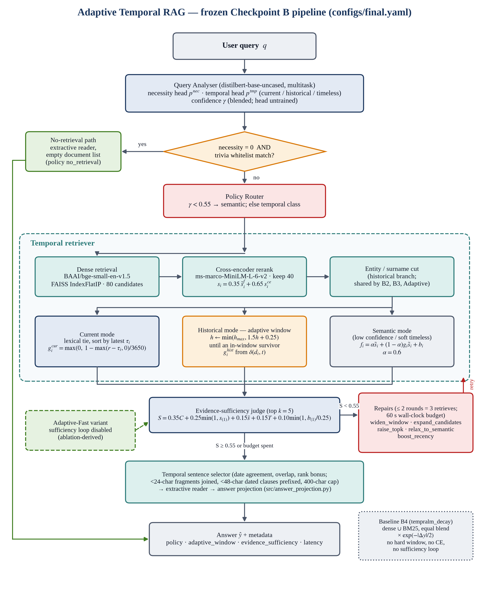
*Figure 5.1: End-to-end architecture*

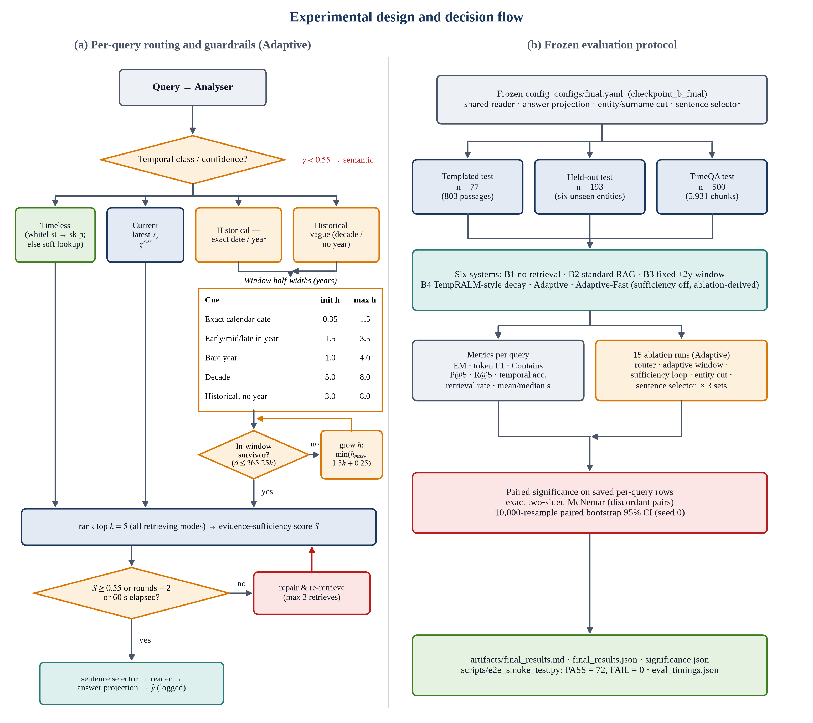
*Figure 5.2: Experimental design and decision flow*

A question enters as a `QueryItem` or a raw string. Adaptive calls `QueryAnalyzerService.predict`, then `resolve_adaptive_routing`, which returns `no_retrieval` or a mode among `current`, `historical`, and `semantic`. Retrieval, when it runs, is 80 FAISS neighbours, a cross-encoder keep of 40, a mode-specific filter, and a final \(k=5\). `assess_evidence_sufficiency` may repair inside `QueryBudget`. `extractive_answer` and `project_answer` produce the string `evaluate.py` scores. B1 never touches the index. B2 stops after the blend and the subject cut. B3 inserts `filter_by_year_window`. B4 replaces the cross-encoder and the window with a BM25 union and exponential decay. Adaptive-Fast is the Adaptive class with the loop cleared. The same `EvalConfig` is loaded for every cell. `apply_ablation` changes one Boolean at a time.

Three benchmarks are scored in full. The templated file is generated from timelines of office holders, chief executives, sports winners, awards, and a few laws. Each fact is a short dated passage whose entity field is the timeline name. Questions ask for the holder at a date, the current holder, or a timeless item, and paraphrases fill the target size. The file has 803 passages and 3,000 questions: 2,849 train, 74 validation, and 77 test. Gold identifiers are up to three passages of that entity, nearest the asked date. One test question asks who was president of Brazil in 2016. The corpus has no passage for that year. Every ranker that stays inside 2016 misses it. The hole is part of the test.

The held-out file rebuilds the generator with a target of 1,200 questions and moves every question naming one of six entities into test. The names are every fifth entity in a sorted list: Academy Award for Best Picture, CEO of Apple, CEO of Twitter/X, GDPR, President of Brazil, and UEFA Champions League winners. Test size is 193 because those questions are placed in test, not because a 15 per cent draw was taken. Train and validation of that file omit the six names. The analyser used at test time was trained on the main file, which does contain them, so the split does not hold the names out of the router. Almost every other component is a rule. The file remains a stress test of the window and the entity cut, because the passages are new timelines and the reader is shared.

The TimeQA subset from `src/benchmarks/timeqa.py` has 5,931 chunks and 900 questions, 400 train and 500 test. Chunks are pieces of the page attached to the sampled question, not a retrieval corpus over Wikipedia. A gold identifier is a chunk containing the answer, capped at 8. The index timestamp is the first date found, or 1 January 1970 when none is found, and many timestamps are birth years. Temporal accuracy is left blank. Contains scores the sentence. Exact match and token F1 score `extract_factoid_span`, which is why Adaptive exact match is 0.008 while Contains is 0.296. These figures are not compared with the official TimeQA numbers cited above.

**Table 5.1:** Systems under Checkpoint B. All six share the extractive reader, projection, sentence selector, and entity or surname cut.

| System | Class | Retrieval | Time control | Sufficiency |
|---|---|---|---|---|
| B1 | `LLMOnlyPipeline` | None. Trivia replies still fire. Empty document list. | None. | No. |
| B2 | `StandardRAGPipeline` | Always. FAISS 80, cross-encoder blend, keep 40, subject cut, \(k=5\). | None. | No. |
| B3 | `FixedTemporalRAGPipeline` | Always. Same dense front end as B2. | Stored year within \(\pm 2\) when a year is found; empty filters keep the pool. Ranker without the time-first flag. No year: current-mode timestamp sort. | No. |
| B4 | `TempRALMDecayPipeline` | Always. Dense union BM25. Equal min–max blend, then \(\exp(-|\Delta y|/2)\). No cross-encoder. | Soft decay. No hard cutoff. | No. |
| Adaptive | `AdaptiveTemporalRAGPipeline` | Router and whitelist. Same dense front end when retrieving. | Table 4.2, growth \(1.5h+0.25\), time-first historical rank. | Yes. Threshold 0.55, two repairs, 60 s. |
| Adaptive-Fast | Same class, loop off | Same router and window. | Same window. | No. Saved `sufficiency_off` run. Latency from that later run. |

The ablation design is Adaptive-only: `router_off`, `window_off`, `sufficiency_off`, `entity_cut_off`, and `sentence_selector_off`, on each of three files, 15 runs, driven by `scripts/run_frozen_ablations.py`. Baselines are not rebuilt inside a cell. Adaptive-Fast in the master table is the sufficiency cell. On the templated and held-out files its exact match, token F1, Contains, P@5, R@5, temporal accuracy, and retrieval rate match Adaptive. Only latency changes. On TimeQA, Contains differs by 0.002 and the paired Contains test is \(-0.002\) with McNemar \(p=1.000\).

Exact match is 1 when the normalised prediction equals a normalised gold string. Token F1 is token-overlap F1 against the best gold string. Contains is 1 when either normalised string contains the other. On TimeQA the exact-match string is the factoid span and the Contains string is the sentence. Precision at 5 is the fraction of the top five identifiers that are gold. Recall at 5 is the fraction of gold identifiers found in the top five. Temporal accuracy is `temporal_correctness` of the top document, defined in Section 5.6, and is omitted on TimeQA. Retrieval rate is the mean of `did_retrieve`. Latency is `PipelineResult.latency_s`, mean and median. Every frozen run used the laptop CPU. No GPU was used.

`scripts/e2e_smoke_test.py` is the gate in front of that design. It checks corpus, queries, FAISS files, `analyzer.pt`, and the Streamlit application; corpus size between 600 and 1,000; retrieval; an analyser prediction; temporal reranking; all pipeline classes under the extractive backend; extractive edge cases; API failover; a 12-query evaluation smoke; Streamlit import; CLI checks; the window; and the sufficiency loop. The outcome is PASS=72, FAIL=0, WARN=2, the warnings being missing OpenRouter and OpenCode keys. Wall clocks in `artifacts/eval_timings.json` are 407.2253013 s, 1,125.3883383 s, 10,466.7595792 s, and 75.0132418 s for synthetic, held-out, TimeQA, and B4, plus 13,767.4655516 s for the ablation block.

## 5.3 Machines and Materials / Hardware and Software Used

Frozen evaluation was a CPU workload on one laptop. The router fine-tune was a separate GPU job and had not returned metrics. The October pilot used a Colab T4 before Checkpoint B.

**Table 5.2:** Hardware for the frozen evaluation, the October pilot, and the unfinished router run.

| Role | Machine | Processor and memory | Accelerator | Workload |
|---|---|---|---|---|
| Frozen evaluation | Dell Latitude 5420 | Intel Core i7-1165G7 at 2.80 GHz, 4 cores / 8 threads; 32 GB RAM (33,723,650,048 bytes); Intel Iris Xe Graphics; Windows 11 Pro | None. CPU only. | `evaluate.py`, ablations, B4, significance, smoke test. |
| October 2026 pilot | Google Colab | Colab host | NVIDIA T4 | DistilBERT pilot, logits-safe loss, untrained confidence head. |
| 100,000-row router | Kaggle notebook `atrag-router-large-100k-training` (private) | Kaggle host | T4 \(\times\) 2, one device used. fp32. DataParallel off. | `train_large_router`. In progress. No metrics. |

Streamlit traces of 24 November 2026 (2.629 s, 0.621 s, 0.065 s) were taken on the laptop. They are demonstrations, not substitutes for the master-table means. The Vercel UI does not run FAISS or DistilBERT.

**Table 5.3:** Software in the project environment, and the models those packages load.

| Component | Version or identifier | Role |
|---|---|---|
| Python | 3.11.9 | Interpreter. |
| torch | 2.14.1 | Analyser inference. |
| transformers | 5.20.2 | DistilBERT; experimental DeBERTa and SQuAD reader. |
| sentence-transformers | 6.2.0 | BGE-small and the MiniLM cross-encoder. |
| faiss-cpu | 1.15.1 | `IndexFlatIP`. |
| streamlit | 1.66.1 | `app/streamlit_app.py`. |
| plotly | 7.1.0 | Comparative charts. |
| numpy | 2.4.6 | Embeddings and bootstrap indices. |
| pandas | 3.1.0 | Per-query joins in the significance script. |
| scipy | 1.17.1 | Installed. McNemar uses `math.comb`. |
| python-dateutil | 3.0.0 | `_parse_loose`, capped at 64 characters. |
| PyYAML | 6.0.3 | `load_eval_config`. |
| Web UI | Next.js 15.5, React 19 | Lexical port, separate from the CPU tables. |
| Embedder | `BAAI/bge-small-en-v1.5` | Frozen dense index. |
| Cross-encoder | `cross-encoder/ms-marco-MiniLM-L-6-v2` | Frozen reranker. Unused by B4. |
| Frozen analyser | `distilbert-base-uncased` | Necessity, temporal class, untrained confidence. |
| Experimental reader | `deepset/tinyroberta-squad2` | Learned path only. |
| Experimental router | `microsoft/deberta-v3-base` | Unfinished 100,000-row fine-tune. |

Every reported answer comes from the extractive function. The Streamlit box also offers `api` and `hf`. The frozen YAML sets `generator: extractive`, and the tables use that setting.

## 5.4 Optimization / Data Flow Diagram / E-R Diagram

Figure 5.3 is the Level-0 context and the Level-1 split. Figure 5.4 is the stored objects. The processes below are the ones the code runs.

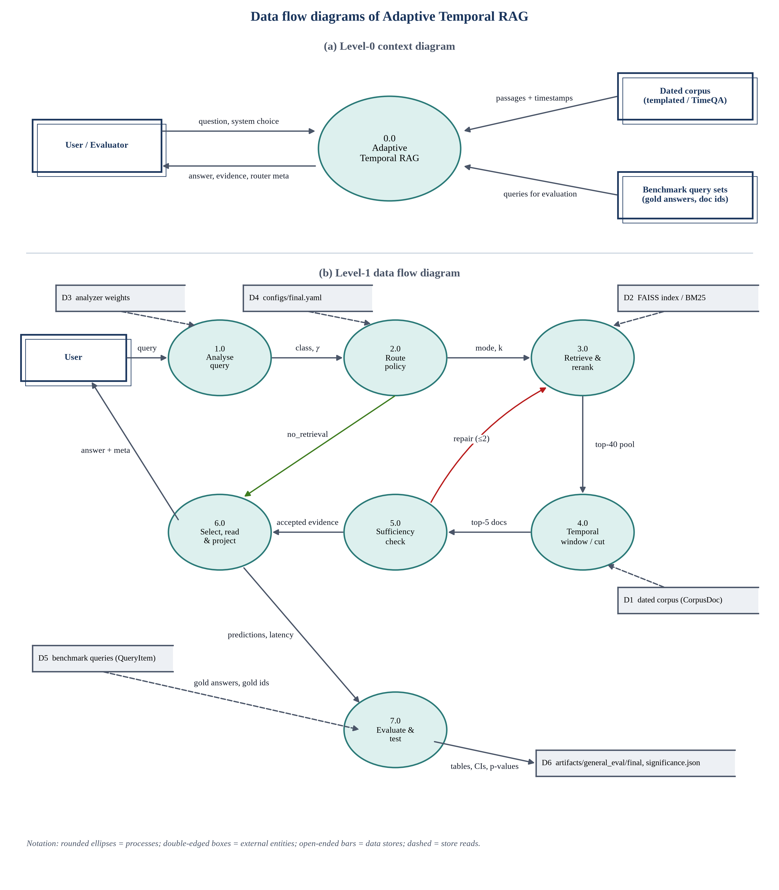
*Figure 5.3: Level-0 and Level-1 DFD*

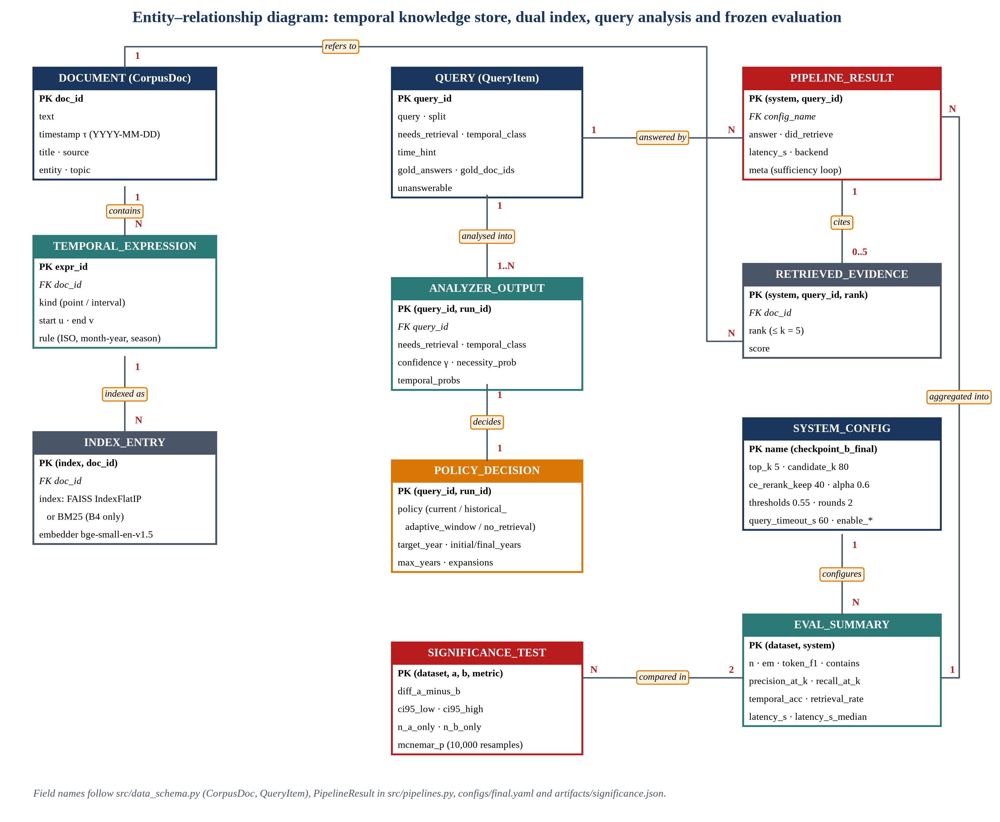
*Figure 5.4: E-R diagram*

At Level-0 the system is one process. External agents are the person asking and the harness supplying a JSONL split. Inputs are a question and, in evaluation, gold answers and gold document identifiers. Outputs are an answer, evidence, a latency, and a metric row. No external language-model service sits on the frozen path. API keys affect only the Streamlit `api` backend and the two smoke warnings.

At Level-1 the tagger and indexer emit a dense index and temporal spans. The analyser emits `AnalyzerOutput`. The policy emits `AdaptiveRoutingDecision`. Retrieval emits a pool. The reranker and temporal ranker emit ordered evidence. Sufficiency emits `SufficiencyResult` and either accepts it or returns a repair, subject to `QueryBudget`. The reader emits an answer. Evaluation joins that answer to the gold fields. Significance reads only saved rows. The router-dataset flow is separate: public questions enter, `label_question` and `LeakageIndex` filter them, and balanced JSONL leaves. It does not update frozen `analyzer.pt`.

The entity-relationship objects are the following. A Document or Chunk is a `CorpusDoc`. A Timestamp or Interval is the `timestamp` string, a pair from `extract_intervals`, or a `TemporalParse` target. An Entity is the templated `entity` field or the surname token. A Dense Index is `IndexFlatIP` plus `embeddings.npy` and `corpus_snapshot.jsonl`. A Query is a `QueryItem`. An AnalyzerOutput is the five-field prediction. A PolicyDecision is an `AdaptiveRoutingDecision`. A RetrievalRun or Evidence item is the document list, the scores, and `PipelineResult.meta` (`adaptive_window`, `evidence_sufficiency`, `sufficiency_loop`, `query_budget`). An Answer is the projected string. An EvaluationRecord is one `results.csv` row. A SystemConfig is an `EvalConfig`, including an ablated copy. An AblationRun is a summary under `artifacts/general_eval/final/ablations/`. A SignificanceTest is one block of `artifacts/significance.json`. A RouterDatasetRow is one object from `build_large_router_dataset.py`.

Four measured optimisations sit on top of that flow.

The guardrail bound is the Janet Frame probe. Before the retrieve cap, the 60-second timeout, and the dateutil passage cap, the question ran for 20,974.8 s. After `max_sufficiency_rounds` 2, `query_timeout_s` 60, the 64-character fragment cap, and the 12,000-character passage cap, it finishes in 8.184 s. `QueryBudget.log_stop` records when a bound fires. The answer is whatever packet the loop held.

Removing the sufficiency loop is the latency cut called Adaptive-Fast. Mean latency falls from 2.584 s to 0.663 s on the held-out test and from 8.736 s to 3.184 s on TimeQA. Exact match does not rise when the loop is present. Both rows are kept.

Candidate caching stores the post-cross-encoder pool under the integer width. A repair that only widens the year window, raises \(k\), or flips mode reuses the pool. A larger `candidate_k` misses and searches again.

The router trainer is an optimisation with no accuracy outcome. `train_large_router` stays on one CUDA device in fp32, does not use DataParallel, and writes atomic checkpoints every epoch and every 500 steps, so a 12-hour Kaggle limit can resume from `latest_checkpoint.pt`. Best weights go to `best_model.pt` and a provisional `analyzer.pt` when validation macro-F1 improves. Test rows are not read. Launch settings were 5 epochs, patience 2, learning rate \(2\times 10^{-5}\), batch 16, length 128, and 4,999 steps per epoch, on one of two T4 GPUs. Training had not produced results at the time of writing. No router accuracy, macro-F1, or ECE is available. The frozen analyser remains `distilbert-base-uncased`.

## 5.5 Algorithms Used

Constants below are those in the source and in `configs/final.yaml`. They are not retuned per dataset.

```text
Algorithm 1: Adaptive Temporal Routing and Window Policy
Input: question q, analyser A, threshold 0.55, reference r = 2025-10-01
Output: policy, mode, and an AdaptiveWindow when the mode is historical

1  Predict necessity, temporal class, and c = sigmoid(z_conf). c is untrained.
2  gamma = 0.5*c + 0.5*max(max p_nec, max p_tmp). Blending is on.
3  If necessity is 0 and is_trivial_query(q): return no_retrieval.
4  If necessity is 0: return soft_retrieve_timeless, mode semantic.
5  If gamma < 0.55 or the class is timeless: return low_conf_semantic
   or timeless_semantic, mode semantic.
6  If the class is current: return policy current.
7  If the class is historical: w = infer_adaptive_window(q, r)
   using Table 4.2, and return historical_adaptive_window.
```

Routing is one DistilBERT pass plus a few expressions. Cost appears only when the mode retrieves. The templated retrieval rate is 0.870. Held-out and TimeQA rates are 1.000, so the skip does not reduce latency there. The untrained half of \(\gamma\) can still force semantic mode. That rate was not counted.

```text
Algorithm 2: Dense Retrieval, Cross-Encoder Reranking and Temporal Scoring
Input: q, mode, index, window, k0 = 80, keep = 40, k = 5, alpha = 0.6
Output: top-k rows (document, final score, semantic, temporal)

1  C = IndexFlatIP search of k0 neighbours on BGE-small vectors.
2  s_i = 0.35*minmax(FAISS) + 0.65*raw cross-encoder score. Keep 40.
3  Historical: filter_subject, then grow h by min(h_max, 1.5*h+0.25)
   until some document has delta <= 365.25*h, or h reaches h_max.
   Tagged time-first score: g_hist + 0.01*s_tilde + b.
   Untagged score: 0.45*s_tilde_prime + 0.55*g_hist + b,
   with s_tilde_prime = 0.5 + 0.5*s_tilde.
4  Current: keep the lexical tie within 0.01, sort by timestamp,
   display 1 - 0.05*i/n. g_cur uses a 3650-day scale from 1 Oct 2025.
5  Semantic: final = s_tilde + b. Temporal score is the neutral 0.5.
6  Default gate when time-first is off:
   f = alpha*s_tilde + (1-alpha)*g*s_tilde + b, alpha = 0.6.
7  B4 variant, replacing steps 2-6: union dense top-k0 with BM25 top-k0
   (k1 = 1.5, b = 0.75). Equal min-max blend times exp(-|dyear|/2)
   when both years exist. No cross-encoder, no hard window, no loop.
   Then filter_subject and keep k.
```

`IndexFlatIP` is linear in the number of chunks. On 803 passages the cross-encoder, which scores 80 pairs, dominates that scan. On 5,931 TimeQA chunks the same 80-pair encoder still dominates, which is why B4 mean latencies are 0.031 s, 0.040 s, and 0.062 s while Adaptive means are 1.690 s, 2.584 s, and 8.736 s. Those B4 times are not a matched ablation of the decay. The window and surname steps are linear in the pool of 40.

```text
Algorithm 3: Entity/Surname Filtering, Temporal Sentence Selection and Answer Projection
Input: q, ranked documents, flags for entity cut, sentence selector, projection
Output: answer string

1  If any entity field is filled, keep overlap within 0.01 of the best
   entity-only overlap. Years are ignored.
2  If every entity field is empty, keep overlap >= 0.05 when the surname
   (last capitalised token, length >= 3) occurs, unless overlap is
   already within 0.01 of the best.
3  If the question is on the trivia whitelist, return the fixed reply.
4  If it is a definition, return the first sentence.
5  If the top passage is one long fact matching "is/was the" or "won",
   return the name. Initials are not sentence breaks.
6  Otherwise split sentences, attaching fragments shorter than 24
   characters to the next sentence. Score date agreement, content
   overlap, and rank bonus. A dated clause shorter than 48 characters
   is prepended with the previous sentence. Truncate at 400 characters.
   If the selector is off, return the first 220 characters.
7  If projection applies, replace the string by the first acceptable
   who-span or result span.
8  On TimeQA, exact match and token F1 score extract_factoid_span.
   Contains scores the sentence.
```

The cut is linear in the pool of 40. Selection looks at most at 40 sentences in each of five documents. On TimeQA, removing the selector drops Contains by 0.128, interval \([+0.084,+0.172]\), McNemar \(p=2.89\times 10^{-8}\) (99 questions only Adaptive, 35 only the ablation). On the held-out file, removing the entity cut drops exact match by 0.062, interval \([+0.031,+0.098]\), \(p=4.88\times 10^{-4}\). The cut cannot invent the missing 2016 Brazil passage.

```text
Algorithm 4: Bounded Sufficiency Repair Loop with Wall-Clock Guardrail
Input: q, mode, threshold 0.55, max repairs 2, timeout 60 s
Output: documents, answer, budget metadata

1  Budget allows 3 rounds when the loop is on, else 1. Timeout is 60 s.
2  Cache the cross-encoder pool by candidate width.
3  While a round is allowed and the clock has not expired:
   retrieve, rank, and score
   S = 0.35*C + 0.25*min(1, s1) + 0.15*mean(s)
       + 0.15*T + 0.10*min(1, b/0.25).
   Accept when the entity check passes and S >= 0.55.
   Otherwise apply repairs, capped as follows:
   candidates to min(200, max(k+30, floor(1.75*k)));
   top-k to min(12, k+3);
   window boost +1.25, with maximum half-width 12;
   semantic mode at alpha 0.7, or recency at alpha 0.45.
   Stop if no repair changes state.
4  Restore the best historical packet if a later mode scores no higher.
5  Read the answer. If a round remains and the answer is a weak stub,
   one semantic retry at alpha 0.75 is kept only when its S is strictly higher.
6  log_stop records timeout or cap on logger atr.sufficiency.
```

Each extra round repeats the cross-encoder unless the cache hits. The cap is three searches, plus one post-answer retry only while a round remains. On the frozen tests the extra rounds do not raise exact match. They do raise mean latency, which is the Adaptive versus Adaptive-Fast gap. The loop is a bound on work. Under this reader and these files its exact-match contribution is indistinguishable from zero, and on TimeQA Contains it is slightly negative (\(-0.002\)).

```text
Algorithm 5: Leak-Free 100k Router Dataset Construction and Resumable Fine-Tuning
Input: public QA sources, forbidden questions, entities, and templates
       seed 42, reference year 2026
Output: 100,000 labelled rows, and weights only after a finished run

1  Load TimeQA, SituatedQA, NQ-open, TriviaQA, SQuAD v2, CommonsenseQA,
   OpenBookQA, SciQ, QASC, and ARC. Optional temporal sets may add 0 rows.
2  Drop questions with fewer than 3 words or canonical length under 8.
3  label_question: latest year before reference_year-1 is historical;
   a later year, a current cue, or a fresh source is current;
   TimeQA defaults to historical; general QA with no time cue is timeless
   and needs_retrieval = 0. Current and historical use needs_retrieval = 1.
4  Deduplicate: 313,314 labelled rows become 310,977 (2,337 dropped).
5  Drop leaks: template 10,647, entity 1,227, exact 87.
   299,016 remain. residual_leaks = 0.
6  Balance to current 1,729, historical 49,135, timeless 49,136.
   synthetic_selected = 0.
7  Splits: train 79,982, validation 10,077, test 9,941.
8  train_large_router on deberta-v3-base, fp32, one CUDA device:
   5 epochs, patience 2, lr 2e-5, batch 16, length 128,
   4,999 steps per epoch, atomic checkpoint every 500 steps.
   This loss includes the confidence head. Test rows are not read.
9  Until that run finishes, report no accuracy, macro-F1, or ECE.
```

Construction is a linear scan with hashing for duplicates and templates. A completed fine-tune would be about 4,999 steps per epoch on one T4, with patience 2. Step 9 is the status at the time of writing. Checkpoint B does not wait on it. The frozen analyser remains the DistilBERT checkpoint whose confidence head was never in the loss.

## 5.6 Characterizations

Table 5.4 describes only the files `evaluate.py` scores. Tables 5.5 and 5.6 describe only `data/router_large/stats.json`. The router counts are not test-set counts.

**Table 5.4:** Evaluation datasets under Checkpoint B. Temporal accuracy is defined on the first two files and omitted on TimeQA. TimeQA exact match is a span metric. TimeQA Contains is a sentence metric.

| Property | Templated synthetic | Held-out entities | TimeQA subset |
|---|---|---|---|
| Passages | 803 | Rebuilt generator | 5,931 chunks |
| Questions | 3,000 (2,849 / 74 / 77) | 1,200-question rebuild | 900 (400 / 500) |
| Test \(N\) | 77 | 193 | 500 |
| Split rule | Generator split | All questions naming 6 entities | Loader test split |
| Entity field | Timeline name | Timeline name; 6 names absent from that file’s train and val | Empty |
| Gold documents | Up to 3, nearest the date | Same rule | Chunks containing the answer, at most 8 |
| Index time | Generator fact date | Generator fact date | Often a birth year or 1970-01-01 |
| Known limit | No passage for President of Brazil in 2016 | Same generator | Timestamp is not a fact date |
| Temporal accuracy | Defined, reference 1 Oct 2025 | Defined, reference 1 Oct 2025 | Omitted |
| Adaptive retrieval rate | 0.870 | 1.000 | 1.000 |
| Adaptive EM / Contains | 0.948 / 0.987 | 0.762 / 0.762 | 0.008 / 0.296 |

The six held-out names are Academy Award for Best Picture, CEO of Apple, CEO of Twitter/X, GDPR, President of Brazil, and UEFA Champions League winners. Adaptive’s exact-match gap over B3 is \(+0.013\) on the templated test (McNemar \(p=1.000\)) and \(+0.078\) on the held-out test, interval \([+0.041,+0.119]\), \(p=6.10\times 10^{-5}\). On TimeQA the Contains gap over B3 is \(+0.026\) with \(p=0.117\), and the exact-match difference is \(-0.002\). The Contains gap over B4 is \(+0.062\) with \(p=5.39\times 10^{-4}\). These pairs come from `artifacts/significance.json` and use the same rows as the master table.

The router file has `synthetic_rows = 0`. The labelling rule in `stats.json` is the following. Explicit years map to historical when the latest year is before `reference_year - 1`, and to current otherwise. Explicit current cues, present-tense changing offices, original temporally dependent SituatedQA questions, and fresh or realtime sources map to current. TimeQA and other temporal sets default to historical. General QA without a time cue maps to timeless and `needs_retrieval = 0`. Current and historical labels use `needs_retrieval = 1`. Test of Time rows, when loaded, are marked synthetic and share a 20 per cent cap. In this build, timequestions, tempquestions, freshqa, realtimeqa, mintaka, tot, and temporalwiki contributed zero rows, and the loaded synthetic pool was not selected.

The funnel is 313,314 labelled rows, 310,977 after deduplication (2,337 dropped), and 299,016 after the leak filter. Drops were 10,647 template, 1,227 entity, and 87 exact. Forbidden lists held 6,117 questions, 226 entities, and 335 templates, including 6,075 official TimeQA test questions. `residual_leaks` is 0. After the filter the pool was current 1,729, historical 89,620, and timeless 207,667. Balancing keeps every current row, because no further current row exists, and downsamples the other classes. The current class is 1,729 of 100,000.

**Table 5.5:** The 100,000-row leak-free router corpus by split and class (`by_split_and_class`). Seed 42. Reference year 2026.

| Split | \(N\) | Current | Historical | Timeless |
|---|---:|---:|---:|---:|
| Train | 79,982 | 1,383 | 39,291 | 39,308 |
| Validation | 10,077 | 173 | 4,990 | 4,914 |
| Test | 9,941 | 173 | 4,854 | 4,914 |
| Total | 100,000 | 1,729 | 49,135 | 49,136 |

Necessity follows the class map: 50,864 rows with `needs_retrieval = 1` and 49,136 with `needs_retrieval = 0`. The test split is not read by `train_large_router`. A future macro-F1 or ECE on that split is what `score_predictions` is written to emit. This report does not have that number.

**Table 5.6:** The same 100,000 rows by source after balancing.

| Source | Rows |
|---|---:|
| triviaqa | 15,827 |
| nq_open | 26,701 |
| squad_v2 | 22,858 |
| commonsense_qa | 2,535 |
| sciq | 3,174 |
| arc | 1,906 |
| openbookqa | 1,407 |
| qasc | 2,013 |
| timeqa | 16,880 |
| situatedqa | 6,699 |
| Total | 100,000 |

Normalisation lower-cases, deletes punctuation, and collapses whitespace. Exact match against one gold string is the indicator that the normalised strings are equal. The reported value is the maximum over `gold_strings`. Token F1 uses the same normalisation. With \(P\) and \(R\) the precision and recall of the token bags,

$$
\mathrm{F1} = \frac{2PR}{P+R}
$$

when the bags share a token, and 0 otherwise. The reported F1 is the maximum over gold strings. Contains is 1 when the normalised gold is inside the prediction or the prediction is inside the gold. On TimeQA the exact-match and F1 string is the factoid span, and the Contains string is the sentence, so a 400-character sentence that merely contains the gold span scores 1 on Contains.

With \(R_5\) the retrieved identifiers truncated at 5 and \(G\) the gold set,

$$
\mathrm{P@5} = \frac{|R_5 \cap G|}{\max(|R_5|, 1)}, \qquad
\mathrm{R@5} = \frac{|R_5 \cap G|}{|G|}.
$$

Both are omitted from the mean when \(G\) is empty. On TimeQA, \(|G|\) is at most 8.

Temporal accuracy uses the top document and 1 October 2025. If nothing was retrieved, the score is 1 when the question is timeless and `needs_retrieval` is 0, and 0 otherwise. Current questions score 1 when the top timestamp is at most 3.0 years before the reference. Historical questions with a readable year score 1 when the top year is within 2 of that year, and score 0.5 when no year can be read. A retrieved timeless question scores 1. The metric is not computed for TimeQA. On the templated file the timestamps are fact dates. On TimeQA they are often birth years, which is why B3’s temporal accuracy of 1.000 on the templated and held-out files is read together with the filter that produced it, and why the TimeQA column is blank.

Retrieval rate is the fraction of questions with `did_retrieve` true. Mean and median latency include questions that skipped retrieval. B1’s mean and median are 0.000 on all three files at the precision of the master table.

Calibration is planned for the learned router and is not part of the frozen table. `expected_calibration_error` uses 15 bins. With bin count \(n_b\), bin accuracy \(\mathrm{acc}_b\), and mean bin confidence \(\mathrm{conf}_b\),

$$
\mathrm{ECE} = \sum_{b=1}^{15} \frac{n_b}{n}\,\left|\mathrm{acc}_b - \mathrm{conf}_b\right|.
$$

`score_predictions` would also report accuracy, macro-F1, and a confusion matrix. `train_large_router` can fit a temperature on validation logits. None of these functions has been applied to a finished DeBERTa checkpoint. The frozen DistilBERT run reports validation necessity and temporal accuracy of 1.0 on the templated validation split only. It does not report an ECE. An ECE on \(\gamma\) would mix a trained class probability with an untrained sigmoid. That calculation was not run.

Paired tests block on the question. For exact match and Contains, values of at least 0.5 count as success, which leaves the stored 0/1 scores unchanged. The point estimate is the mean of \(A_i - B_i\). Let \(n_{10}\) be the count with Adaptive correct and the other system wrong, and \(n_{01}\) the opposite count. With \(n=n_{10}+n_{01}\) and \(k=n_{10}\),

$$
P(X=i)=\binom{n}{i}\,2^{-n},
$$

and the McNemar \(p\)-value is the sum of \(P(X=i)\) over every \(i\) whose probability is at most \(P(X=k)\), clipped to 1. If \(n=0\), then \(p=1\). This is `_binom_two_sided`. It is an exact two-sided binomial test on the discordant pairs, not a chi-squared approximation.

The interval resamples the same paired differences. A generator seeded with 0 draws 10,000 index rows. The reported 95 per cent interval is the 2.5 and 97.5 percentiles of those means. Seed, resample count, and pairing are fixed, so the same CSV files reproduce `artifacts/significance.json`. The interval describes the finite test file under resampling of questions. It does not describe a new corpus, a new reader, or the unfinished DeBERTa router.

On the templated file, Adaptive and B3 are close, and the exact-match gap is not significant. On the held-out file, Adaptive leads B2, B3, and B4 on exact match and Contains. The held-out exact-match comparison with B2 has 83 questions only Adaptive answered and none the other way. On TimeQA, exact match is not an Adaptive win, the Contains edge over B3 is not significant, and the Contains edges over B4 and over the sentence-selector ablation are significant. The sufficiency loop does not improve exact match. B4 is faster because it does not run the cross-encoder, and that speed is not a matched comparison. The confidence head of the frozen router is untrained. The 100,000-row router, which would train that head, had not produced a number when this report was written.

# CHAPTER 6: RESULTS AND DISCUSSIONS

The numbers in this chapter are the frozen Checkpoint B evaluation. `scripts/evaluate.py` loaded `configs/final.yaml` (`name: checkpoint_b_final`) for every system. B1, B2, B3, and Adaptive share the extractive reader, answer projection (`project_answer` in `src/answer_projection.py`), the entity or surname cut, and the sentence selector. They differ in the retrieval decision, the time window, and the sufficiency loop. B4 (`TempRALMDecayPipeline`) is a separate ranker: dense FAISS candidates union a BM25 candidate list, an equal min–max blend, then multiplication by $\exp(-|\Delta y|/2)$, with `DECAY_LAMBDA_YEARS = 2.0`. B4 does not run the cross-encoder, so its latency is not a matched comparison. Adaptive-Fast is the saved sufficiency-off ablation, and its latency comes from that later Adaptive-only run. The learned path (`deepset/tinyroberta-squad2`, flagged `learned_experimental: true`) is absent from every table. Paired tests were computed by `scripts/compute_significance.py` on the saved per-query rows: exact two-sided McNemar tests on discordant pairs, and paired bootstrap percentile intervals of Adaptive minus the named system, 10,000 resamples, seed 0. No retrieval was repeated for the tests. All of these runs used the laptop CPU (Dell Latitude 5420, Intel Core i7-1165G7 at 2.80 GHz, four cores and eight threads, 32 GB RAM, Intel Iris Xe Graphics, Windows 11 Pro). No GPU was used for evaluation. The reference date inside current-question scoring and temporal accuracy is 1 October 2025.

The index behind B1–B3 and Adaptive is `BAAI/bge-small-en-v1.5` searched with FAISS `IndexFlatIP` (Xiao et al., 2024; Johnson et al., 2019). Eighty candidates are blended as $s_i = 0.35\,\tilde{s}^{\mathrm{f}}_i + 0.65\,s^{\mathrm{ce}}_i$ and forty are kept, with $k = 5$. The cross-encoder is `cross-encoder/ms-marco-MiniLM-L-6-v2` (Wang et al., 2020; Nguyen et al., 2016; Nogueira & Cho, 2019). The cross-encoder term is left in its raw range, so a displayed score can exceed 1. BM25 (`BM25Index` in `src/bm25.py`) is used only inside B4. The frozen router is `distilbert-base-uncased` (`MultitaskQueryAnalyzer`): a two-way necessity head, a three-way temporal head, and a confidence head that is not in the loss (Sanh et al., 2019; Devlin et al., 2019). The temporal term is weighted by $\lambda = 1.75$. The scalar the policy reads is the blended confidence

$$\gamma = \tfrac{1}{2}c + \tfrac{1}{2}\max\{\max p^{\mathrm{nec}}, \max p^{\mathrm{tmp}}\},$$

with threshold 0.55. The October 2026 Colab T4 pilot found that the confidence head had stayed at its initialisation and emitted a near-constant value of about 0.75. The live Streamlit traces below sit on that same plateau.

## 6.1 Snapshots of Results Obtained

Three surfaces answer against the same 803-passage corpus. Streamlit (`render_live_demo`, `render_comparative_analysis` in `app/streamlit_app.py`) loads `configs/final.yaml`, the FAISS index, and DistilBERT. The local Next.js interface and `https://adaptive-temporal-rag.vercel.app` are a lexical port (`web/lib/engine.ts`) of the policy and the extractive reader. That port does not run FAISS, the MiniLM cross-encoder, or DistilBERT. A printed confidence of 0.88 or 0.90 is the port’s constant for a historical or current question. A printed confidence of 0.751, 0.746, or 0.75 is the blended $\gamma$ of the frozen analyser.

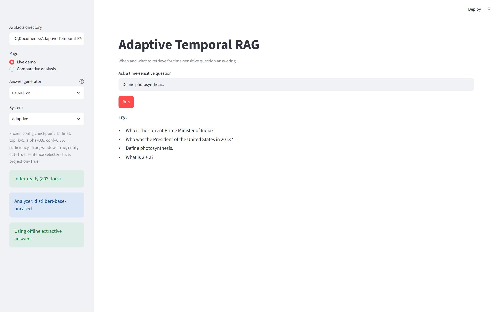
*Figure 6.1: Streamlit live demonstration, home view and sidebar, frozen configuration checkpoint_b_final*

Figure 6.1 is the home state before a question is submitted. `load_eval_config` reads `configs/final.yaml`. The sidebar names `checkpoint_b_final` and shows `top_k` 5, $\alpha = 0.6$ inside `combine_scores`, confidence 0.55, and the sufficiency loop, adaptive window, entity cut, sentence selector, and answer projection all enabled. `load_stack` reports an `EmbeddingIndex` of 803 documents and the analyser `distilbert-base-uncased`. The generator is the offline `extractive` backend (`extractive_answer`), so Groq, OpenRouter, and OpenCode are not called. The suggested questions are the three probes below. This screen is the configuration checkpoint, not a row of the 77-question test.

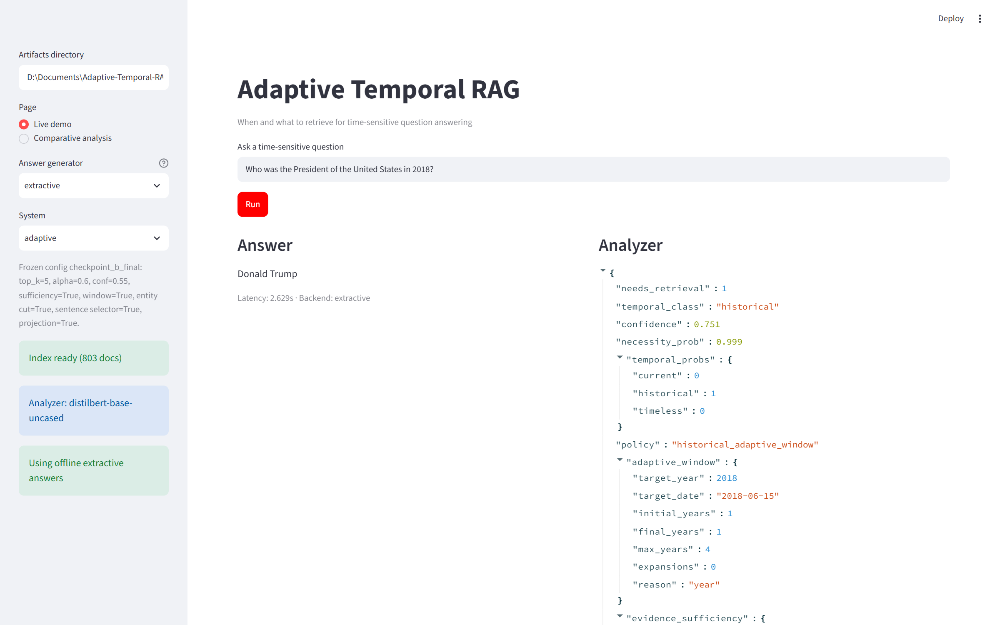
*Figure 6.2: Historical query on the Streamlit demonstration, United States President in 2018*

Figure 6.2 submits “Who was the President of the United States in 2018?” to `AdaptiveTemporalRAGPipeline.run`. `QueryAnalyzerService.predict` returns `needs_retrieval` 1, class historical, confidence 0.751, and `necessity_prob` 0.999. Confidence is above 0.55, so `resolve_adaptive_routing` selects policy `historical_adaptive_window`. `infer_adaptive_window` reads a bare year: target year 2018, target date `2018-06-15` (the 15 June midpoint), initial width 1 year, maximum 4, expansions 0, reason year. A passage already lay inside the initial band, so the growth $h \leftarrow \min(h_{\max}, 1.5h + 0.25)$ did not run. The answer is Donald Trump. Latency on this CPU call is 2.629 s.

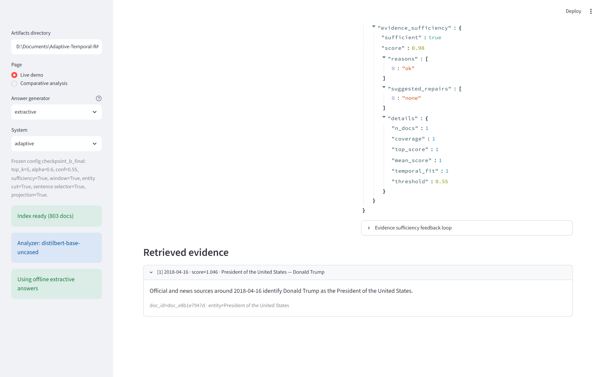
*Figure 6.3: Evidence and sufficiency for the 2018 presidential query*

Figure 6.3 is the evidence pane of the same call, from `assess_evidence_sufficiency`. Sufficient is true, score 0.98, threshold 0.55, `n_docs` 1, and coverage, top score, mean score, and temporal fit are displayed as 1. The score $S = 0.35C + 0.25\min(1,s_1) + 0.15\overline{s} + 0.15T + 0.10\min(1, b_1/0.25)$ is accepted at $S \ge 0.55$, which is why expansions stayed at 0. The passage is dated 2018-04-16, titled “President of the United States — Donald Trump”, `doc_id` `doc_e8b1e7947d`, displayed score 1.046. The score exceeds 1 because the MiniLM logit in the 0.35/0.65 blend is raw. The passage date falls inside the $\pm 1$ year window, and the extractive reader returns the office holder.

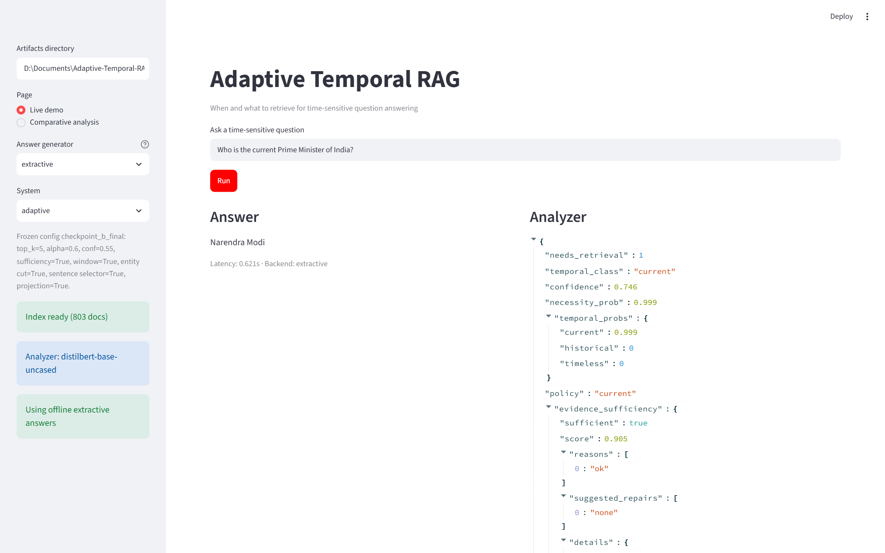
*Figure 6.4: Current query on the Streamlit demonstration, Prime Minister of India*

Figure 6.4 submits “Who is the current Prime Minister of India?”. The class is current, the current-class probability is 0.999, confidence is 0.746, and the policy is `current`. The answer is Narendra Modi. Sufficiency is 0.905 and latency is 0.621 s. Current mode does not open a year window. `rerank` keeps the strongest entity overlap and orders by timestamp, with recency $g_{\mathrm{cur}} = \max(0, 1 - \max(r - \tau, 0)/3650)$ and $r$ fixed at 1 October 2025. The 0.621 s figure is this probe. It is not the TimeQA Adaptive mean of 8.736 s. Confidence 0.746 is again the untrained blend.

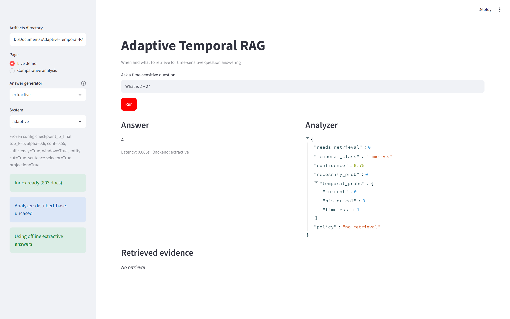
*Figure 6.5: Timeless arithmetic query taking the no-retrieval path*

Figure 6.5 submits “What is 2 + 2?”. The analyser reports `needs_retrieval` 0, class timeless, and confidence 0.75. `is_trivial_query` matches the marker `2 + 2`. `resolve_adaptive_routing` skips only when necessity is 0 and the whitelist hits. The policy is `no_retrieval`, the pane prints “No retrieval”, `_trivial_answer` returns 4, and latency is 0.065 s. A necessity of 0 on any other string still retrieves. On the templated test the retrieval rate 0.870 is 67 of 77 questions; the other 10 are this list. On the held-out file and on TimeQA the rate is 1.000, so this path does not fire there.

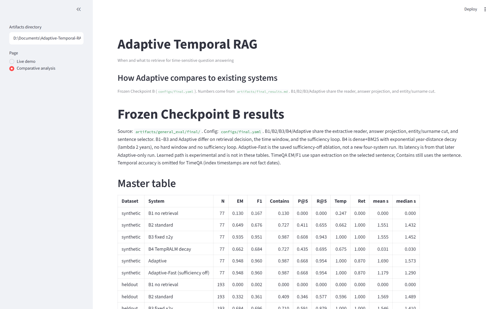
*Figure 6.6: Comparative-analysis page rendering the frozen master table*

Figure 6.6 is `render_comparative_analysis`. It renders `artifacts/final_results.md`, which `scripts/compile_final_results.py` built from `artifacts/general_eval/final/`. Each dataset block has six rows: B1, B2, B3, B4, Adaptive, and Adaptive-Fast. The blocks are the templated test ($n = 77$), the six-entity held-out file ($n = 193$), and TimeQA ($n = 500$). Temporal accuracy is blank on TimeQA because those index timestamps are not fact dates. The page is a view of the artefact. Section 6.2 reprints the cells.

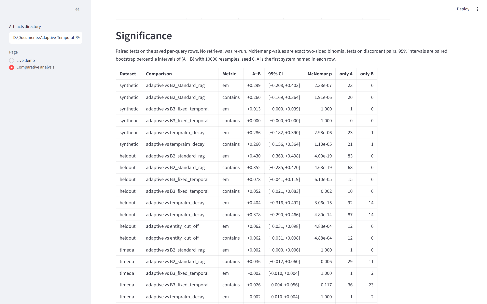
*Figure 6.7: Paired significance table inside the Streamlit application*

Figure 6.7 is the significance block, sourced from `artifacts/significance.json` and computed by `scripts/compute_significance.py`. Each row is Adaptive minus a named system. Intervals are 10,000-resample bootstraps, seed 0, and each $p$-value is an exact two-sided test on the discordant counts. The screen shows the templated comparison with B3 as a tie ($p = 1.000$), the held-out exact-match comparison with B3 as $+0.078$ $[+0.041, +0.119]$, $p = 6.10\times 10^{-5}$ (15 questions only Adaptive), and the TimeQA containment comparison with B3 as $+0.026$ $[-0.004, +0.056]$, $p = 0.117$. Table 6.3 is the full 28-row grid.

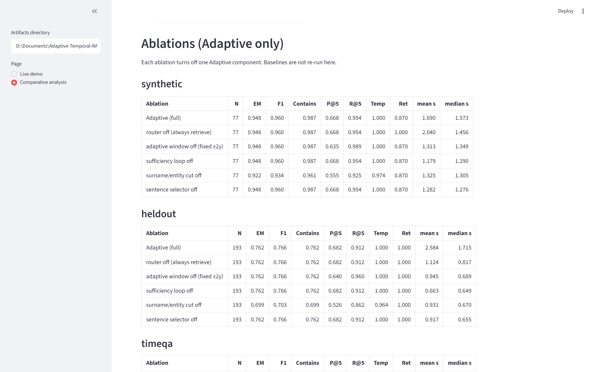
*Figure 6.8: Ablation tables inside the Streamlit application*

Figure 6.8 renders the ablation block. `EvalConfig.apply_ablation` flips one flag: `router_off`, `window_off`, `sufficiency_off`, `entity_cut_off`, or `sentence_selector_off`. Baselines are not re-run. The “Adaptive (full)” rows copy the four-system means. Ablation latencies are a later Adaptive-only run and are not paired with the B2 or B3 means. On the generated files, router, window, sufficiency, and sentence selector leave exact match and containment unchanged. The entity cut moves those answers. On TimeQA the sentence selector is the large drop. Table 6.2 holds the cells.

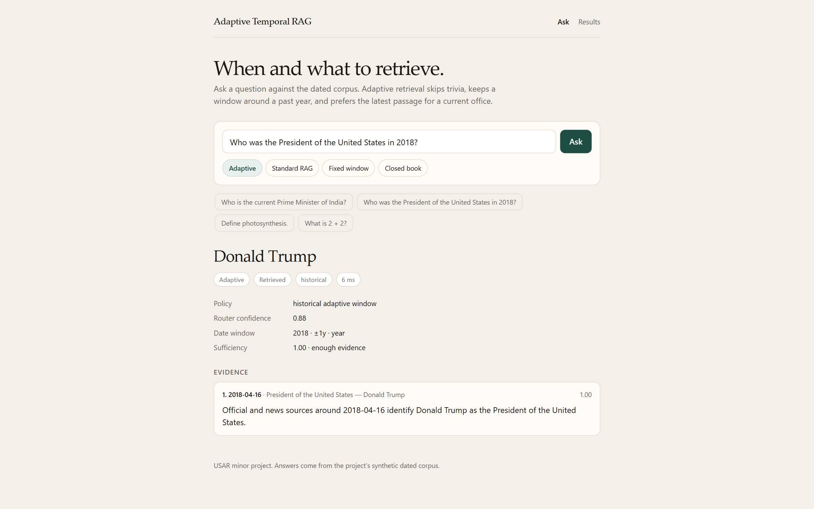
*Figure 6.9: Local Next.js interface, 2018 presidential query*

Figure 6.9 is the local Next.js port. The 2018 presidency again returns Donald Trump, under the historical adaptive window, with the date window shown as 2018 $\pm 1$ year and sufficiency 1.00. The printed confidence is 0.88, the constant `web/lib/engine.ts` assigns to a historical question, not $\gamma$ from DistilBERT. Retrieval is lexical overlap on the 803-document corpus. Agreement with Figure 6.2 on this one answer does not transfer Table 6.1 onto the port. `scripts/evaluate.py` did not score this interface.

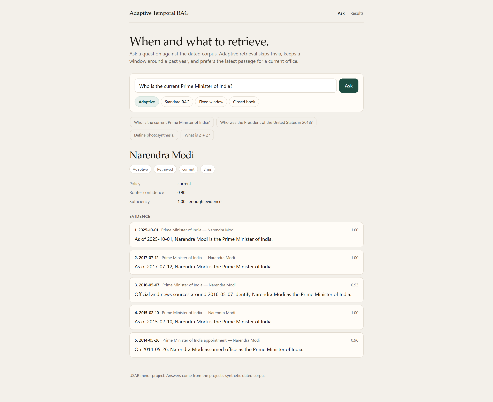
*Figure 6.10: Hosted Vercel Ask tab, current Prime Minister of India*

Figure 6.10 is the hosted Ask tab. “Who is the current Prime Minister of India?” returns Narendra Modi, policy `current`, displayed confidence 0.90 (the port’s current-class constant). Five dated passages run from 2025-10-01 to 2014-05-26. The newest stamp is the frozen reference date, which the port stores as `REFERENCE`. Current policy keeps a recency order, so a 2014 passage can sit beside a passage stamped on 1 October 2025. The corpus does not update when the wall clock moves. The page is a public view of the same 803 documents, not a live web search.

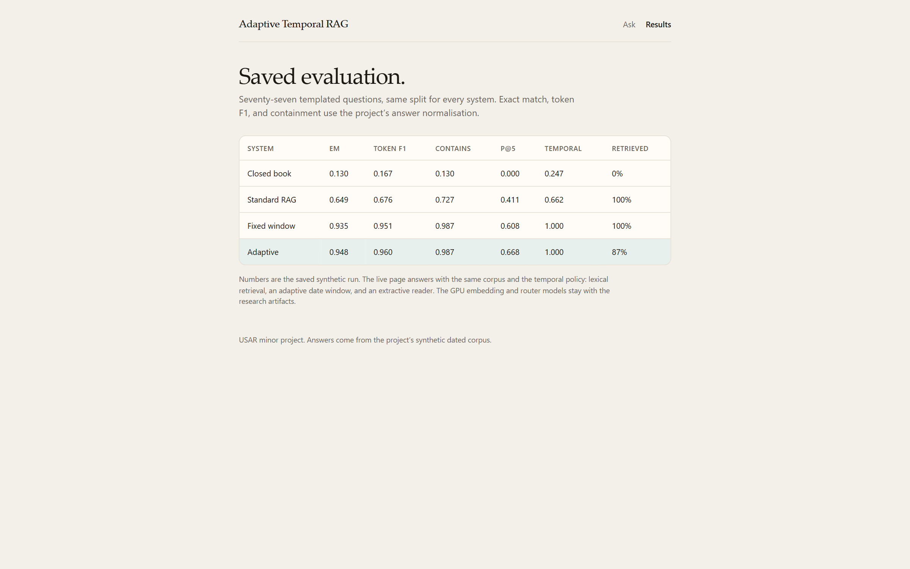
*Figure 6.11: Hosted Vercel Results tab, saved 77-question synthetic table*

Figure 6.11 is the Results tab (`web/app/results/page.tsx`), a saved slice of the 77-question file. Exact match is 0.130, 0.649, 0.935, and 0.948 for the rows labelled closed book, standard RAG, fixed window, and Adaptive. Retrieval of 87% is the rate 0.870. “Closed book” is B1: the extractive reader with an empty document list, plus the hardcoded trivia replies, which is why B1 still scores 0.130 on the templated file and 0.000 on the held-out file. B4, Adaptive-Fast, the held-out file, and TimeQA are not on this tab.

### 6.1.1 Verification of the demonstration build

`scripts/e2e_smoke_test.py` reported PASS = 72, FAIL = 0, and WARN = 2. The warnings are missing OpenRouter and OpenCode keys, so `load_provider_chain` falls through to the extractive reader, which is the frozen backend (`generator: extractive`). The local Streamlit process answered HTTP 200. The Janet Frame probe, “Janet Frame received which award in 1990?”, finished in 8.184 s after the guardrails (at most three retrieves, a 60 s timeout, and the dateutil cap on long passages). The same probe had taken 20,974.8 s before those guardrails. The smoke test checks that the tree runs. It does not replace Tables 6.1–6.3.

## 6.2 Graphs and Tables

Answer strings are normalised as in SQuAD: lower case, punctuation removed, whitespace collapsed (Rajpurkar et al., 2018). Exact match is 1 when the normalised strings are equal. Token F1 is the harmonic mean of token precision and token recall, taking the best gold string when several are listed. Containment is 1 when the gold string occurs in the prediction or the prediction occurs in the gold string. On TimeQA, exact match and token F1 use a span taken from the selected sentence (`span_extract_timeqa: true`, through `extract_factoid_span`), while containment still scores the sentence. Precision and recall at 5 use the stored gold document identifiers. On the templated data those identifiers are up to three passages of the named entity, nearest the asked date. On TimeQA a gold identifier is a chunk that contains the answer string, at most eight. Temporal accuracy reads only the timestamp of the top document. For a current question that timestamp must fall within three years of 1 October 2025. For a historical question its year must fall within two of a year written in the question. The metric does not read the answer. It is undefined on TimeQA and is left blank. For B3 the metric largely restates the filter: any document that survives a $\pm 2$ year cut has a stored year inside the band the metric checks.

**Table 6.1:** Frozen Checkpoint B master comparison from `artifacts/final_results.md`. B1–B3 and Adaptive share the extractive reader, answer projection, entity or surname cut, and sentence selector. B4 is dense retrieval union BM25 with exponential year decay and no cross-encoder. Adaptive-Fast is the saved sufficiency-off ablation; its latency is from that later run. Temporal accuracy is undefined on TimeQA.

| Dataset | System | N | EM | F1 | Contains | P@5 | R@5 | Temp | Ret | mean s | median s |
|---|---|---:|---:|---:|---:|---:|---:|---:|---:|---:|---:|
| synthetic | B1 no retrieval | 77 | 0.130 | 0.167 | 0.130 | 0.000 | 0.000 | 0.247 | 0.000 | 0.000 | 0.000 |
| synthetic | B2 standard | 77 | 0.649 | 0.676 | 0.727 | 0.411 | 0.655 | 0.662 | 1.000 | 1.551 | 1.432 |
| synthetic | B3 fixed ±2y | 77 | 0.935 | 0.951 | 0.987 | 0.608 | 0.943 | 1.000 | 1.000 | 1.555 | 1.452 |
| synthetic | B4 TempRALM decay | 77 | 0.662 | 0.684 | 0.727 | 0.435 | 0.695 | 0.675 | 1.000 | 0.031 | 0.030 |
| synthetic | Adaptive | 77 | 0.948 | 0.960 | 0.987 | 0.668 | 0.954 | 1.000 | 0.870 | 1.690 | 1.573 |
| synthetic | Adaptive-Fast (sufficiency off) | 77 | 0.948 | 0.960 | 0.987 | 0.668 | 0.954 | 1.000 | 0.870 | 1.179 | 1.290 |
| heldout | B1 no retrieval | 193 | 0.000 | 0.002 | 0.000 | 0.000 | 0.000 | 0.000 | 0.000 | 0.000 | 0.000 |
| heldout | B2 standard | 193 | 0.332 | 0.361 | 0.409 | 0.346 | 0.577 | 0.596 | 1.000 | 1.569 | 1.489 |
| heldout | B3 fixed ±2y | 193 | 0.684 | 0.696 | 0.710 | 0.591 | 0.879 | 1.000 | 1.000 | 1.546 | 1.410 |
| heldout | B4 TempRALM decay | 193 | 0.358 | 0.369 | 0.383 | 0.383 | 0.639 | 0.497 | 1.000 | 0.040 | 0.038 |
| heldout | Adaptive | 193 | 0.762 | 0.766 | 0.762 | 0.682 | 0.912 | 1.000 | 1.000 | 2.584 | 1.715 |
| heldout | Adaptive-Fast (sufficiency off) | 193 | 0.762 | 0.766 | 0.762 | 0.682 | 0.912 | 1.000 | 1.000 | 0.663 | 0.649 |
| timeqa | B1 no retrieval | 500 | 0.000 | 0.013 | 0.014 | 0.000 | 0.000 | — | 0.000 | 0.000 | 0.000 |
| timeqa | B2 standard | 500 | 0.006 | 0.077 | 0.260 | 0.235 | 0.468 | — | 1.000 | 6.056 | 6.118 |
| timeqa | B3 fixed ±2y | 500 | 0.010 | 0.089 | 0.270 | 0.237 | 0.392 | — | 1.000 | 6.074 | 6.116 |
| timeqa | B4 TempRALM decay | 500 | 0.010 | 0.084 | 0.234 | 0.174 | 0.358 | — | 1.000 | 0.062 | 0.059 |
| timeqa | Adaptive | 500 | 0.008 | 0.088 | 0.296 | 0.241 | 0.488 | — | 1.000 | 8.736 | 6.492 |
| timeqa | Adaptive-Fast (sufficiency off) | 500 | 0.008 | 0.088 | 0.298 | 0.243 | 0.491 | — | 1.000 | 3.184 | 3.160 |

**Table 6.2:** Single-component ablations of Adaptive. Each row turns off one flag in `EvalConfig.apply_ablation`. The three “Adaptive (full)” rows are the Table 6.1 Adaptive scores, repeated as the reference. Ablation latencies are from a later Adaptive-only run and are not matched to the four-system means.

| Dataset | Ablation | N | EM | F1 | Contains | P@5 | R@5 | Temp | Ret | mean s | median s |
|---|---|---:|---:|---:|---:|---:|---:|---:|---:|---:|---:|
| synthetic | Adaptive (full) | 77 | 0.948 | 0.960 | 0.987 | 0.668 | 0.954 | 1.000 | 0.870 | 1.690 | 1.573 |
| synthetic | router off (always retrieve) | 77 | 0.948 | 0.960 | 0.987 | 0.668 | 0.954 | 1.000 | 1.000 | 2.040 | 1.456 |
| synthetic | adaptive window off (fixed ±2y) | 77 | 0.948 | 0.960 | 0.987 | 0.635 | 0.989 | 1.000 | 0.870 | 1.313 | 1.349 |
| synthetic | sufficiency loop off | 77 | 0.948 | 0.960 | 0.987 | 0.668 | 0.954 | 1.000 | 0.870 | 1.179 | 1.290 |
| synthetic | surname/entity cut off | 77 | 0.922 | 0.934 | 0.961 | 0.555 | 0.925 | 0.974 | 0.870 | 1.325 | 1.305 |
| synthetic | sentence selector off | 77 | 0.948 | 0.960 | 0.987 | 0.668 | 0.954 | 1.000 | 0.870 | 1.282 | 1.276 |
| heldout | Adaptive (full) | 193 | 0.762 | 0.766 | 0.762 | 0.682 | 0.912 | 1.000 | 1.000 | 2.584 | 1.715 |
| heldout | router off (always retrieve) | 193 | 0.762 | 0.766 | 0.762 | 0.682 | 0.912 | 1.000 | 1.000 | 1.124 | 0.817 |
| heldout | adaptive window off (fixed ±2y) | 193 | 0.762 | 0.766 | 0.762 | 0.640 | 0.960 | 1.000 | 1.000 | 0.945 | 0.689 |
| heldout | sufficiency loop off | 193 | 0.762 | 0.766 | 0.762 | 0.682 | 0.912 | 1.000 | 1.000 | 0.663 | 0.649 |
| heldout | surname/entity cut off | 193 | 0.699 | 0.703 | 0.699 | 0.526 | 0.862 | 0.964 | 1.000 | 0.931 | 0.670 |
| heldout | sentence selector off | 193 | 0.762 | 0.766 | 0.762 | 0.682 | 0.912 | 1.000 | 1.000 | 0.917 | 0.655 |
| timeqa | Adaptive (full) | 500 | 0.008 | 0.088 | 0.296 | 0.241 | 0.488 | — | 1.000 | 8.736 | 6.492 |
| timeqa | router off (always retrieve) | 500 | 0.008 | 0.088 | 0.296 | 0.241 | 0.488 | — | 1.000 | 4.446 | 3.185 |
| timeqa | adaptive window off (fixed ±2y) | 500 | 0.010 | 0.089 | 0.272 | 0.236 | 0.397 | — | 1.000 | 3.333 | 3.141 |
| timeqa | sufficiency loop off | 500 | 0.008 | 0.088 | 0.298 | 0.243 | 0.491 | — | 1.000 | 3.184 | 3.160 |
| timeqa | surname/entity cut off | 500 | 0.006 | 0.076 | 0.252 | 0.167 | 0.338 | — | 1.000 | 6.650 | 5.430 |
| timeqa | sentence selector off | 500 | 0.002 | 0.048 | 0.168 | 0.241 | 0.488 | — | 1.000 | 6.551 | 4.300 |

**Table 6.3:** Paired tests from `artifacts/significance.json`. A is Adaptive. The interval is a paired bootstrap of A minus B, 10,000 resamples, seed 0. McNemar $p$ is an exact two-sided test on discordant questions. “only A” and “only B” are the discordant counts.

| Dataset | Comparison | Metric | A−B | 95% CI | McNemar p | only A | only B |
|---|---|---|---:|---|---:|---:|---:|
| synthetic | adaptive vs B2_standard_rag | em | +0.299 | [+0.208, +0.403] | 2.38e-07 | 23 | 0 |
| synthetic | adaptive vs B2_standard_rag | contains | +0.260 | [+0.169, +0.364] | 1.91e-06 | 20 | 0 |
| synthetic | adaptive vs B3_fixed_temporal | em | +0.013 | [+0.000, +0.039] | 1.000 | 1 | 0 |
| synthetic | adaptive vs B3_fixed_temporal | contains | +0.000 | [+0.000, +0.000] | 1.000 | 0 | 0 |
| synthetic | adaptive vs tempralm_decay | em | +0.286 | [+0.182, +0.390] | 2.98e-06 | 23 | 1 |
| synthetic | adaptive vs tempralm_decay | contains | +0.260 | [+0.156, +0.364] | 1.10e-05 | 21 | 1 |
| heldout | adaptive vs B2_standard_rag | em | +0.430 | [+0.363, +0.498] | 4.00e-19 | 83 | 0 |
| heldout | adaptive vs B2_standard_rag | contains | +0.352 | [+0.285, +0.420] | 4.68e-19 | 68 | 0 |
| heldout | adaptive vs B3_fixed_temporal | em | +0.078 | [+0.041, +0.119] | 6.10e-05 | 15 | 0 |
| heldout | adaptive vs B3_fixed_temporal | contains | +0.052 | [+0.021, +0.083] | 0.002 | 10 | 0 |
| heldout | adaptive vs tempralm_decay | em | +0.404 | [+0.316, +0.492] | 3.06e-15 | 92 | 14 |
| heldout | adaptive vs tempralm_decay | contains | +0.378 | [+0.290, +0.466] | 4.80e-14 | 87 | 14 |
| heldout | adaptive vs entity_cut_off | em | +0.062 | [+0.031, +0.098] | 4.88e-04 | 12 | 0 |
| heldout | adaptive vs entity_cut_off | contains | +0.062 | [+0.031, +0.098] | 4.88e-04 | 12 | 0 |
| timeqa | adaptive vs B2_standard_rag | em | +0.002 | [+0.000, +0.006] | 1.000 | 1 | 0 |
| timeqa | adaptive vs B2_standard_rag | contains | +0.036 | [+0.012, +0.060] | 0.006 | 29 | 11 |
| timeqa | adaptive vs B3_fixed_temporal | em | -0.002 | [-0.010, +0.004] | 1.000 | 1 | 2 |
| timeqa | adaptive vs B3_fixed_temporal | contains | +0.026 | [-0.004, +0.056] | 0.117 | 36 | 23 |
| timeqa | adaptive vs tempralm_decay | em | -0.002 | [-0.010, +0.004] | 1.000 | 1 | 2 |
| timeqa | adaptive vs tempralm_decay | contains | +0.062 | [+0.028, +0.096] | 5.39e-04 | 54 | 23 |
| timeqa | adaptive vs sentence_selector_off | em | +0.006 | [+0.000, +0.014] | 0.250 | 3 | 0 |
| timeqa | adaptive vs sentence_selector_off | contains | +0.128 | [+0.084, +0.172] | 2.89e-08 | 99 | 35 |
| timeqa | adaptive vs entity_cut_off | em | +0.002 | [+0.000, +0.006] | 1.000 | 1 | 0 |
| timeqa | adaptive vs entity_cut_off | contains | +0.044 | [+0.024, +0.066] | 1.13e-04 | 27 | 5 |
| timeqa | adaptive vs window_off | em | -0.002 | [-0.010, +0.004] | 1.000 | 1 | 2 |
| timeqa | adaptive vs window_off | contains | +0.024 | [-0.004, +0.052] | 0.134 | 33 | 21 |
| timeqa | adaptive vs sufficiency_off | em | +0.000 | [+0.000, +0.000] | 1.000 | 0 | 0 |
| timeqa | adaptive vs sufficiency_off | contains | -0.002 | [-0.006, +0.000] | 1.000 | 0 | 1 |

**Table 6.4:** Evaluation wall-clock time from `artifacts/eval_timings.json`, plus the Janet Frame probe before and after the Checkpoint B guardrails. The four-system block is `scripts/evaluate.py --final --config configs/final.yaml`. B4 was timed separately. Ablations were timed separately.

| Run | Wall-clock (s) | What the clock covers |
|---|---:|---|
| Synthetic, four systems | 407.2 | B1, B2, B3, Adaptive on 77 questions |
| Held-out, four systems | 1,125.4 | The same four systems on 193 questions |
| TimeQA, four systems | 10,466.8 | The same four systems on 500 questions |
| Ablations | 13,767.5 | Five Adaptive ablations across the three files |
| B4 TempRALM decay | 75.0 | Dense union BM25 decay on all three files, no cross-encoder |
| Janet Frame probe, before guardrails | 20,974.8 | “Janet Frame received which award in 1990?” |
| Janet Frame probe, after guardrails | 8.184 | At most three retrieves, 60 s timeout, long-passage date cap |

**Table 6.5:** Leak-free 100,000-row router dataset (`data/router_large/stats.json`, seed 42, labelling reference year 2026) and the Kaggle training specification for `microsoft/deberta-v3-base`. The training run is queued or in progress. No accuracy, macro-F1, or expected calibration error is available, and none is reported.

| Item | Value |
|---|---|
| Rows (train / val / test) | 100,000 (79,982 / 10,077 / 9,941) |
| Temporal class (current / historical / timeless) | 1,729 / 49,135 / 49,136 |
| needs_retrieval (1 / 0) | 50,864 / 49,136 |
| Synthetic rows after balancing | 0 (synthetic fraction 0.0) |
| Residual leaks | 0 |
| Sources retained | TriviaQA 15,827; NQ-open 26,701; SQuAD v2 22,858; CommonsenseQA 2,535; SciQ 3,174; ARC 1,906; OpenBookQA 1,407; QASC 2,013; TimeQA 16,880; SituatedQA 6,699 |
| Funnel | Labelled 313,314; after deduplication 310,977 (2,337 dropped); leak drops 10,647 template, 1,227 entity, 87 exact; after leak filter 299,016 |
| Leakage index | 6,117 forbidden questions, 226 forbidden entities, 335 forbidden templates; 6,075 official TimeQA test questions added |
| Class availability before balance | Current 1,729 (all kept); historical 89,620 available, 49,135 kept; timeless 207,667 available, 49,136 kept |
| Labelling rule | A written year is historical when the latest year is before reference year minus one, otherwise current. TimeQA defaults to historical. General QA with no time cue is timeless and needs_retrieval 0. Current and historical labels use needs_retrieval 1 |
| Model | microsoft/deberta-v3-base |
| Precision and device | fp32, single cuda:0, DataParallel off; Kaggle GPU T4 ×2, one device used |
| Optimisation | 5 epochs, patience 2, learning rate 2e-05, batch size 16, maximum length 128 |
| Schedule | 4,999 steps per epoch, checkpoint every 500 steps |
| Notebook | atrag-router-large-100k-training (private) |
| Status | Queued or in progress; no test metrics |

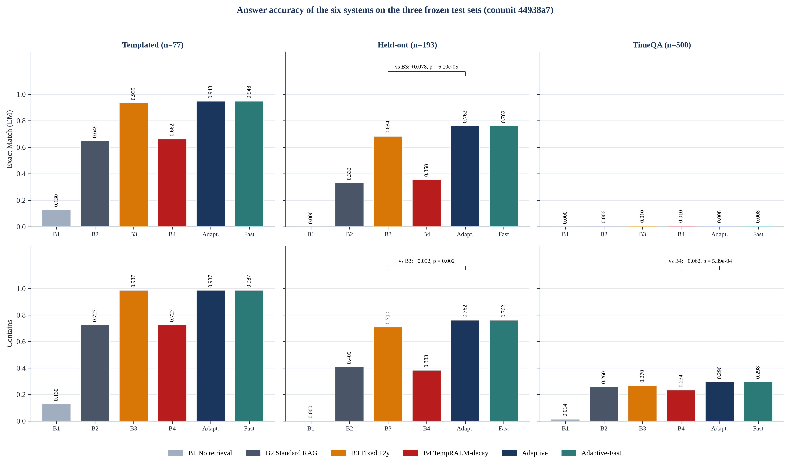
*Figure 6.12: Exact match and containment for six systems on three datasets*

Figure 6.12 plots exact match and containment from Table 6.1. On the templated test Adaptive and B3 tie on containment at 0.987 (76 of 77) and differ by one exact match (0.948 against 0.935). B2 and B4 sit together (exact match 0.649 and 0.662, containment 0.727). B1 scores 0.130 from the hardcoded trivia replies. On the held-out file the windowed systems separate: Adaptive 0.762 exact match, B3 0.684, B4 0.358, B2 0.332, B1 0.000. On TimeQA every exact-match bar lies between 0.000 and 0.010 while containment lies between 0.234 and 0.298. Adaptive-Fast copies Adaptive on the generated files and is 0.002 containment higher on TimeQA. Exact match on TimeQA does not rank the systems.

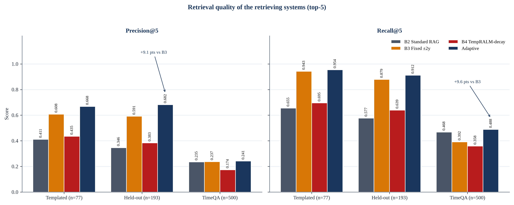
*Figure 6.13: Precision at 5 and recall at 5*

Figure 6.13 plots precision and recall at 5. No paired test on these columns is stored in `artifacts/significance.json`. On the templated test Adaptive is 0.668 and 0.954, against 0.608 and 0.943 for B3 and 0.411 and 0.655 for B2. The held-out file keeps that order: Adaptive 0.682 and 0.912, B3 0.591 and 0.879, B4 0.383 and 0.639, B2 0.346 and 0.577. On TimeQA precision is almost flat for B2, B3, and Adaptive (0.235, 0.237, 0.241), while B3 recall falls to 0.392, below B2 at 0.468, and Adaptive recall rises to 0.488. B4 recall is 0.358 with precision 0.174. The B3 drop is the birth-year and 1970-01-01 timestamp problem: the hard cut uses the index date. Adaptive’s window reads dates from the passage (`extract_dates`, `parse_temporal`). B1 is zero on both axes because it retrieves nothing.

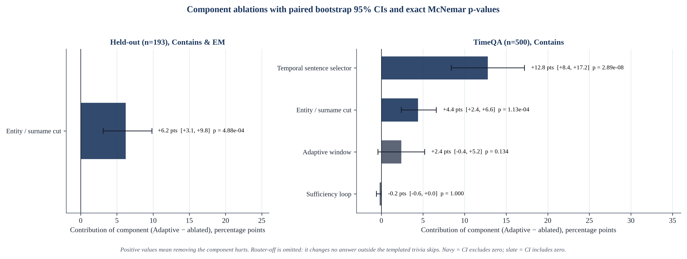
*Figure 6.14: Ablation deltas with 95% paired bootstrap intervals*

Figure 6.14 plots Adaptive minus the system with one component removed. Three intervals exclude zero. Held-out entity cut: $+0.062$ exact match and containment, $[+0.031, +0.098]$, $p = 4.88\times 10^{-4}$, 12 questions only the full system. TimeQA sentence selector: $+0.128$ containment, $[+0.084, +0.172]$, $p = 2.89\times 10^{-8}$, 99 and 35. TimeQA entity cut: $+0.044$ containment, $[+0.024, +0.066]$, $p = 1.13\times 10^{-4}$. Two intervals do not support a gain. The TimeQA window ablation is $+0.024$, $[-0.004, +0.052]$, $p = 0.134$. The TimeQA sufficiency ablation is $-0.002$, $[-0.006, +0.000]$, $p = 1.000$, one extra contained answer for the system without the loop. Subject filtering and, on TimeQA, sentence selection move answers. The repair loop does not.

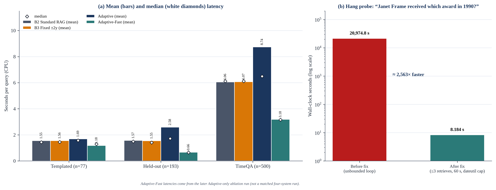
*Figure 6.15: Latency by system and the Janet Frame hang fix*

Figure 6.15 plots mean and median latency beside the hang fix. On the templated file the cross-encoder systems cluster: B2 1.551 s, B3 1.555 s, Adaptive 1.690 s. Skipping ten whitelist questions does not make Adaptive faster than B3. On the held-out file the Adaptive mean is 2.584 s against a median of 1.715 s. Adaptive-Fast, from the later run, reports 0.663 s mean with the same answers. On TimeQA the Adaptive mean is 8.736 s and the median 6.492 s; Adaptive-Fast falls to 3.184 s mean and 3.160 s median. Those clocks are different runs. The direction is that removing the loop removes the slow tail. B4 means of 0.031 s, 0.040 s, and 0.062 s, and the 75.0 s wall clock, omit the cross-encoder. The Janet Frame probe fell from 20,974.8 s to 8.184 s once retrieves were capped at three and the timeout at 60 s.

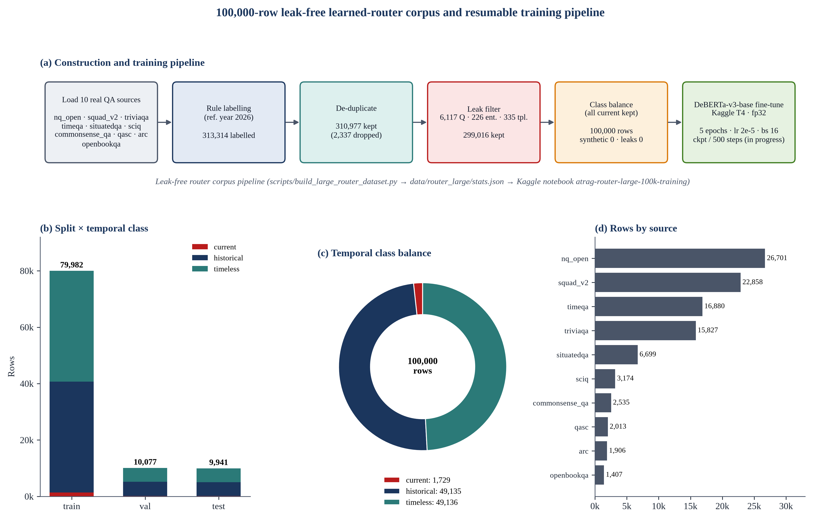
*Figure 6.16: The 100,000-row leak-free router dataset and the training pipeline*

Figure 6.16 summarises Table 6.5. `label_question`, `LeakageIndex`, and `select_balanced_rows` labelled public questions against reference year 2026, which is not the 1 October 2025 examination clock. After labelling, 313,314 rows remained; deduplication dropped 2,337; the leak filter dropped 10,647 template collisions, 1,227 entity collisions, and 87 exact collisions, leaving 299,016. Balancing kept all 1,729 current rows and down-sampled historical and timeless rows to 49,135 and 49,136. Synthetic rows selected are zero and residual leaks are zero. The drawing’s training block is `microsoft/deberta-v3-base`, fp32 on one Kaggle T4, five epochs, patience 2, learning rate $2\times 10^{-5}$, batch 16, length 128, 4,999 steps per epoch. The run is queued or in progress. `score_predictions` and `expected_calibration_error` have not been run, so no macro-F1 or calibration is stated.

## 6.3 Comparative Analysis

The frozen comparison separates three controls: whether to retrieve (the router and the whitelist), which dates to keep (the window, against a fixed band and against smooth decay), and when to stop (the sufficiency loop). The reader, the projection, and the entity cut are shared, so a surviving gap in Table 6.1 is a gap in one of those controls or in a component an ablation removes.

### 6.3.1 Adaptive versus standard RAG

B2 (`StandardRAGPipeline`) always retrieves and ranks by the 0.35/0.65 blend, with no date window and no sufficiency loop (Lewis et al., 2020; Karpukhin et al., 2020). On the templated test exact match differs by $+0.299$, $[+0.208, +0.403]$, $p = 2.38\times 10^{-7}$ (23 questions only Adaptive, none only B2), and containment by $+0.260$, $[+0.169, +0.364]$, $p = 1.91\times 10^{-6}$ (20 and 0). Precision at 5 moves from 0.411 to 0.668 and recall at 5 from 0.655 to 0.954. Neighbours of a title such as “President of the United States” include other years of the same office, and the window removes them before the reader runs.

On the held-out file the exact-match gap is $+0.430$, $[+0.363, +0.498]$, $p = 4.00\times 10^{-19}$ (83 and 0), and containment is $+0.352$, $[+0.285, +0.420]$, $p = 4.68\times 10^{-19}$ (68 and 0). B2 exact match is 0.332 against 0.762. B1 is 0.000, so that 0.762 is retrieval plus the shared reader. The six timelines still contain many years, and unconstrained retrieval has more wrong-year neighbours than on the short templated test. On TimeQA the exact-match difference is $+0.002$, $p = 1.000$. Containment is $+0.036$, $[+0.012, +0.060]$, $p = 0.006$ (29 and 11), an 18-question net gain out of 500. Recall at 5 is 0.488 against 0.468. Standard retrieval is the comparison a date policy is supposed to win. On the generated files it does. On TimeQA the win is small, and exact match does not move.

### 6.3.2 Adaptive versus the fixed window

B3 (`FixedTemporalRAGPipeline`) keeps candidates whose stored year lies within $\pm 2$ when a year is present, falls back to the unfiltered pool if that set is empty, and calls `rerank` with `prefer_time` left false. It has no sufficiency loop.

On the templated test the paired test calls the gap a tie. Containment is 0.987 for both, $p = 1.000$, with zero discordant questions. Exact match is 0.948 against 0.935, one question, $[+0.000, +0.039]$, $p = 1.000$. Precision at 5 still moves from 0.608 to 0.668, and the shared reader turns the two sets into the same containment. A $\pm 2$ year band already covers a bare-year fact whose passage sits on the fact date. Temporal accuracy is 1.000 for both, and for B3 that figure restates the filter.

On the held-out file the pipeline comparison is significant: exact match $+0.078$, $[+0.041, +0.119]$, $p = 6.10\times 10^{-5}$ (15 and 0), containment $+0.052$, $[+0.021, +0.083]$, $p = 0.002$ (10 and 0). That contrast is not the window-off ablation. Setting `enable_adaptive_window` false still calls `rerank` with `prefer_time=True`. Exact match stays 0.762, while precision at 5 falls from 0.682 to 0.640 and recall at 5 rises from 0.912 to 0.960. B3’s precision at 5 is 0.591, so the ablation does not reproduce B3. Adaptive beats this fixed-window pipeline. Replacing only the width, with time-first ranking left on, does not move the answer strings. The flag that does is the entity cut (Section 6.3.4).

On TimeQA, B3 is a weak control. Containment is $+0.026$, $[-0.004, +0.056]$, $p = 0.117$ (36 and 23). The interval includes zero. Exact match is $-0.002$, $p = 1.000$. Recall at 5 falls from 0.468 for B2 to 0.392 because stored timestamps are often a birth year or 1970-01-01. The window-off ablation lands on the same pattern (containment 0.272, recall at 5 of 0.397, exact match 0.010), and its containment interval also includes zero ($p = 0.134$).

### 6.3.3 Hard window and cross-encoder versus smooth exponential decay

B4 takes one idea from TempRALM, not the published system (Gade & Jetcheva, 2024). `TempRALMDecayPipeline` unions dense and BM25 candidates, blends the min–max scores equally, and multiplies by $\exp(-|\Delta y|/2)$. There is no hard cutoff, no sufficiency loop, and no cross-encoder, so a passage several years away is down-weighted and not deleted.

On the templated test B4 sits next to B2: exact match 0.662 against 0.649, containment 0.727 for both, against 0.987 for the windowed systems. Versus Adaptive, exact match is $+0.286$, $[+0.182, +0.390]$, $p = 2.98\times 10^{-6}$ (23 and 1). On the held-out file exact match is $+0.404$, $[+0.316, +0.492]$, $p = 3.06\times 10^{-15}$ (92 and 14), and containment is $+0.378$, $[+0.290, +0.466]$, $p = 4.80\times 10^{-14}$ (87 and 14). B4 exact match is 0.358, close to B2 and far from B3’s 0.684. Smooth decay does not replace either window. The counts are not one-sided: B4 wins 14 held-out questions that Adaptive misses, and the net is still 78.

On TimeQA, B4 exact match is 0.010, level with B3 and one question ahead of Adaptive ($p = 1.000$). Containment is $+0.062$, $[+0.028, +0.096]$, $p = 5.39\times 10^{-4}$ (54 and 23). Part of that gap is the cross-encoder, which B2, B3, and Adaptive run and B4 does not. B2 already reaches containment 0.260, above B4’s 0.234 and below Adaptive’s 0.296. B4’s means of 0.031 s, 0.040 s, and 0.062 s, and its 75.0 s wall clock, are the missing cross-encoder. They are not a matched speed result.

### 6.3.4 Component attribution from the ablations

Forcing the router on leaves every answer column unchanged. On the templated file the retrieval rate moves from 0.870 to 1.000, which is the 10 whitelist questions, and exact match stays 0.948. On the held-out file and on TimeQA the rate is already 1.000. Outside the templated trivia skips, router off changes nothing in the answers. Ablation latencies are a later run.

The window ablation uses `filter_by_year_window` at $\pm 2$ years and keeps `prefer_time=True`. Templated and held-out exact match and containment are unchanged. Precision and recall do move: templated precision at 5 falls from 0.668 to 0.635 and recall at 5 rises from 0.954 to 0.989; held-out precision at 5 falls from 0.682 to 0.640 and recall at 5 rises from 0.912 to 0.960. The shared reader absorbs that difference. On TimeQA, containment falls from 0.296 to 0.272 and recall at 5 from 0.488 to 0.397. The paired containment difference is $+0.024$, $[-0.004, +0.052]$, $p = 0.134$. The interval includes zero.

The entity or surname cut is the generated-file answer effect. Removing it drops templated exact match from 0.948 to 0.922 and held-out exact match from 0.762 to 0.699. The paired held-out difference is $+0.062$ on exact match and containment, $[+0.031, +0.098]$, $p = 4.88\times 10^{-4}$, 12 questions only the full system. Held-out precision at 5 falls from 0.682 to 0.526. On a reused title, a date window can still admit the right year of the wrong person. On TimeQA the cut is a containment effect of $+0.044$, $[+0.024, +0.066]$, $p = 1.13\times 10^{-4}$ (27 and 5). Exact match stays a one-question gap ($p = 1.000$). Precision at 5 falls from 0.241 to 0.167 and recall at 5 from 0.488 to 0.338.

The sentence selector is inert on the generated files, where the passage is already one dated fact, and decisive on TimeQA. Retrieval is unchanged (precision at 5 stays 0.241, recall at 5 stays 0.488) while containment falls from 0.296 to 0.168, $+0.128$, $[+0.084, +0.172]$, $p = 2.89\times 10^{-8}$ (99 and 35). Token F1 falls from 0.088 to 0.048. Exact match falls from 0.008 to 0.002, $p = 0.250$. The selector chooses the sentence containment sees. It does not make the projector emit the gold span.

### 6.3.5 The sufficiency loop and Adaptive-Fast

The loop accepts a pool when $S \ge 0.55$ and otherwise may repair, up to two repairs after the initial retrieve or until 60 s. Adaptive-Fast is that policy with the loop removed, taken from the ablation file so the negative result stays in Table 6.1.

On the templated test every answer cell is copied (exact match 0.948, containment 0.987, retrieval rate 0.870). The later-run mean is 1.179 s against 1.690 s. On the held-out file the copy is exact again, including exact match 0.762, and the later-run mean is 0.663 s against 2.584 s, with the median falling from 1.715 s to 0.649 s. The cost is a tail, and the tail buys no exact matches. On TimeQA the ablated system is slightly higher: containment 0.298 against 0.296, difference $-0.002$, $p = 1.000$, one question, with exact match tied at 0.008. The four-system mean is 8.736 s and the ablation-run mean is 3.184 s. The clocks are different runs. The full row is the slow row, and the loop does not buy answers on any of the three files. The Janet Frame cap remains a robustness control, not an accuracy control.

### 6.3.6 Exact match and containment on TimeQA

Adaptive containment is 0.296 (148 of 500). B3 is 0.270 (135), B2 is 0.260 (130), and B4 is 0.234. Exact match is 0.008, 0.010, 0.006, and 0.010: four, five, three, and five questions. Token F1 for every retrieving system sits between 0.077 and 0.089.

Containment scores the selected sentence, so a long sentence that contains the gold span scores 1. Exact match requires the normalised string to equal the span. With `span_extract_timeqa` on, `extract_factoid_span` and `project_answer` look for a short factoid, and a Wikipedia sentence that buries the answer in a clause often fails them. Removing the selector drops containment by 0.128 and barely moves exact match. Gold labels are chunks that contain the answer, at most eight, not character offsets. Index timestamps often default to a birth year or to 1970-01-01. The subset is 5,931 chunks and 900 questions (400 train, 500 test) from `hugosousa/TimeQA`, with no recorded easy/hard field, and the chunks are pieces of the attached page rather than open Wikipedia.

Published Fusion-in-Decoder figures are context only: 60.5 exact match on the easy test and 46.8 on the hard test, with human exact match of 87.0 on the hard test (Chen et al., 2021; Izacard & Grave, 2021). Those numbers are a different sample and a generative reader. They explain why 0.008 exact match can sit beside 0.296 containment. Closing the gap requires a span reader.

### 6.3.7 Threats to validity

The templated corpus rewards a year-and-title detector. One test question asks who was president of Brazil in 2016, and the corpus has no passage for that year, so every ranker that stays inside 2016 misses it. Adaptive and B3 both stop at containment 0.987 (76 of 77). The held-out file is 193 questions because every item naming one of six entities was dumped into test. Those names are absent from that file’s training split and present in the main file on which the analyser was trained (17,094 rows, batch size 8, 7 of 15 configured epochs logged). Validation necessity and temporal accuracy are both 1.0 on cues that are often the word “current” or a written year. The split does not hold the entities out of the router.

The confidence head is not in the loss. The October 2026 pilot saw a near-constant output near 0.75, and the Streamlit probes print 0.751, 0.746, and 0.75, so half of $\gamma$ is an untrained sigmoid. How often $\gamma$ falls below 0.55 was not counted. The web port’s 0.88 and 0.90 are separate constants. The skip is `is_trivial_query`, used on 10 of 77 templated questions and on none of the other tests, and skipping them does not improve latency (1.690 s against 1.555 s for B3). The reference date is frozen at 1 October 2025. FreshQA and RealTime QA were not run (Vu et al., 2023; Kasai et al., 2023). B4 omits the cross-encoder, Adaptive-Fast is a later run, and every timed evaluation is CPU-only. The window widths, blend weights, $\lambda$, $\alpha$, the 0.55 thresholds, the 15 June midpoint, and the two-year decay were chosen by hand. Adaptive-RAG and Self-RAG are not reimplemented (Jeong et al., 2024; Asai et al., 2024).

### 6.3.8 Status of the 100,000-row learned router

The frozen analyser remains DistilBERT. The 100,000-row file and `train_large_router` for `microsoft/deberta-v3-base` are a separate track (He et al., 2021). Synthetic fraction is 0 and residual leaks are 0. The current class is all 1,729 current rows the funnel found, against 49,135 historical and 49,136 timeless, about 1.7% of the file, so a future macro-F1 will feel that imbalance and accuracy would hide it. Mapping general QA with no time cue to timeless and to `needs_retrieval` 0 is the rule in `label_question`, not evidence that those questions need no corpus.

Training is not finished: five epochs, patience 2, learning rate $2\times 10^{-5}$, batch size 16, length 128, fp32 on one Kaggle T4, 4,999 steps per epoch, checkpoints every 500 steps, notebook `atrag-router-large-100k-training`. The run is queued or in progress. `score_predictions` and `expected_calibration_error` have not been run. No accuracy, macro-F1, or calibration figure is stated. Until a scored checkpoint replaces `load_query_analyzer`, Tables 6.1–6.3 remain DistilBERT-and-rules numbers.

# CHAPTER 7: CONCLUSION AND FUTURE SCOPE

## 7.1 Summary of Key Findings

The project froze one pipeline and varied whether to retrieve, which dates to keep, and when to stop. The reader, the projection, the sentence selector, and the entity cut were shared by B1, B2, B3, and Adaptive. B4 added an exponential decay on a dense-plus-BM25 pool and did not share the cross-encoder. The evaluation is Checkpoint B, three test files, and paired tests with 10,000 bootstrap resamples at seed 0.

On 77 templated questions, Adaptive exact match is 0.948 and containment is 0.987. A fixed $\pm 2$ year window reaches 0.935 and 0.987. Both gaps are ties ($p = 1.000$). Standard retrieval reaches 0.649 exact match and smooth decay reaches 0.662 ($p = 2.38\times 10^{-7}$ and $p = 2.98\times 10^{-6}$). Retrieval is skipped on 10 of the 77 questions by the trivia whitelist. Skipping them does not make Adaptive faster than B3 (mean 1.690 s against 1.555 s).

On 193 questions about six entity names, Adaptive exact match is 0.762 against 0.684 for the fixed window ($+0.078$, $[+0.041, +0.119]$, $p = 6.10\times 10^{-5}$) and against 0.358 for decay ($+0.404$, $p = 3.06\times 10^{-15}$). Standard retrieval is at 0.332 and the empty-document reader is at 0.000. The retrieval rate is 1. The ablation that moves held-out exact match is the entity cut ($-0.062$ when removed, $p = 4.88\times 10^{-4}$). Turning only the adaptive width off, with time-first ranking left on, leaves exact match at 0.762.

On 500 TimeQA questions, containment is 0.296, 0.270, 0.260, and 0.234 for Adaptive, B3, B2, and B4. The interval against B3 includes zero ($p = 0.117$). The interval against B4 does not ($+0.062$, $p = 5.39\times 10^{-4}$), and part of that gap is the cross-encoder B4 never runs. Exact match stays between 0.002 and 0.010. The sentence selector accounts for containment ($+0.128$, $p = 2.89\times 10^{-8}$) and not for exact match ($p = 0.250$). Birth-year and 1970-01-01 timestamps make the fixed window a weak control and pull B3 recall at 5 down to 0.392.

The sufficiency loop does not raise these scores. Adaptive-Fast matches Adaptive on the generated files and is 0.002 containment higher on TimeQA ($p = 1.000$). The full system is the slow system. The cap on the loop is a separate engineering result: the Janet Frame probe fell from 20,974.8 s to 8.184 s. The frozen router is DistilBERT with an untrained confidence head near 0.75. The 100,000-row DeBERTa file is built, with zero residual leaks. Its training run has no metrics.

## 7.2 Practical and Academic Significance

The practical object is a question-answering path that treats time as a decision. A nearest neighbour is often a true sentence about another year of the same title. On the two generated examinations, a hard window in front of a shared extractive reader is worth 0.299 exact match on the templated test and 0.430 exact match on the held-out file against unconstrained retrieval. A smooth decay that never deletes a year does not collect that gain. The hosted page at `https://adaptive-temporal-rag.vercel.app` and the Streamlit demonstration make the decision inspectable: policy name, window, sufficiency, and dated evidence sit next to the answer. “2 + 2” never touches the index. A bare year opens a one-year band centred on 15 June. A current question keeps dates back from 1 October 2025. The demonstration runs on the laptop CPU.

The academic object is the control structure. Retrieval-augmented generation supplies the corpus (Lewis et al., 2020). Dense retrieval supplies the first stage (Karpukhin et al., 2020). Adaptive-RAG, Self-RAG, and active retrieval study how much to retrieve and when to retrieve again (Jeong et al., 2024; Asai et al., 2024; Jiang et al., 2023). Time-based language models had already treated the relevant time as a ranking problem (Li & Croft, 2003; Kanhabua & Nørvåg, 2011), and TempRALM re-ranks with a temporal score (Gade & Jetcheva, 2024). This project did not reimplement those systems. It isolated three switches, shared the reader, and left the negative switch in the master table. The paired test that refuses the TimeQA containment edge over B3 is part of the same discipline. The work is submitted under the USAR ARP 455 guidelines (Guru Gobind Singh Indraprastha University, 2026).

Two engineering facts belong with the measurements. An audit on 17 November 2026 found that earlier exact-match comparisons were unfair because only Adaptive carried `answer_projection.py`. Checkpoint B, frozen on 23 November 2026, put the same reader, projection, and entity cut under B1, B2, and B3. The tables in Chapter 6 are that freeze, plus B4 and the paired tests added on 24 November 2026. An uncapped repair on one long passage was a hang. The 60 s timeout and the three-retrieve cap made the 500-question file finish in 10,466.8 s of CPU time. Robustness and accuracy came apart, and both are reported.

## 7.3 Limitations

Section 6.3.7 bounds every positive sentence above. The generated files reward a year-and-title detector. The 2016 Brazil question is a hole in the generator. The held-out entities are not held out of the DistilBERT analyser. The confidence head is an untrained sigmoid blended into $\gamma$. The skip is a whitelist of ten templated items. The reference date does not move. B4’s speed is the absent cross-encoder. Adaptive-Fast’s speed is a different run. TimeQA exact match does not rank the systems, and TimeQA temporal accuracy is undefined. The subset is not labelled easy or hard, so it cannot be placed on the published 60.5 and 46.8 figures except as a statement of what those figures measured (Chen et al., 2021).

Constants were chosen by hand, some while looking at development failures, with no untouched development split. The learned ranker and the SQuAD 2.0 reader stay outside the tables (Rajpurkar et al., 2018). Containment on this reader is close to asking whether the gold string occurred in the chosen sentence. Temporal accuracy does not read the answer. FreshQA, RealTime QA, StreamingQA, and SituatedQA were not run (Vu et al., 2023; Kasai et al., 2023; Liška et al., 2022; Zhang & Choi, 2021). The DeBERTa router has a finished training file and an unfinished run. The screenshots show that the frozen path executes. The tables show what it scores.

## 7.4 Future Scope

The next measurement is to finish the Kaggle run of `microsoft/deberta-v3-base` and to score it with `score_predictions` and `expected_calibration_error`. Macro-F1 and expected calibration error are the right summaries, because the current class has 1,729 rows. The scored router replaces DistilBERT only after that file exists, and only then is it worth asking whether retrieval rate, exact match, or containment moves. The confidence head should enter the loss and be calibrated. As it stands, half of $\gamma$ is a near-constant 0.75, and the 0.55 threshold compares the policy with an initialisation.

TimeQA exact match needs a reader that emits a span. The sentence selector already places the gold string inside the selected sentence on a substantial fraction of the 500 questions. `extract_factoid_span` does not turn that sentence into the gold span. An extractive span reader, or a small generative reader used only at the last step, is the direct experiment. The official Fusion-in-Decoder numbers remain the context for that experiment (Izacard & Grave, 2021; Izacard et al., 2023; Chen et al., 2021). The cross-encoder term in the 0.35/0.65 blend should be normalised onto the same scale as the dense score. A raw MiniLM logit dominates the written weights (Nogueira & Cho, 2019; Reimers & Gurevych, 2019).

The examination clock should become a live clock, and the current branch should be scored on a benchmark that moves. FreshQA and RealTime QA are the natural files (Vu et al., 2023; Kasai et al., 2023). SituatedQA and StreamingQA ask the related question of an answer that depends on when the question is asked (Zhang & Choi, 2021; Liška et al., 2022). Time-aware language models that condition on a timestamp are a closed-book counterpart (Dhingra et al., 2022). Published temporal retrievers should enter as their own rows, using the same projection and the same entity cut. The missing row is TempRALM itself, including the mask on passages dated after the query, rather than only $\exp(-|\Delta y|/2)$ (Gade & Jetcheva, 2024). Adaptive-RAG, scored for question complexity, is the other missing row (Jeong et al., 2024).

Two reasoning gaps sit outside the frozen switches. The policy handles one target interval. Questions that chain two times are not given a target by `parse_temporal`, and multi-hop temporal reasoning is untouched. The skip is still `is_trivial_query`. A learned skip, trained on the timeless half of the 100,000-row file and tested on questions that are not in the whitelist, is what would make the first half of the title a result beyond ten arithmetic strings. That experiment waits on the same unfinished checkpoint. The sufficiency loop, having failed as an accuracy device on these three files, should be revisited only after the reader and the confidence head change. Repeating it on the current extractive stack would reproduce Adaptive-Fast.

# CHAPTER 8: REFERENCES

Asai, A., Wu, Z., Wang, Y., Sil, A., & Hajishirzi, H. (2024). Self-RAG: Learning to retrieve, generate, and critique through self-reflection. In *International Conference on Learning Representations*.

Chen, W., Wang, X., & Wang, W. Y. (2021). A dataset for answering time-sensitive questions. In *NeurIPS Datasets and Benchmarks*. arXiv:2108.06314.

Devlin, J., Chang, M.-W., Lee, K., & Toutanova, K. (2019). BERT: Pre-training of deep bidirectional transformers for language understanding. In *Proceedings of NAACL*.

Dhingra, B., Cole, J. R., Eisenschlos, J. M., Gillick, D., Eisenstein, J., & Cohen, W. W. (2022). Time-aware language models as temporal knowledge bases. *Transactions of the Association for Computational Linguistics, 10*, 257–273.

Friedman, J. H. (2001). Greedy function approximation: A gradient boosting machine. *Annals of Statistics, 29*(5), 1189–1232.

Gade, A., & Jetcheva, J. (2024). It's about time: Incorporating temporality in retrieval augmented language models. arXiv:2401.13222.

Guru Gobind Singh Indraprastha University. (2026). *USAR ARP-455 guidelines*.

He, P., Liu, X., Gao, J., & Chen, W. (2021). DeBERTa: Decoding-enhanced BERT with disentangled attention. In *International Conference on Learning Representations*.

Izacard, G., & Grave, E. (2021). Leveraging passage retrieval with generative models for open domain question answering. In *Proceedings of EACL*.

Izacard, G., Lewis, P., Lomeli, M., Hosseini, L., Petroni, F., Schick, T., Dwivedi-Yu, J., Joulin, A., Riedel, S., & Grave, E. (2023). Atlas: Few-shot learning with retrieval augmented language models. *Journal of Machine Learning Research, 24*(251), 1–43.

Jeong, S., Baek, J., Cho, S., Hwang, S. J., & Park, J. C. (2024). Adaptive-RAG: Learning to adapt retrieval-augmented large language models through question complexity. In *Proceedings of NAACL*.

Jia, Z., Abujabal, A., Saha Roy, R., Strötgen, J., & Weikum, G. (2018). TempQuestions: A benchmark for temporal question answering. In *Companion of The Web Conference*.

Jiang, Z., Xu, F. F., Gao, L., Sun, Z., Liu, Q., Dwivedi-Yu, J., Yang, Y., Callan, J., & Neubig, G. (2023). Active retrieval augmented generation. In *Proceedings of EMNLP*.

Johnson, J., Douze, M., & Jégou, H. (2019). Billion-scale similarity search with GPUs. *IEEE Transactions on Big Data, 7*(3), 535–547.

Kanhabua, N., & Nørvåg, K. (2011). A comparison of time-aware ranking methods. In *Proceedings of SIGIR*.

Karpukhin, V., Oguz, B., Min, S., Lewis, P., Wu, L., Edunov, S., Chen, D., & Yih, W. (2020). Dense passage retrieval for open-domain question answering. In *Proceedings of EMNLP*.

Kasai, J., Sakaguchi, K., Takahashi, Y., Le Bras, R., Asai, A., Yu, X., Radev, D., Smith, N. A., Choi, Y., & Inui, K. (2023). RealTime QA: What's the answer right now? In *NeurIPS Datasets and Benchmarks*.

Lewis, P., Perez, E., Piktus, A., Petroni, F., Karpukhin, V., Goyal, N., Küttler, H., Lewis, M., Yih, W., Rocktäschel, T., Riedel, S., & Kiela, D. (2020). Retrieval-augmented generation for knowledge-intensive NLP tasks. In *Advances in Neural Information Processing Systems*.

Li, X., & Croft, W. B. (2003). Time-based language models. In *Proceedings of CIKM* (pp. 469–475).

Liška, A., Kočiský, T., Gribovskaya, E., Terzi, E., Sezener, E., Agrawal, D., de Masson d'Autume, C., Scholtes, T., Zaheer, M., Young, S., Gilsenan-McMahon, E., Austin, S., Blunsom, P., & Lazaridou, A. (2022). StreamingQA: A benchmark for adaptation to new knowledge over time in question answering models. In *Proceedings of ICML*.

Nguyen, T., Rosenberg, M., Song, X., Gao, J., Tiwary, S., Majumder, R., & Deng, L. (2016). MS MARCO: A human generated machine reading comprehension dataset. In *CoCo@NeurIPS*.

Nogueira, R., & Cho, K. (2019). Passage re-ranking with BERT. arXiv:1901.04085.

Rajpurkar, P., Jia, R., & Liang, P. (2018). Know what you don't know: Unanswerable questions for SQuAD. In *Proceedings of ACL*.

Reimers, N., & Gurevych, I. (2019). Sentence-BERT: Sentence embeddings using Siamese BERT-networks. In *Proceedings of EMNLP*.

Sanh, V., Debut, L., Chaumond, J., & Wolf, T. (2019). DistilBERT, a distilled version of BERT: Smaller, faster, cheaper and lighter. arXiv:1910.01108.

Vu, T., Iyyer, M., Wang, X., Constant, N., Wei, Jerry, Wei, Jason, Tar, C., Sung, Y.-H., Zhou, D., Le, Q., & Luong, T. (2023). FreshLLMs: Refreshing large language models with search engine augmentation. arXiv:2310.03214.

Wang, W., Wei, F., Dong, L., Bao, H., Yang, N., & Zhou, M. (2020). MiniLM: Deep self-attention distillation for task-agnostic compression of pre-trained transformers. In *International Conference on Learning Representations*.

Xiao, S., Liu, Z., Zhang, P., Muennighoff, N., Lian, D., & Nie, J.-Y. (2024). C-Pack: Packaged resources to advance general Chinese embedding. In *Proceedings of SIGIR*. arXiv:2309.07597.

Zhang, M. J. Q., & Choi, E. (2021). SituatedQA: Incorporating extra-linguistic contexts into QA. In *Proceedings of EMNLP*.
