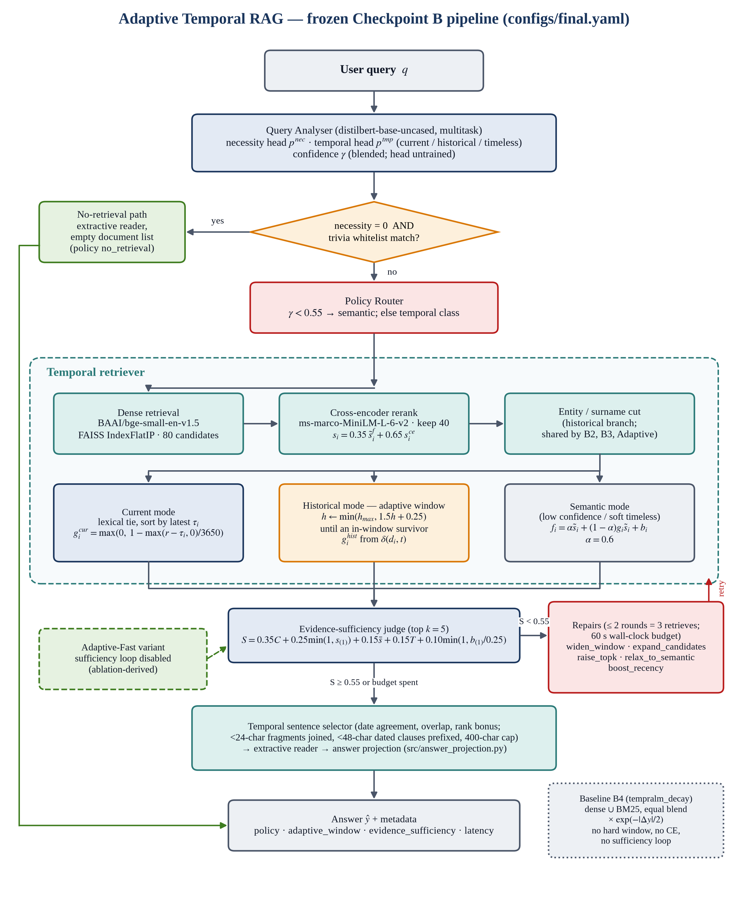
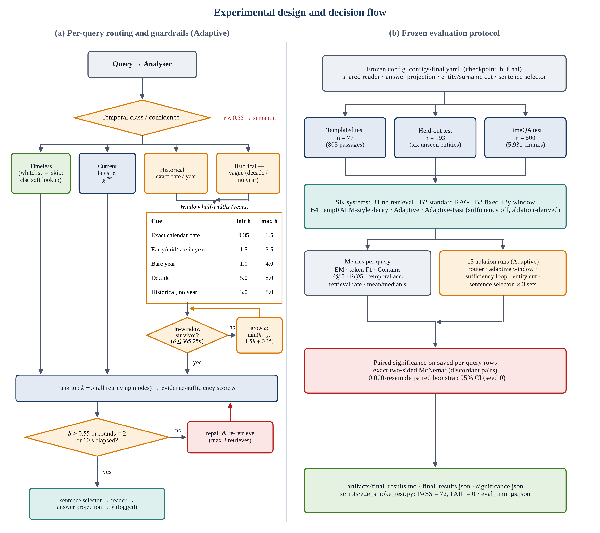
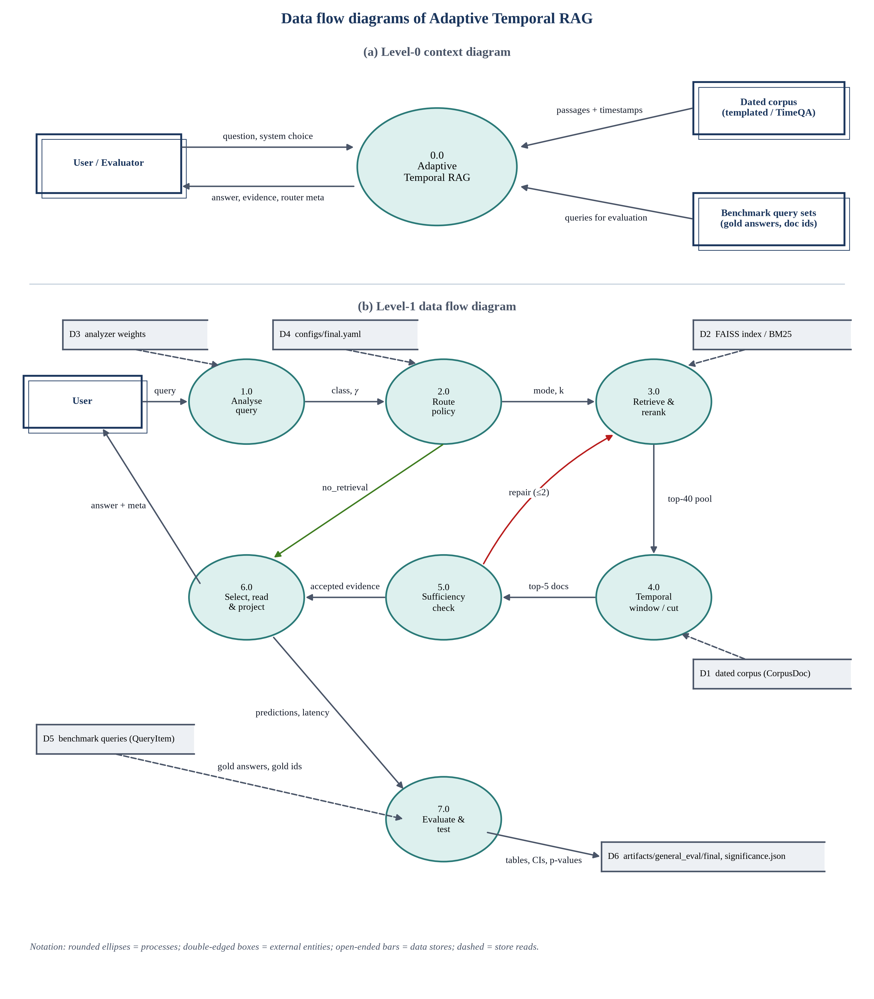
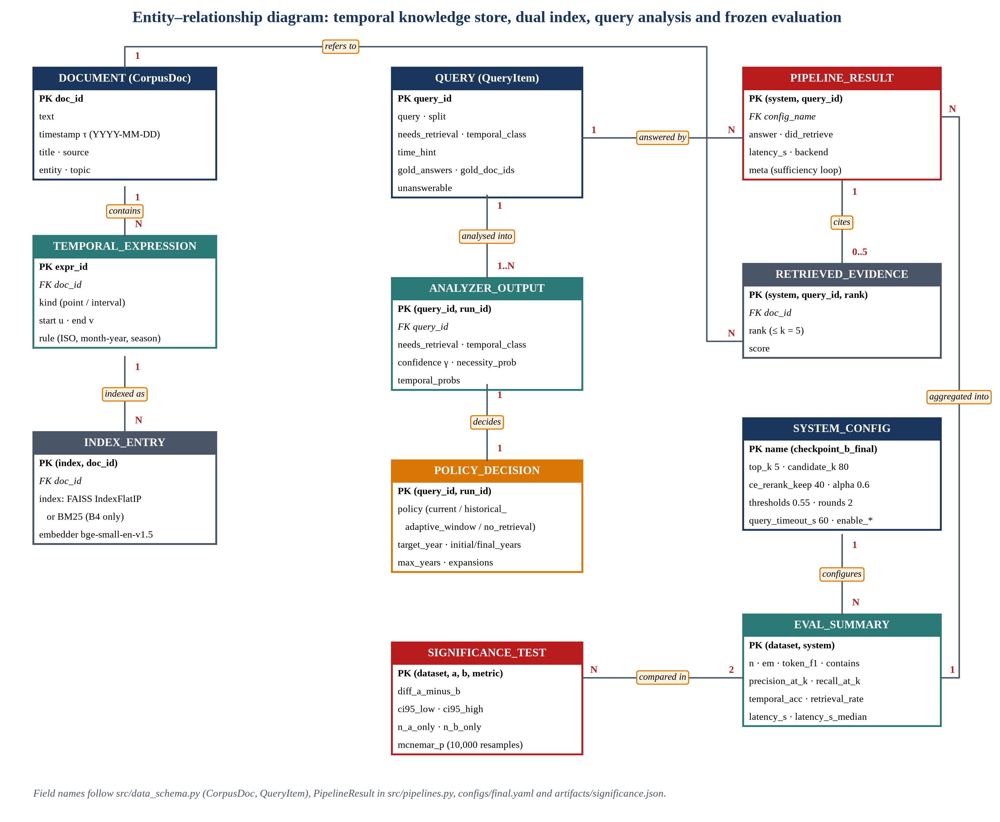

# CHAPTER 4: DESCRIPTION OF VARIOUS MODULES

The system evaluated in this report is the frozen Checkpoint B build named `checkpoint_b_final`. Code under `src/`, `scripts/`, `configs/final.yaml`, and `app/streamlit_app.py` implements it. A separate lexical demonstration lives in `web/`. One dense index, one cross-encoder, one extractive reader, one projection stage, and one entity or surname cut are shared. Systems differ in the retrieval decision, the time window, and the sufficiency loop. Frozen Adaptive retrieval is FAISS `IndexFlatIP` over `BAAI/bge-small-en-v1.5`, then `cross-encoder/ms-marco-MiniLM-L-6-v2`. BM25 exists only inside `TempRALMDecayPipeline` (`src/bm25.py`). The frozen analyser is `distilbert-base-uncased` (`MultitaskQueryAnalyzer`, `QueryAnalyzerService`). A `microsoft/deberta-v3-base` router on a 100,000-row leak-free set is experimental: its Kaggle T4 run had produced no accuracy, macro-F1, or expected calibration error at the time of writing, and those quantities are not reported.

## 4.1 Configuration Freeze and Reproducibility Layer

`EvalConfig` in `src/config.py` is the only set of fields `scripts/evaluate.py` will load. `load_eval_config` uses PyYAML `safe_load` when the package imports, and otherwise parses `key: value` lines with `_parse_scalar`, stripping comments. Unknown keys are dropped. The default path is `configs/final.yaml`. Before scoring, `evaluate.py` prints `cfg.name` and `cfg.as_dict()`.

`apply_ablation` returns a copy. `router_off` sets `always_retrieve`. `window_off` clears `enable_adaptive_window`. `sufficiency_off` clears `enable_sufficiency_loop`. `entity_cut_off` and `sentence_selector_off` clear the matching flags. Any other non-empty name raises `ValueError`. `scripts/run_frozen_ablations.py` runs those five names on each of three datasets, the 15-run design. `learned_experimental: true` leaves the learned path in the tree and out of the master table compiled by `scripts/compile_final_results.py`.

**Table 4.1:** Every key in `configs/final.yaml` and the behaviour it freezes. File comments are part of the meaning column, not extra keys.

| Key | Value | Meaning |
|---|---|---|
| `name` | `checkpoint_b_final` | Identifier printed by `evaluate.py` and by the Streamlit sidebar. |
| `generator` | `extractive` | `Generator` backend. Answers come from `extractive_answer` in `src/generate.py`. |
| `top_k` | `5` | Documents passed to the reader after ranking. |
| `candidate_k` | `80` | First-stage neighbours from `EmbeddingIndex.search_candidates`. |
| `ce_rerank_keep` | `40` | Rows retained by `CrossEncoderReranker.rerank`. |
| `alpha` | `0.6` | Semantic weight in `combine_scores` and `rerank`. |
| `conf_threshold` | `0.55` | If blended \(\gamma\) is below this value, routing retrieves in semantic mode. |
| `sufficiency_threshold` | `0.55` | Evidence is accepted when the subject check passes and \(S \ge 0.55\). |
| `max_sufficiency_rounds` | `2` | Repairs after the first retrieve. With that retrieve, three retrieves in total. |
| `query_timeout_s` | `60.0` | Per-query wall clock enforced by `QueryBudget`. |
| `enable_ce_rerank` | `true` | `build_all_pipelines` constructs the cross-encoder. B4 never calls it. |
| `enable_sufficiency_loop` | `true` | Adaptive may repair. Adaptive-Fast is this flag cleared. |
| `enable_adaptive_window` | `true` | Historical Adaptive queries use `infer_adaptive_window`. |
| `enable_entity_cut` | `true` | `filter_subject` runs for B2, B3, Adaptive, and B4. |
| `enable_sentence_selector` | `true` | `extractive_answer` may call `_best_dated_sentence`. |
| `enable_answer_projection` | `true` | `BasePipeline._read_answer` calls `project_answer`. |
| `always_retrieve` | `false` | The file comment marks the router as on. `router_off` flips the flag. |
| `span_extract_timeqa` | `true` | On TimeQA, exact match and token F1 use `extract_factoid_span`. Contains still uses the sentence. |
| `learned_experimental` | `true` | The learned path is absent from the main comparison table. |

`build_all_pipelines` is the constructor used by evaluation and by Streamlit. It passes one `EvalConfig` into `LLMOnlyPipeline`, `StandardRAGPipeline`, `FixedTemporalRAGPipeline`, `AdaptiveTemporalRAGPipeline`, and `TempRALMDecayPipeline`. Reader, projection, entity-cut, and sentence-selector flags therefore cannot drift among B1, B2, B3, and Adaptive. B4 receives the same reader-side flags and does not call the cross-encoder. The paper records that earlier Checkpoint A drafts sit under `artifacts/_archive_pre_fix/` and are not the tables in `artifacts/final_results.md`.

The October 2026 Colab T4 pilot locked B1, B2, B3, and Adaptive, and moved training to a logits-safe loss. `MultitaskQueryAnalyzer.forward` casts the classification token to float32 before the linear heads, avoiding a bf16/fp32 mismatch under autocast, and the objective is cross-entropy on logits. The confidence head is allocated and is absent from that loss. The 1st Mid-Term evaluation on 8 October 2026 used the pilot. Checkpoint B was frozen on 23 November 2026. Commit `44938a7` on 24 November 2026 added B4 and the paired significance file.

## 4.2 Temporal Corpus Tagger and Indexing Engine

Dates are rules. `src/temporal_tagger.py` provides `TemporalParse`, `extract_dates`, `first_date`, `parse_temporal`, `extract_intervals`, `passage_distance_days`, `years_from_target`, `inside_target`, `passage_dates`, and `closest_passage_date`. `extract_dates` keeps ISO dates, month-day-year, month-year (day 1), and bare years. A bare year is placed on 15 June. `first_date` prefers a fuller date over that midpoint when both occur.

`parse_temporal` strips a parenthetical containing “born” before choosing a target. Cues “today”, “now”, “currently”, “as of now”, “at present”, and “right now” set the target to the reference date. “Last year” and “this year” become calendar intervals. “From/between … to/and …” uses `dateutil` through `_parse_loose`. “Since” or “after” runs from the named month to the reference. “Before” a month and year becomes the interval from three years earlier through that month. A decade is recognised by `infer_adaptive_window`, not by a general ordinal parser. Inside `parse_temporal` the default reference is the day of the call. Frozen ranking does not use that default: `temporal_score` and `infer_adaptive_window` use 1 October 2025 when the caller omits a date.

`extract_intervals` reads year–year spans, “from … to …”, “until” or “through”, two-digit seasons such as 2004–05 when the implied length is at most 15 years, and “for \(n\) years beginning in \(y\)” with \(0 < n \le 40\). A span longer than 45 years is discarded, which removes birth–death pairs and also a long reign or career. `passage_distance_days` returns 0 when the target falls inside an interval, and otherwise the minimum day distance to an endpoint or a point date. `passage_dates` does not treat the stored timestamp `1970-01-01` as an extra point. On the TimeQA subset the index timestamp is often a birth year or that epoch default, so a filter on the stored year is a weak control. The tagger can still score the passage when the prose contains the asked date.

`_parse_loose` returns immediately when the fragment is empty, longer than 64 characters, or lacks a year or a month name (`_HAS_DATE_CUE`). `extract_dates` and `extract_intervals` truncate at `_MAX_PASSAGE_CHARS = 12000` before any fuzzy parse. With the retrieve cap and the 60-second budget, this is the guard that reduced the Janet Frame probe (“Janet Frame received which award in 1990?”) from 20,974.8 s to 8.184 s.

`EmbeddingIndex` in `src/embed_index.py` encodes `CorpusDoc.text` with `SentenceTransformer`, `normalize_embeddings=True`, batch size 64, float32. The index is `faiss.IndexFlatIP`. Normalised vectors make the inner product a cosine, and search is exact on these corpora (Johnson, Douze, & Jégou, 2019; Reimers & Gurevych, 2019; Xiao et al., 2024). `save` writes `embeddings.npy`, `faiss.index`, `index_meta.json`, and `corpus_snapshot.jsonl`. `load` restores documents from the snapshot and reloads the encoder if the metadata names a different model. BGE queries are prefixed by `_format_query` with “Represent this sentence for searching relevant passages:”. `scripts/build_index.py` calls `build_index_from_corpus` with `DEFAULT_EMBED_MODEL`, which `src/model_config.py` sets to `BAAI/bge-small-en-v1.5`. The script docstring still says MiniLM; the default argument does not. `LEGACY_EMBED_MODEL` remains `sentence-transformers/all-MiniLM-L6-v2`.

`CorpusDoc` (`src/data_schema.py`) stores `doc_id`, `text`, `timestamp`, `title`, `source`, `entity`, and `topic`. The templated generator fills `entity`. Every TimeQA chunk leaves it empty, so `filter_subject` takes the surname branch. `scripts/build_dataset.py` builds the templated timelines. `src/benchmarks/timeqa.py` builds the `hugosousa/TimeQA` subset (5,931 chunks, 900 questions). `src/benchmarks/heldout.py` rebuilds the generator and moves six entity names into test.

## 4.3 Query Analyser and Routing Layer

`MultitaskQueryAnalyzer` is a `torch.nn.Module`. The default encoder is `distilbert-base-uncased` (Sanh et al., 2019; Devlin et al., 2019). A model name containing “deberta” requests `attn_implementation="eager"` (He, Liu, Gao, & Chen, 2021). After dropout 0.1, `necessity_head` maps the classification token to \(\mathbb{R}^{2}\), `temporal_head` maps it to three logits over `TEMPORAL_LABELS = ["current", "historical", "timeless"]`, and `confidence_head` maps it to one logit. Heads are Xavier-uniform with gain 0.02 and zero bias. The forward method returns logits, a sigmoid confidence, and a loss only when both label tensors are present.

With class weights \(w\) and \(\lambda = 1.75\) stored as `temporal_loss_weight`,

$$
\mathcal{L}
= \mathrm{CE}\!\left(z^{\mathrm{nec}}, y^{\mathrm{nec}}; w^{\mathrm{nec}}\right)
+ \lambda\,
\mathrm{CE}\!\left(z^{\mathrm{tmp}}, y^{\mathrm{tmp}}; w^{\mathrm{tmp}}\right).
$$

`confidence_head` is not in \(\mathcal{L}\). Its weights stay at initialisation while the encoder moves. The October 2026 pilot recorded a near-constant output of 0.75. Streamlit traces on 24 November 2026 agree: confidence 0.751 on the 2018 presidency question, 0.746 on the current Prime Minister of India, and 0.75 on “What is 2 + 2?”.

`QueryAnalyzerService.predict` divides class logits by a temperature, default 1.0, before the softmax. Let \(c=\sigma(z^{\mathrm{conf}})\). With `blend_confidence=True`, which the frozen service uses,

$$
\gamma = \tfrac{1}{2}\, c + \tfrac{1}{2}\, \max\{\max p^{\mathrm{nec}}, \max p^{\mathrm{tmp}}\}.
$$

With blending off, \(\gamma\) is only the maximum class probability. Because \(c\) was never trained, half of \(\gamma\) is an untrained sigmoid, and the head can change the ranker whenever \(\gamma < 0.55\). How often that happens on the test sets was not counted. `AnalyzerOutput` carries `needs_retrieval`, `temporal_class`, `confidence` (this \(\gamma\)), `necessity_prob` (class 1), and `temporal_probs`.

`train_analyzer` fitted the frozen checkpoint on the templated training questions plus six calls through `augment_training_rows`: 17,094 rows, batch size 8. The configured budget was 15 epochs. The saved log contains 7. Validation necessity accuracy and temporal accuracy on that templated split are both 1.0. On this data the label is often the word “current” or a written year, so the figure says the classifier fits those cues. It does not say the classifier reads time in Wikipedia prose. No real-text test of this router is reported. `load_query_analyzer` restores `artifacts/analyzer.pt`. The service length defaults to 64 when metadata omit `max_length`.

`resolve_adaptive_routing` in `src/adaptive_policy.py` returns `AdaptiveRoutingDecision` (`skip_retrieval`, `policy`, `retrieve_mode`). Retrieval is skipped only when `needs_retrieval == 0` and `is_trivial_query` is true. The whitelist in `src/generate.py` is the substring list “2 + 2”, “2+2”, “10 times 5”, “7 + 8”, “days are in a week”, “hours are in a day”, “minutes are in an hour”, “spell ”, “h2o”, “opposite of hot”, “sun a star”, and “clear daytime sky”. Necessity 0 on any other string still retrieves, as `soft_retrieve_timeless`, in semantic mode. If \(\gamma\) is below `conf_threshold`, the policy is `low_conf_semantic`. A timeless prediction with necessity 1 is `timeless_semantic`. Current mode uses policy `current`. Historical mode sets `historical_adaptive_window`. There is no parametric memory under a skip. B1 is the same extractive reader on an empty document list, plus `_trivial_answer` for whitelist items. A skip is scored as “the index was not called”.

If `always_retrieve` is set and the decision would skip, `AdaptiveTemporalRAGPipeline.run` forces a retrieve. The frozen file leaves the flag false, so the whitelist stays armed. Held-out and TimeQA Adaptive retrieval rates are 1.000, so the skip did not fire there. The templated rate is 0.870.

`src/router_large.py` and `scripts/build_large_router_dataset.py` are the experimental router. `train_large_router` fine-tunes the same module class, default `microsoft/deberta-v3-base`, and it does put a confidence term outside `forward` (`confidence_loss_weight` default 0.3). That loss is different from the frozen DistilBERT objective. The private Kaggle notebook `atrag-router-large-100k-training` was launched on one of two T4 GPUs, fp32, DataParallel off, for 5 epochs, patience 2, learning rate \(2\times 10^{-5}\), batch 16, length 128, 4,999 steps per epoch, with an atomic checkpoint every 500 steps. No test metric had been written. `expected_calibration_error` (15 bins) and `score_predictions` exist for a later macro-F1 and ECE. No such number is stated. `load_large_router` is not the analyser behind the frozen tables. `LearnedAdaptivePipeline`, `LearnedRanker`, and `SquadReader` (`deepset/tinyroberta-squad2`) are likewise experimental and absent from `artifacts/final_results.md` (Friedman, 2001; Rajpurkar, Jia, & Liang, 2018).

## 4.4 Adaptive Temporal Windowing, Cross-Encoder Reranking and Temporal Scoring

`EmbeddingIndex.search_candidates` requests `candidate_k` = 80. `CrossEncoderReranker.rerank` (`src/rerank_ce.py`) scores `(query, doc.text)` with `cross-encoder/ms-marco-MiniLM-L-6-v2` (Wang et al., 2020; Nguyen et al., 2016; Nogueira & Cho, 2019). FAISS scores are min–max normalised to \(\tilde{s}^{\mathrm{f}}_i\). The cross-encoder score stays raw. The blend is

$$
s_i = 0.35\,\tilde{s}^{\mathrm{f}}_i + 0.65\,s^{\mathrm{ce}}_i .
$$

The top 40 values are kept. The terms do not share a scale, so 0.35 and 0.65 are implementation constants. A cross-encoder score of several units dominates a dense score in \([0,1]\). Reported runs did not normalise \(s^{\mathrm{ce}}\), and the weights were not chosen on a development split. `get_cross_encoder_reranker` caches one model per device key. B2 ranks by this blend, applies `filter_subject`, and stops. B3 uses the same front end, then a year rule.

`AdaptiveWindow` and `infer_adaptive_window` (`src/temporal_rank.py`) use reference date 1 October 2025. Half-widths are in years. A decade cue centres the target on 15 June of the middle year. An explicit calendar date uses the parsed date. “Early”, “mid”, or “late” with a year, and a bare year, both use 15 June of that year. A historical question with no year targets five years before the reference, floored at 1900, again on 15 June.

**Table 4.2:** Initial and maximum half-width of the historical window, in years, from `infer_adaptive_window` and from the paper.

| Cue | Initial \(h\) | Maximum \(h\) | `reason` |
|---|---:|---:|---|
| Exact calendar date | 0.35 | 1.5 | `exact_date` |
| Early, mid, or late in a year | 1.5 | 3.5 | `year_phase` |
| A bare year | 1.0 | 4.0 | `year` |
| A decade | 5.0 | 8.0 | `decade` |
| Historical, but no year | 3.0 | 8.0 | `vague_historical` |

`adaptive_filter_by_window` may call `filter_subject`, then grows \(h\) while no document satisfies \(\delta(d,t) \le 365.25\,h\):

$$
h \leftarrow \min(h_{\max},\; 1.5h + 0.25).
$$

Growth stops at the first in-window document or at \(h_{\max}\). It does not wait for `min_docs`. Widths were set by hand. The early stop was not ablated. A repair may add `window_boost`, raising the initial half-width up to the current maximum and the maximum itself up to 12 years. An empty window falls back to the subject pool, then to the full list. On untagged prose, `_backfill_untagged` can fill up to `top_k`.

Survivors are min–max normalised again to \(\tilde{s}_i\). For current questions, reference \(r =\) 1 October 2025 and document time \(\tau_i\),

$$
g^{\mathrm{cur}}_i = \max\left(0,\; 1 - \frac{\max(r-\tau_i,\, 0)}{3650}\right).
$$

The denominator is about ten years. Current mode then keeps overlap within 0.01 of the best and sorts by timestamp, latest first. Rank \(i\) in a tie of size \(n\) displays \(1 - 0.05\,i/n\), so an older tied document is not treated as weak by the sufficiency check. Latest timestamp stands for current holder only when the index date is the fact date. The reference day is frozen. No live benchmark is used. The 24 November trace “Who is the current Prime Minister of India?” took this branch: policy `current`, current-class probability 0.999, sufficiency 0.905, latency 0.621 s, answer Narendra Modi.

Historical affinity is

$$
g^{\mathrm{hist}}_i
= \max\left(0,\;
1 - \frac{\delta(d_i, t)}{\max(90,\; 365.25\,w)}
\right),
$$

with \(w\) the window width in years. On untagged prose the function first tries `closest_passage_date`, so a birth-year index date can still score well when the text contains the asked date. After the stop list, if \(H\) query tokens occur in the document,

$$
b = \min(0.25,\; 0.05H).
$$

`lexical_overlap_boost` implements the cap. The stop list includes months, years, and words such as “between”, “held”, and “team”.

On a tagged corpus, when the caller sets `prefer_time=True` (Adaptive’s historical branch),

$$
f_i = g^{\mathrm{hist}}_i + 0.01\,\tilde{s}_i + b_i .
$$

B3 calls `rerank` without that flag. On untagged prose with the flag set, \(\tilde{s}'_i = 0.5 + 0.5\tilde{s}_i\) and

$$
f_i = 0.45\,\tilde{s}'_i + 0.55\,g^{\mathrm{hist}}_i + b_i .
$$

Otherwise, including B3 and the semantic default,

$$
f_i = \alpha \tilde{s}_i + (1-\alpha)\,g_i\tilde{s}_i + b_i ,
$$

with \(\alpha = 0.6\). The product \(g_i\tilde{s}_i\) stops wrong-entity recency from dominating. Semantic and timeless modes use \(\tilde{s}_i + b_i\), and `temporal_score` returns 0.5. The top \(k=5\) documents go to the reader. Tagged and untagged questions do not share one ranking formula. When the pool is large and time-first is off, a semantic floor of 0.75 times the best normalised score is applied.

B3 uses `filter_by_year_window` with `window_years=2`. A year keeps stored years within \(\pm 2\); an empty keep returns the unfiltered pool. The ranker is then called without `prefer_time`. With no year, B3 calls current mode. Perfect temporal accuracy for this baseline largely restates the filter, and the filter is a weak control on TimeQA.

B4 is `TempRALMDecayPipeline`, name `tempralm_decay`, with `DECAY_LAMBDA_YEARS = 2.0`. It unions the dense top-`candidate_k` set and the BM25 top-`candidate_k` set, min–max normalises each family, and blends them equally, \(0.5\,\tilde{s}^{\mathrm{dense}} + 0.5\,\tilde{s}^{\mathrm{BM25}}\). `BM25Index` uses \(k_1 = 1.5\), \(b = 0.75\), and idf \(\log(1+(N-n_t+0.5)/(n_t+0.5))\). When both years exist the blend is multiplied by \(\exp(-|\Delta y|/2)\). There is no hard cutoff and no sufficiency loop. The cross-encoder is not called, so B4 latency is not matched to Adaptive. This is a TempRALM-style decay beside the project’s reader (Gade & Jetcheva, 2024). The published TempRALM system was not reimplemented. The subject cut and the shared reader still run.

The 24 November historical demonstration followed the bare-year row. “Who was the President of the United States in 2018?” was historical, necessity probability 0.999, policy `historical_adaptive_window`, target year 2018, target date 2018-06-15, initial half-width 1, final half-width 1, maximum 4, expansions 0, reason `year`. Top evidence was 2018-04-16, score 1.046, `doc_id` `doc_e8b1e7947d`. The answer was Donald Trump. Latency on that call was 2.629 s. The trace is a demonstration, not a row of the 77-question test.

## 4.5 Entity/Surname Cut, Temporal Sentence Selector and Answer Projection

`filter_subject` runs before the historical window and, through `_subject_pool`, on B2, B3, and B4. If any candidate has a non-empty `entity`, overlap uses `entity_only=True` and years are ignored. Documents within 0.01 of the best overlap are kept. The cut is shared, so a precision gap is not an Adaptive-only use of the entity field. Current mode keeps its own lexical tie and sorts by timestamp.

If every entity field is empty, as on every TimeQA chunk, a document is kept when overlap is at least 0.05 and the text contains a surname, unless overlap is already within 0.01 of the best. `_subject_surname` takes the last capitalised token of the first person-like span, ignoring months and question words, length at least 3. Parentheses are removed first. The rule is English-specific. It was added while inspecting TimeQA failures. On tagged timelines the overlap is against `doc.entity` only, so a template word such as “held” cannot prefer a later holder, and a window that already contains the right entity does not grow out to the next appointment. `_top_matches_best_entity` tells the sufficiency judge whether the top hit is within 0.01 of the best entity overlap. A miss sets `entity_matched=False`, caps the score just under the threshold, and suggests `expand_candidates` and `relax_to_semantic`.

`extractive_answer` does not call an external language model. B1, B2, B3, Adaptive, and B4 share it, then share `project_answer`. `_trivial_answer` fires before any document is read: “2 + 2” maps to “4”, “10 times 5” to “50”, “7 + 8” to “15”, days in a week to “7”, hours in a day to “24”, minutes in an hour to “60”, plus fixed replies for H2O, “cold”, “Yes”, “blue”, “cat”, and “180”. `is_definition_query` returns the first sentence. A single long sentence (length at least 40) matching “is/was the …” or “won” is shortened to the name. `_sentences` does not treat initials as breaks, so a form such as “B. R. Gavai” stays one token.

`_best_dated_sentence` scores date agreement, content overlap, and rank bonus \(\max(0, 0.25 - 0.05\cdot i)\) on the first five documents, at most 40 sentences from the first 8,000 characters. A fragment shorter than 24 characters stays attached to the next sentence. A dated clause shorter than 48 characters is prepended with the previous sentence. The winner is truncated at 400 characters. Date distance 0 scores 6.0, distance at most 0.55 scores 5.0, and distance at most 1.25 scores 3.5. A lower-case opening is penalised by 2.5. Two or more “ : ” separators are penalised by 3.0. If the selector is off, or nothing scores above 0, the reader returns the first 220 characters. The selector was developed against TimeQA failures. On TimeQA, Contains scores the selected sentence. Exact match uses a further span and stays near zero.

`project_answer` (`src/answer_projection.py`) shortens who-questions and result questions. Who-patterns cover a parenthetical name, “identify … as”, “list … as”, “held the office”, “won”, “was crowned”, “awarded to”, and “hosted by”. Result questions, detected by winner, champion, result, outcome, title, prize, or medal, use the event patterns only. A leading “Yes” on a yes/no question collapses to “Yes”. `_acceptable` rejects a span shorter than 2 characters, a span that is the whole answer, and spans opening with “official”, “dated”, “on”, “as of”, “the”, “records”, “before”, “after”, or “in”. Parenthetical shortening is refused when the span contains “ of ” or begins with “article”.

`extract_factoid_span` is the TimeQA scoring helper. If `project_answer` changed the string and the result has at most 24 words, that span is used. Otherwise patterns for “received”, “was awarded”, “won”, “held”, “joined”, “went to”, “worked for”, “belonged to”, and “nationality” apply, again with a 24-word cap. A sentence of at most 12 words is kept whole. The patterns do not reliably extract a title such as “assistant district attorney” from a passing mention. `evaluate.py` calls the helper only when `span_extract_timeqa` is true and the dataset is `timeqa`. Contains still calls `best_contains` on the sentence. A November 2026 self-audit found that an earlier exact-match comparison had been unfair because only Adaptive passed through `answer_projection.py`. Checkpoint B sets `enable_answer_projection: true` on every frozen system.

`SquadReader` in `src/reader.py` is a different object. It loads `deepset/tinyroberta-squad2` and is part of the learned path. The frozen flag `extractive` does not call it.

## 4.6 Evidence-Sufficiency Repair Loop and Bounded Execution Guardrails

`assess_evidence_sufficiency` does not see the raw cross-encoder score. Adaptive passes min–max semantic scores after temporal reordering. Let \(s_{(1)}\) be the top score, \(\overline{s}\) the mean, \(C\) the fraction of content query tokens found in the retrieved text, \(T\) the temporal fit, and \(b_{(1)}\) the lexical boost of the top document. Then

$$
\begin{aligned}
S =\;& 0.35\,C + 0.25\,\min(1, s_{(1)}) + 0.15\,\overline{s}\\
&+ 0.15\,T + 0.10\,\min(1, b_{(1)}/0.25).
\end{aligned}
$$

Content tokens are alphanumeric, longer than 2 characters, not in the stop list, and not pure digits. Because of min–max normalisation, \(s_{(1)}=1\) whenever the temporal top is also the semantic maximum, and the 0.25 term is then a constant. \(T\) is 0.7 for timeless and semantic modes. Current mode maps the top year against 2025 on an eight-year scale. Historical mode takes the better of the stored timestamp and `passage_distance_days`. Evidence is accepted when `entity_matched` is true, \(S \ge 0.55\), and the reasons omit `weak_generated_answer` and `wrong_entity`. Weights and threshold were not fit to data.

Coverage below 0.35 suggests `expand_candidates` and `raise_topk`. A top score below 0.25 suggests expansion. Historical fit below 0.45 suggests `widen_window`. Current fit below 0.45 suggests `boost_recency`. An empty list scores 0. `_apply_repairs` caps the actions: candidate width becomes \(\min(200,\max(k+30,\lfloor 1.75k\rfloor))\); \(k\) becomes \(\min(12,k+3)\); `window_boost` increases by 1.25; semantic mode uses \(\alpha=0.7\); recency mode uses \(\alpha=0.45\).

`QueryBudget` uses `QUERY_TIMEOUT_S = 60.0` and `MAX_REPAIR_ROUNDS = 3`. With the loop on, `allow_round` permits the initial retrieve and two repairs, then sets `capped`. With the loop off, `max_rounds` is 1. `expired` sets `timed_out`. `log_stop` warns through logger `atr.sufficiency` with a 120-character query prefix, rounds, flags, and elapsed seconds. The best historical packet is restored if a later mode does not score strictly higher.

After a draft answer, one further check runs only if `allow_round` still returns true. `_weak_answer_text` matches stubs such as “insufficient”, “could not find”, “no local evidence”, and “unable to”, or an answer shorter than two characters, and caps \(S\) at 0.4. A weak stub triggers one semantic retry at \(\alpha=0.75\), kept only when its score is strictly higher. If three rounds are already consumed, the retry is refused. The YAML comment and the paper agree: two repairs, three retrieves, and a post-answer retry only while budget remains.

The loop does not raise answers on the frozen tests. Clearing it leaves exact match unchanged (synthetic 0.948, held-out 0.762, TimeQA 0.008). TimeQA Contains moves from 0.296 to 0.298. Adaptive-Fast is that saved ablation, kept so the negative result stays visible. Its latency is from the later Adaptive-only run: held-out mean 2.584 s against 0.663 s, TimeQA 8.736 s against 3.184 s, synthetic 1.690 s against 1.179 s. Templated and held-out answers match Adaptive.

`_retrieve_rank` caches the post-cross-encoder pool by `candidate_k`. A repair that does not change the width reuses it. The cache does not change the score. Full frozen CPU clocks in `artifacts/eval_timings.json` are 407.2253013 s (synthetic), 1,125.3883383 s (held-out), 10,466.7595792 s (TimeQA), 13,767.4655516 s (ablations), and 75.0132418 s (B4). The Janet Frame note in that file is 8.184 s.

## 4.7 Interactive Demonstration Applications

`app/streamlit_app.py` sets the title “Adaptive Temporal RAG”. The sidebar text input “Artifacts directory” defaults to `artifacts`. The radio “Page” offers “Live demo” and “Comparative analysis”. `render_live_demo` loads `configs/final.yaml`. The generator select box lists `extractive`, `api`, and `hf`, defaulting to `extractive`. The system select box lists `adaptive`, `adaptive_fast`, `B1_llm_only`, `B2_standard_rag`, `B3_fixed_temporal`, and `tempralm_decay`. `adaptive_fast` clears `enable_sufficiency_loop` and still runs the pipeline named `adaptive`. A caption prints `cfg.name`, `top_k`, `alpha`, the confidence threshold, and the Boolean flags.

`load_stack` loads `EmbeddingIndex` and `load_query_analyzer`. The sidebar reports the document count and `model_name` from `analyzer_meta.json`, which for the frozen artefacts is `distilbert-base-uncased`, with the line “Using offline extractive answers”. The API backend calls `load_provider_chain` and warns when GROQ, OPENROUTER, or OPENCODE keys are absent. The answer column shows the string, latency to three decimals, and the backend. The analyser column shows JSON for necessity, class, confidence, necessity probability, class probabilities, policy, window, and sufficiency, plus an expander for `sufficiency_loop`. Each evidence row is an expander with timestamp, score, title, text, `doc_id`, and `entity`. Empty retrieval prints “No retrieval”. The 24 November traces used this page, including “What is 2 + 2?” with policy `no_retrieval`, necessity 0, confidence 0.75, and latency 0.065 s. Evidence for the 2018 question recorded sufficiency true, score 0.98, threshold 0.55, and details in which document count, coverage, top score, mean score, and temporal fit were all 1.

`render_comparative_analysis` renders `artifacts/final_results.md` and, through `src/comparative_analysis.py`, the synthetic `results.csv`, with Plotly charts. A note tells the reader to quote `final_results.md` and not older 16-question slices or Checkpoint A files. The page does not re-run retrieval.

The browser demonstration is Next.js 15.5 and React 19 under `web/`. `app/page.tsx` renders `AskPanel`. `app/results/page.tsx` renders the saved 77-question synthetic table for closed book, standard retrieval, the fixed window, and Adaptive. `app/api/ask/route.ts` calls `ask` in `web/lib/engine.ts`. That file is a TypeScript port over the 803-document corpus. Retrieval there is lexical BM25, 80 candidates, `TOP_K = 5`, not FAISS and not the cross-encoder. The reference instant is `Date.UTC(2025, 9, 1)`. `analyze` is a rule table: trivial questions return confidence 0.94 and necessity 0; a current cue returns 0.9; a year or a past-tense cue returns historical confidence 0.88. Those figures are not outputs of `distilbert-base-uncased`. `route` reuses the 0.55 threshold and the policy names. `inferWindow` repeats Table 4.2 and the growth step \(1.5h+0.25\). Port sufficiency is \(0.6C+0.4\) times an alignment term, accepted at 0.55. It is not the formula for \(S\) above. The hosted deployment is https://adaptive-temporal-rag.vercel.app , with Ask and Results tabs. Frozen metrics remain the CPU tables.

## 4.8 Automated Evaluation, Ablation and Statistical Significance Harness

`scripts/evaluate.py` scores B1, B2, B3, and Adaptive. `--final` writes under `artifacts/general_eval/final/`. `--dataset` accepts `synthetic`, `heldout`, and `timeqa`. `--ablation` accepts the five names in `apply_ablation`. `--include-learned` is documented as experimental and was not used for the frozen tables. `--generator` stayed at `extractive`. `_score_query` records exact match, token F1, Contains, precision at 5, recall at 5, latency, `did_retrieve`, policy, timeout, and cap. Temporal accuracy is written only when the dataset is not TimeQA. Analyser fields are stored when the pipeline attached one. `aggregate_rows` means the columns and takes the median of latency. Gold strings come from `gold_strings`. Unanswerable rows use `abstention_correct`.

`scripts/run_frozen_ablations.py` loops three datasets and five ablations, skips a cell whose summary JSON exists, and writes `artifacts/ablation_timings.json`. Baselines are not rebuilt inside an ablation cell. `scripts/compile_final_results.py` attaches B4 from `b4_tempralm_decay/results_summary.json` and Adaptive-Fast from `results_sufficiency_off_summary.json`, and writes `artifacts/final_results.md`. The header states the sharing rules, the B4 decay, the Adaptive-Fast latency caveat, the TimeQA span-versus-sentence split, and the omission of temporal accuracy on TimeQA.

`scripts/compute_significance.py` does not re-run retrieval. It reads saved CSV files. Metrics are exact match and Contains. `N_BOOT = 10000` and `SEED = 0`. `_binary` treats a value of at least 0.5 as success. `_paired` returns the mean of \(A-B\), the discordant counts, an exact two-sided binomial McNemar probability, and a paired bootstrap percentile interval. The script writes `artifacts/significance.json` and appends a Significance section to `final_results.md`.

`scripts/e2e_smoke_test.py` prints thirteen sections: project files, dataset integrity, index load and retrieval, analyser predictions, temporal rerank, all pipelines under the extractive backend, extractive edge cases, API failover, a 12-query evaluation smoke, Streamlit import, script CLI checks, the adaptive window and sufficiency loop, and Colab notebook sanity. The recorded summary is PASS=72, FAIL=0, WARN=2. The warnings are missing OpenRouter and OpenCode keys. The process exits non-zero only when a check fails.

`scripts/build_large_router_dataset.py` builds the 100,000-row set. Loaders include `load_timeqa`, `load_situatedqa`, `load_hf_questions`, `load_arc`, and `load_synthetic`. `label_question` maps a question onto the three classes and the necessity bit. `dedup`, `LeakageIndex`, and `scan_leakage` remove template, entity, and exact overlaps with the project’s own questions. `select_balanced_rows` and `assign_splits` write the splits. `data/router_large/stats.json` records 100,000 rows, seed 42, reference year 2026, zero selected synthetic rows, and `residual_leaks` 0. No accuracy is computed from that file here, because the DeBERTa run had not finished.

**Table 4.3:** Module, source file, and responsibility. Experimental paths are marked.

| Module | File | Responsibility |
|---|---|---|
| Configuration freeze | `src/config.py`, `configs/final.yaml` | `EvalConfig`, `load_eval_config`, `apply_ablation`. |
| Schema | `src/data_schema.py` | `CorpusDoc`, `QueryItem`, JSONL I/O. |
| Date tagger | `src/temporal_tagger.py` | Intervals, birth-year stripping, dateutil caps at 64 and 12,000 characters. |
| Dense index | `src/embed_index.py`, `scripts/build_index.py` | `EmbeddingIndex`, `IndexFlatIP`, BGE-small, query prefix. |
| Query analyser | `src/query_analyzer.py` | Necessity and temporal heads, untrained confidence head, \(\lambda=1.75\), \(\gamma\), threshold 0.55. |
| Routing | `src/adaptive_policy.py`, `src/generate.py` | `resolve_adaptive_routing`. Skip only with necessity 0 and `is_trivial_query`. |
| Window and rank | `src/temporal_rank.py` | Half-widths, growth rule, `filter_subject`, `rerank`, \(g^{\mathrm{cur}}\), \(g^{\mathrm{hist}}\), \(\alpha=0.6\). |
| Cross-encoder | `src/rerank_ce.py` | Blend \(0.35\) dense \(+ 0.65\) raw CE. Keep 40. |
| Pipelines | `src/pipelines.py` | B1, B2, B3, Adaptive, `TempRALMDecayPipeline`, `build_all_pipelines`. |
| BM25 | `src/bm25.py` | `BM25Index`, used by B4 only. \(k_1=1.5\), \(b=0.75\). |
| Sufficiency | `src/evidence_sufficiency.py` | \(S\), repairs, `QueryBudget`, 60 s, three rounds, logger `atr.sufficiency`. |
| Reader | `src/generate.py` | 24-character fragments, 48-character clauses, 400-character truncation. |
| Projection | `src/answer_projection.py` | `project_answer`, `extract_factoid_span`. |
| Metrics | `src/metrics.py` | Exact match, token F1, Contains, P@5, R@5, `temporal_correctness`. |
| Evaluation | `scripts/evaluate.py` | Frozen scoring and the TimeQA span switch. |
| Ablations | `scripts/run_frozen_ablations.py` | Five ablations times three datasets. |
| Compiler | `scripts/compile_final_results.py` | `artifacts/final_results.md`. |
| Significance | `scripts/compute_significance.py` | Exact McNemar, 10,000 resamples, seed 0. |
| Smoke test | `scripts/e2e_smoke_test.py` | PASS=72, FAIL=0, WARN=2. |
| Streamlit | `app/streamlit_app.py` | Live demo and comparative analysis. |
| Web demo | `web/lib/engine.ts` | Lexical port. Hosted Ask and Results tabs. Not the metric path. |
| Large router | `scripts/build_large_router_dataset.py`, `src/router_large.py` | 100,000-row set. Training unfinished. No accuracy, macro-F1, or ECE. |
| Learned path | `src/learned_pipeline.py`, `src/learned_ranker.py`, `src/reader.py` | Excluded from the frozen table. |

# CHAPTER 5: METHODOLOGY ADOPTED

## 5.1 Objective of Project

The project separates two control decisions that an always-on retriever collapses. The first is when a dated corpus should be consulted. The second is which dated slice should be admitted once a time is named. Retrieval-augmented generation conditions a reader on passages (Lewis et al., 2020). Dense passage retrieval, fusion-in-decoder, and Atlas improve the passage stage and still retrieve for every question (Karpukhin et al., 2020; Izacard & Grave, 2021; Izacard et al., 2023). Self-RAG and Adaptive-RAG study whether retrieval is useful (Asai et al., 2024; Jeong et al., 2024). FLARE decides when to retrieve again during generation (Jiang et al., 2023). None of those designs is copied. The skip here is a trivia whitelist guarded by a classifier. The second retrieve is a bounded sufficiency repair.

Time-based language models and time-aware ranking treat document time as a feature of the score (Li & Croft, 2003; Kanhabua & Nørvåg, 2011). TempQuestions, TimeQA, SituatedQA, StreamingQA, and RealTime QA define questions whose answers depend on a time (Jia et al., 2018; Chen, Wang, & Wang, 2021; Zhang & Choi, 2021; Liška et al., 2022; Kasai et al., 2023). Time-aware language models and FreshLLMs study parametric knowledge that goes stale (Dhingra et al., 2022; Vu et al., 2023). TempRALM studies retrieval with a temporal signal (Gade & Jetcheva, 2024). Published TimeQA Fusion-in-Decoder scores are 60.5 exact match on the easy test and 46.8 on the hard test, with human exact match 87.0 on the hard test (Chen, Wang, & Wang, 2021). This project’s subset is 5,931 chunks and 900 questions from `hugosousa/TimeQA`. It is not that evaluation, and no easy or hard claim is made, because the loader did not record whether a level field was present.

The operational objective is to compare six systems on three full test files under one frozen configuration and one shared extractive reader. The quantities are exact match, token F1, Contains, precision at 5, recall at 5, temporal accuracy where it is defined, retrieval rate, and mean and median latency. Uncertainty is an exact McNemar test and a 10,000-resample paired bootstrap. A second objective, unfinished at the time of writing, is a leak-free 100,000-row router set and a fine-tune of `microsoft/deberta-v3-base` in which the confidence head is in the loss. That run contributes a method and no result number.

The design is also required to be able to report a negative finding. If the window, the entity cut, the sentence selector, or the sufficiency loop does not move exact match or Contains, the ablation must say so. The sufficiency loop is the clearest case: exact match is unchanged when it is removed, and TimeQA Contains moves from 0.296 to 0.298. That is a result of the method.

## 5.2 Design of Experiment / Flow Chart

Figure 5.1 is the path from question to answer. Figure 5.2 is the decision flow that distinguishes the six systems and the three test files.


*Figure 5.1: End-to-end architecture*


*Figure 5.2: Experimental design and decision flow*

A question enters as a `QueryItem` or a raw string. Adaptive calls `QueryAnalyzerService.predict`, then `resolve_adaptive_routing`, which returns `no_retrieval` or a mode among `current`, `historical`, and `semantic`. Retrieval, when it runs, is 80 FAISS neighbours, a cross-encoder keep of 40, a mode-specific filter, and a final \(k=5\). `assess_evidence_sufficiency` may repair inside `QueryBudget`. `extractive_answer` and `project_answer` produce the string `evaluate.py` scores. B1 never touches the index. B2 stops after the blend and the subject cut. B3 inserts `filter_by_year_window`. B4 replaces the cross-encoder and the window with a BM25 union and exponential decay. Adaptive-Fast is the Adaptive class with the loop cleared. The same `EvalConfig` is loaded for every cell. `apply_ablation` changes one Boolean at a time.

Three benchmarks are scored in full. The templated file is generated from timelines of office holders, chief executives, sports winners, awards, and a few laws. Each fact is a short dated passage whose entity field is the timeline name. Questions ask for the holder at a date, the current holder, or a timeless item, and paraphrases fill the target size. The file has 803 passages and 3,000 questions: 2,849 train, 74 validation, and 77 test. Gold identifiers are up to three passages of that entity, nearest the asked date. One test question asks who was president of Brazil in 2016. The corpus has no passage for that year. Every ranker that stays inside 2016 misses it. The hole is part of the test.

The held-out file rebuilds the generator with a target of 1,200 questions and moves every question naming one of six entities into test. The names are every fifth entity in a sorted list: Academy Award for Best Picture, CEO of Apple, CEO of Twitter/X, GDPR, President of Brazil, and UEFA Champions League winners. Test size is 193 because those questions are placed in test, not because a 15 per cent draw was taken. Train and validation of that file omit the six names. The analyser used at test time was trained on the main file, which does contain them, so the split does not hold the names out of the router. Almost every other component is a rule. The file remains a stress test of the window and the entity cut, because the passages are new timelines and the reader is shared.

The TimeQA subset from `src/benchmarks/timeqa.py` has 5,931 chunks and 900 questions, 400 train and 500 test. Chunks are pieces of the page attached to the sampled question, not a retrieval corpus over Wikipedia. A gold identifier is a chunk containing the answer, capped at 8. The index timestamp is the first date found, or 1 January 1970 when none is found, and many timestamps are birth years. Temporal accuracy is left blank. Contains scores the sentence. Exact match and token F1 score `extract_factoid_span`, which is why Adaptive exact match is 0.008 while Contains is 0.296. These figures are not compared with the official TimeQA numbers cited above.

**Table 5.1:** Systems under Checkpoint B. All six share the extractive reader, projection, sentence selector, and entity or surname cut.

| System | Class | Retrieval | Time control | Sufficiency |
|---|---|---|---|---|
| B1 | `LLMOnlyPipeline` | None. Trivia replies still fire. Empty document list. | None. | No. |
| B2 | `StandardRAGPipeline` | Always. FAISS 80, cross-encoder blend, keep 40, subject cut, \(k=5\). | None. | No. |
| B3 | `FixedTemporalRAGPipeline` | Always. Same dense front end as B2. | Stored year within \(\pm 2\) when a year is found; empty filters keep the pool. Ranker without the time-first flag. No year: current-mode timestamp sort. | No. |
| B4 | `TempRALMDecayPipeline` | Always. Dense union BM25. Equal min–max blend, then \(\exp(-|\Delta y|/2)\). No cross-encoder. | Soft decay. No hard cutoff. | No. |
| Adaptive | `AdaptiveTemporalRAGPipeline` | Router and whitelist. Same dense front end when retrieving. | Table 4.2, growth \(1.5h+0.25\), time-first historical rank. | Yes. Threshold 0.55, two repairs, 60 s. |
| Adaptive-Fast | Same class, loop off | Same router and window. | Same window. | No. Saved `sufficiency_off` run. Latency from that later run. |

The ablation design is Adaptive-only: `router_off`, `window_off`, `sufficiency_off`, `entity_cut_off`, and `sentence_selector_off`, on each of three files, 15 runs, driven by `scripts/run_frozen_ablations.py`. Baselines are not rebuilt inside a cell. Adaptive-Fast in the master table is the sufficiency cell. On the templated and held-out files its exact match, token F1, Contains, P@5, R@5, temporal accuracy, and retrieval rate match Adaptive. Only latency changes. On TimeQA, Contains differs by 0.002 and the paired Contains test is \(-0.002\) with McNemar \(p=1.000\).

Exact match is 1 when the normalised prediction equals a normalised gold string. Token F1 is token-overlap F1 against the best gold string. Contains is 1 when either normalised string contains the other. On TimeQA the exact-match string is the factoid span and the Contains string is the sentence. Precision at 5 is the fraction of the top five identifiers that are gold. Recall at 5 is the fraction of gold identifiers found in the top five. Temporal accuracy is `temporal_correctness` of the top document, defined in Section 5.6, and is omitted on TimeQA. Retrieval rate is the mean of `did_retrieve`. Latency is `PipelineResult.latency_s`, mean and median. Every frozen run used the laptop CPU. No GPU was used.

`scripts/e2e_smoke_test.py` is the gate in front of that design. It checks corpus, queries, FAISS files, `analyzer.pt`, and the Streamlit application; corpus size between 600 and 1,000; retrieval; an analyser prediction; temporal reranking; all pipeline classes under the extractive backend; extractive edge cases; API failover; a 12-query evaluation smoke; Streamlit import; CLI checks; the window; and the sufficiency loop. The outcome is PASS=72, FAIL=0, WARN=2, the warnings being missing OpenRouter and OpenCode keys. Wall clocks in `artifacts/eval_timings.json` are 407.2253013 s, 1,125.3883383 s, 10,466.7595792 s, and 75.0132418 s for synthetic, held-out, TimeQA, and B4, plus 13,767.4655516 s for the ablation block.

## 5.3 Machines and Materials / Hardware and Software Used

Frozen evaluation was a CPU workload on one laptop. The router fine-tune was a separate GPU job and had not returned metrics. The October pilot used a Colab T4 before Checkpoint B.

**Table 5.2:** Hardware for the frozen evaluation, the October pilot, and the unfinished router run.

| Role | Machine | Processor and memory | Accelerator | Workload |
|---|---|---|---|---|
| Frozen evaluation | Dell Latitude 5420 | Intel Core i7-1165G7 at 2.80 GHz, 4 cores / 8 threads; 32 GB RAM (33,723,650,048 bytes); Intel Iris Xe Graphics; Windows 11 Pro | None. CPU only. | `evaluate.py`, ablations, B4, significance, smoke test. |
| October 2026 pilot | Google Colab | Colab host | NVIDIA T4 | DistilBERT pilot, logits-safe loss, untrained confidence head. |
| 100,000-row router | Kaggle notebook `atrag-router-large-100k-training` (private) | Kaggle host | T4 \(\times\) 2, one device used. fp32. DataParallel off. | `train_large_router`. In progress. No metrics. |

Streamlit traces of 24 November 2026 (2.629 s, 0.621 s, 0.065 s) were taken on the laptop. They are demonstrations, not substitutes for the master-table means. The Vercel UI does not run FAISS or DistilBERT.

**Table 5.3:** Software in the project environment, and the models those packages load.

| Component | Version or identifier | Role |
|---|---|---|
| Python | 3.11.9 | Interpreter. |
| torch | 2.14.1 | Analyser inference. |
| transformers | 5.20.2 | DistilBERT; experimental DeBERTa and SQuAD reader. |
| sentence-transformers | 6.2.0 | BGE-small and the MiniLM cross-encoder. |
| faiss-cpu | 1.15.1 | `IndexFlatIP`. |
| streamlit | 1.66.1 | `app/streamlit_app.py`. |
| plotly | 7.1.0 | Comparative charts. |
| numpy | 2.4.6 | Embeddings and bootstrap indices. |
| pandas | 3.1.0 | Per-query joins in the significance script. |
| scipy | 1.17.1 | Installed. McNemar uses `math.comb`. |
| python-dateutil | 3.0.0 | `_parse_loose`, capped at 64 characters. |
| PyYAML | 6.0.3 | `load_eval_config`. |
| Web UI | Next.js 15.5, React 19 | Lexical port, separate from the CPU tables. |
| Embedder | `BAAI/bge-small-en-v1.5` | Frozen dense index. |
| Cross-encoder | `cross-encoder/ms-marco-MiniLM-L-6-v2` | Frozen reranker. Unused by B4. |
| Frozen analyser | `distilbert-base-uncased` | Necessity, temporal class, untrained confidence. |
| Experimental reader | `deepset/tinyroberta-squad2` | Learned path only. |
| Experimental router | `microsoft/deberta-v3-base` | Unfinished 100,000-row fine-tune. |

Every reported answer comes from the extractive function. The Streamlit box also offers `api` and `hf`. The frozen YAML sets `generator: extractive`, and the tables use that setting.

## 5.4 Optimization / Data Flow Diagram / E-R Diagram

Figure 5.3 is the Level-0 context and the Level-1 split. Figure 5.4 is the stored objects. The processes below are the ones the code runs.


*Figure 5.3: Level-0 and Level-1 DFD*


*Figure 5.4: E-R diagram*

At Level-0 the system is one process. External agents are the person asking and the harness supplying a JSONL split. Inputs are a question and, in evaluation, gold answers and gold document identifiers. Outputs are an answer, evidence, a latency, and a metric row. No external language-model service sits on the frozen path. API keys affect only the Streamlit `api` backend and the two smoke warnings.

At Level-1 the tagger and indexer emit a dense index and temporal spans. The analyser emits `AnalyzerOutput`. The policy emits `AdaptiveRoutingDecision`. Retrieval emits a pool. The reranker and temporal ranker emit ordered evidence. Sufficiency emits `SufficiencyResult` and either accepts it or returns a repair, subject to `QueryBudget`. The reader emits an answer. Evaluation joins that answer to the gold fields. Significance reads only saved rows. The router-dataset flow is separate: public questions enter, `label_question` and `LeakageIndex` filter them, and balanced JSONL leaves. It does not update frozen `analyzer.pt`.

The entity-relationship objects are the following. A Document or Chunk is a `CorpusDoc`. A Timestamp or Interval is the `timestamp` string, a pair from `extract_intervals`, or a `TemporalParse` target. An Entity is the templated `entity` field or the surname token. A Dense Index is `IndexFlatIP` plus `embeddings.npy` and `corpus_snapshot.jsonl`. A Query is a `QueryItem`. An AnalyzerOutput is the five-field prediction. A PolicyDecision is an `AdaptiveRoutingDecision`. A RetrievalRun or Evidence item is the document list, the scores, and `PipelineResult.meta` (`adaptive_window`, `evidence_sufficiency`, `sufficiency_loop`, `query_budget`). An Answer is the projected string. An EvaluationRecord is one `results.csv` row. A SystemConfig is an `EvalConfig`, including an ablated copy. An AblationRun is a summary under `artifacts/general_eval/final/ablations/`. A SignificanceTest is one block of `artifacts/significance.json`. A RouterDatasetRow is one object from `build_large_router_dataset.py`.

Four measured optimisations sit on top of that flow.

The guardrail bound is the Janet Frame probe. Before the retrieve cap, the 60-second timeout, and the dateutil passage cap, the question ran for 20,974.8 s. After `max_sufficiency_rounds` 2, `query_timeout_s` 60, the 64-character fragment cap, and the 12,000-character passage cap, it finishes in 8.184 s. `QueryBudget.log_stop` records when a bound fires. The answer is whatever packet the loop held.

Removing the sufficiency loop is the latency cut called Adaptive-Fast. Mean latency falls from 2.584 s to 0.663 s on the held-out test and from 8.736 s to 3.184 s on TimeQA. Exact match does not rise when the loop is present. Both rows are kept.

Candidate caching stores the post-cross-encoder pool under the integer width. A repair that only widens the year window, raises \(k\), or flips mode reuses the pool. A larger `candidate_k` misses and searches again.

The router trainer is an optimisation with no accuracy outcome. `train_large_router` stays on one CUDA device in fp32, does not use DataParallel, and writes atomic checkpoints every epoch and every 500 steps, so a 12-hour Kaggle limit can resume from `latest_checkpoint.pt`. Best weights go to `best_model.pt` and a provisional `analyzer.pt` when validation macro-F1 improves. Test rows are not read. Launch settings were 5 epochs, patience 2, learning rate \(2\times 10^{-5}\), batch 16, length 128, and 4,999 steps per epoch, on one of two T4 GPUs. Training had not produced results at the time of writing. No router accuracy, macro-F1, or ECE is available. The frozen analyser remains `distilbert-base-uncased`.

## 5.5 Algorithms Used

Constants below are those in the source and in `configs/final.yaml`. They are not retuned per dataset.

```text
Algorithm 1: Adaptive Temporal Routing and Window Policy
Input: question q, analyser A, threshold 0.55, reference r = 2025-10-01
Output: policy, mode, and an AdaptiveWindow when the mode is historical

1  Predict necessity, temporal class, and c = sigmoid(z_conf). c is untrained.
2  gamma = 0.5*c + 0.5*max(max p_nec, max p_tmp). Blending is on.
3  If necessity is 0 and is_trivial_query(q): return no_retrieval.
4  If necessity is 0: return soft_retrieve_timeless, mode semantic.
5  If gamma < 0.55 or the class is timeless: return low_conf_semantic
   or timeless_semantic, mode semantic.
6  If the class is current: return policy current.
7  If the class is historical: w = infer_adaptive_window(q, r)
   using Table 4.2, and return historical_adaptive_window.
```

Routing is one DistilBERT pass plus a few expressions. Cost appears only when the mode retrieves. The templated retrieval rate is 0.870. Held-out and TimeQA rates are 1.000, so the skip does not reduce latency there. The untrained half of \(\gamma\) can still force semantic mode. That rate was not counted.

```text
Algorithm 2: Dense Retrieval, Cross-Encoder Reranking and Temporal Scoring
Input: q, mode, index, window, k0 = 80, keep = 40, k = 5, alpha = 0.6
Output: top-k rows (document, final score, semantic, temporal)

1  C = IndexFlatIP search of k0 neighbours on BGE-small vectors.
2  s_i = 0.35*minmax(FAISS) + 0.65*raw cross-encoder score. Keep 40.
3  Historical: filter_subject, then grow h by min(h_max, 1.5*h+0.25)
   until some document has delta <= 365.25*h, or h reaches h_max.
   Tagged time-first score: g_hist + 0.01*s_tilde + b.
   Untagged score: 0.45*s_tilde_prime + 0.55*g_hist + b,
   with s_tilde_prime = 0.5 + 0.5*s_tilde.
4  Current: keep the lexical tie within 0.01, sort by timestamp,
   display 1 - 0.05*i/n. g_cur uses a 3650-day scale from 1 Oct 2025.
5  Semantic: final = s_tilde + b. Temporal score is the neutral 0.5.
6  Default gate when time-first is off:
   f = alpha*s_tilde + (1-alpha)*g*s_tilde + b, alpha = 0.6.
7  B4 variant, replacing steps 2-6: union dense top-k0 with BM25 top-k0
   (k1 = 1.5, b = 0.75). Equal min-max blend times exp(-|dyear|/2)
   when both years exist. No cross-encoder, no hard window, no loop.
   Then filter_subject and keep k.
```

`IndexFlatIP` is linear in the number of chunks. On 803 passages the cross-encoder, which scores 80 pairs, dominates that scan. On 5,931 TimeQA chunks the same 80-pair encoder still dominates, which is why B4 mean latencies are 0.031 s, 0.040 s, and 0.062 s while Adaptive means are 1.690 s, 2.584 s, and 8.736 s. Those B4 times are not a matched ablation of the decay. The window and surname steps are linear in the pool of 40.

```text
Algorithm 3: Entity/Surname Filtering, Temporal Sentence Selection and Answer Projection
Input: q, ranked documents, flags for entity cut, sentence selector, projection
Output: answer string

1  If any entity field is filled, keep overlap within 0.01 of the best
   entity-only overlap. Years are ignored.
2  If every entity field is empty, keep overlap >= 0.05 when the surname
   (last capitalised token, length >= 3) occurs, unless overlap is
   already within 0.01 of the best.
3  If the question is on the trivia whitelist, return the fixed reply.
4  If it is a definition, return the first sentence.
5  If the top passage is one long fact matching "is/was the" or "won",
   return the name. Initials are not sentence breaks.
6  Otherwise split sentences, attaching fragments shorter than 24
   characters to the next sentence. Score date agreement, content
   overlap, and rank bonus. A dated clause shorter than 48 characters
   is prepended with the previous sentence. Truncate at 400 characters.
   If the selector is off, return the first 220 characters.
7  If projection applies, replace the string by the first acceptable
   who-span or result span.
8  On TimeQA, exact match and token F1 score extract_factoid_span.
   Contains scores the sentence.
```

The cut is linear in the pool of 40. Selection looks at most at 40 sentences in each of five documents. On TimeQA, removing the selector drops Contains by 0.128, interval \([+0.084,+0.172]\), McNemar \(p=2.89\times 10^{-8}\) (99 questions only Adaptive, 35 only the ablation). On the held-out file, removing the entity cut drops exact match by 0.062, interval \([+0.031,+0.098]\), \(p=4.88\times 10^{-4}\). The cut cannot invent the missing 2016 Brazil passage.

```text
Algorithm 4: Bounded Sufficiency Repair Loop with Wall-Clock Guardrail
Input: q, mode, threshold 0.55, max repairs 2, timeout 60 s
Output: documents, answer, budget metadata

1  Budget allows 3 rounds when the loop is on, else 1. Timeout is 60 s.
2  Cache the cross-encoder pool by candidate width.
3  While a round is allowed and the clock has not expired:
   retrieve, rank, and score
   S = 0.35*C + 0.25*min(1, s1) + 0.15*mean(s)
       + 0.15*T + 0.10*min(1, b/0.25).
   Accept when the entity check passes and S >= 0.55.
   Otherwise apply repairs, capped as follows:
   candidates to min(200, max(k+30, floor(1.75*k)));
   top-k to min(12, k+3);
   window boost +1.25, with maximum half-width 12;
   semantic mode at alpha 0.7, or recency at alpha 0.45.
   Stop if no repair changes state.
4  Restore the best historical packet if a later mode scores no higher.
5  Read the answer. If a round remains and the answer is a weak stub,
   one semantic retry at alpha 0.75 is kept only when its S is strictly higher.
6  log_stop records timeout or cap on logger atr.sufficiency.
```

Each extra round repeats the cross-encoder unless the cache hits. The cap is three searches, plus one post-answer retry only while a round remains. On the frozen tests the extra rounds do not raise exact match. They do raise mean latency, which is the Adaptive versus Adaptive-Fast gap. The loop is a bound on work. Under this reader and these files its exact-match contribution is indistinguishable from zero, and on TimeQA Contains it is slightly negative (\(-0.002\)).

```text
Algorithm 5: Leak-Free 100k Router Dataset Construction and Resumable Fine-Tuning
Input: public QA sources, forbidden questions, entities, and templates
       seed 42, reference year 2026
Output: 100,000 labelled rows, and weights only after a finished run

1  Load TimeQA, SituatedQA, NQ-open, TriviaQA, SQuAD v2, CommonsenseQA,
   OpenBookQA, SciQ, QASC, and ARC. Optional temporal sets may add 0 rows.
2  Drop questions with fewer than 3 words or canonical length under 8.
3  label_question: latest year before reference_year-1 is historical;
   a later year, a current cue, or a fresh source is current;
   TimeQA defaults to historical; general QA with no time cue is timeless
   and needs_retrieval = 0. Current and historical use needs_retrieval = 1.
4  Deduplicate: 313,314 labelled rows become 310,977 (2,337 dropped).
5  Drop leaks: template 10,647, entity 1,227, exact 87.
   299,016 remain. residual_leaks = 0.
6  Balance to current 1,729, historical 49,135, timeless 49,136.
   synthetic_selected = 0.
7  Splits: train 79,982, validation 10,077, test 9,941.
8  train_large_router on deberta-v3-base, fp32, one CUDA device:
   5 epochs, patience 2, lr 2e-5, batch 16, length 128,
   4,999 steps per epoch, atomic checkpoint every 500 steps.
   This loss includes the confidence head. Test rows are not read.
9  Until that run finishes, report no accuracy, macro-F1, or ECE.
```

Construction is a linear scan with hashing for duplicates and templates. A completed fine-tune would be about 4,999 steps per epoch on one T4, with patience 2. Step 9 is the status at the time of writing. Checkpoint B does not wait on it. The frozen analyser remains the DistilBERT checkpoint whose confidence head was never in the loss.

## 5.6 Characterizations

Table 5.4 describes only the files `evaluate.py` scores. Tables 5.5 and 5.6 describe only `data/router_large/stats.json`. The router counts are not test-set counts.

**Table 5.4:** Evaluation datasets under Checkpoint B. Temporal accuracy is defined on the first two files and omitted on TimeQA. TimeQA exact match is a span metric. TimeQA Contains is a sentence metric.

| Property | Templated synthetic | Held-out entities | TimeQA subset |
|---|---|---|---|
| Passages | 803 | Rebuilt generator | 5,931 chunks |
| Questions | 3,000 (2,849 / 74 / 77) | 1,200-question rebuild | 900 (400 / 500) |
| Test \(N\) | 77 | 193 | 500 |
| Split rule | Generator split | All questions naming 6 entities | Loader test split |
| Entity field | Timeline name | Timeline name; 6 names absent from that file’s train and val | Empty |
| Gold documents | Up to 3, nearest the date | Same rule | Chunks containing the answer, at most 8 |
| Index time | Generator fact date | Generator fact date | Often a birth year or 1970-01-01 |
| Known limit | No passage for President of Brazil in 2016 | Same generator | Timestamp is not a fact date |
| Temporal accuracy | Defined, reference 1 Oct 2025 | Defined, reference 1 Oct 2025 | Omitted |
| Adaptive retrieval rate | 0.870 | 1.000 | 1.000 |
| Adaptive EM / Contains | 0.948 / 0.987 | 0.762 / 0.762 | 0.008 / 0.296 |

The six held-out names are Academy Award for Best Picture, CEO of Apple, CEO of Twitter/X, GDPR, President of Brazil, and UEFA Champions League winners. Adaptive’s exact-match gap over B3 is \(+0.013\) on the templated test (McNemar \(p=1.000\)) and \(+0.078\) on the held-out test, interval \([+0.041,+0.119]\), \(p=6.10\times 10^{-5}\). On TimeQA the Contains gap over B3 is \(+0.026\) with \(p=0.117\), and the exact-match difference is \(-0.002\). The Contains gap over B4 is \(+0.062\) with \(p=5.39\times 10^{-4}\). These pairs come from `artifacts/significance.json` and use the same rows as the master table.

The router file has `synthetic_rows = 0`. The labelling rule in `stats.json` is the following. Explicit years map to historical when the latest year is before `reference_year - 1`, and to current otherwise. Explicit current cues, present-tense changing offices, original temporally dependent SituatedQA questions, and fresh or realtime sources map to current. TimeQA and other temporal sets default to historical. General QA without a time cue maps to timeless and `needs_retrieval = 0`. Current and historical labels use `needs_retrieval = 1`. Test of Time rows, when loaded, are marked synthetic and share a 20 per cent cap. In this build, timequestions, tempquestions, freshqa, realtimeqa, mintaka, tot, and temporalwiki contributed zero rows, and the loaded synthetic pool was not selected.

The funnel is 313,314 labelled rows, 310,977 after deduplication (2,337 dropped), and 299,016 after the leak filter. Drops were 10,647 template, 1,227 entity, and 87 exact. Forbidden lists held 6,117 questions, 226 entities, and 335 templates, including 6,075 official TimeQA test questions. `residual_leaks` is 0. After the filter the pool was current 1,729, historical 89,620, and timeless 207,667. Balancing keeps every current row, because no further current row exists, and downsamples the other classes. The current class is 1,729 of 100,000.

**Table 5.5:** The 100,000-row leak-free router corpus by split and class (`by_split_and_class`). Seed 42. Reference year 2026.

| Split | \(N\) | Current | Historical | Timeless |
|---|---:|---:|---:|---:|
| Train | 79,982 | 1,383 | 39,291 | 39,308 |
| Validation | 10,077 | 173 | 4,990 | 4,914 |
| Test | 9,941 | 173 | 4,854 | 4,914 |
| Total | 100,000 | 1,729 | 49,135 | 49,136 |

Necessity follows the class map: 50,864 rows with `needs_retrieval = 1` and 49,136 with `needs_retrieval = 0`. The test split is not read by `train_large_router`. A future macro-F1 or ECE on that split is what `score_predictions` is written to emit. This report does not have that number.

**Table 5.6:** The same 100,000 rows by source after balancing.

| Source | Rows |
|---|---:|
| triviaqa | 15,827 |
| nq_open | 26,701 |
| squad_v2 | 22,858 |
| commonsense_qa | 2,535 |
| sciq | 3,174 |
| arc | 1,906 |
| openbookqa | 1,407 |
| qasc | 2,013 |
| timeqa | 16,880 |
| situatedqa | 6,699 |
| Total | 100,000 |

Normalisation lower-cases, deletes punctuation, and collapses whitespace. Exact match against one gold string is the indicator that the normalised strings are equal. The reported value is the maximum over `gold_strings`. Token F1 uses the same normalisation. With \(P\) and \(R\) the precision and recall of the token bags,

$$
\mathrm{F1} = \frac{2PR}{P+R}
$$

when the bags share a token, and 0 otherwise. The reported F1 is the maximum over gold strings. Contains is 1 when the normalised gold is inside the prediction or the prediction is inside the gold. On TimeQA the exact-match and F1 string is the factoid span, and the Contains string is the sentence, so a 400-character sentence that merely contains the gold span scores 1 on Contains.

With \(R_5\) the retrieved identifiers truncated at 5 and \(G\) the gold set,

$$
\mathrm{P@5} = \frac{|R_5 \cap G|}{\max(|R_5|, 1)}, \qquad
\mathrm{R@5} = \frac{|R_5 \cap G|}{|G|}.
$$

Both are omitted from the mean when \(G\) is empty. On TimeQA, \(|G|\) is at most 8.

Temporal accuracy uses the top document and 1 October 2025. If nothing was retrieved, the score is 1 when the question is timeless and `needs_retrieval` is 0, and 0 otherwise. Current questions score 1 when the top timestamp is at most 3.0 years before the reference. Historical questions with a readable year score 1 when the top year is within 2 of that year, and score 0.5 when no year can be read. A retrieved timeless question scores 1. The metric is not computed for TimeQA. On the templated file the timestamps are fact dates. On TimeQA they are often birth years, which is why B3’s temporal accuracy of 1.000 on the templated and held-out files is read together with the filter that produced it, and why the TimeQA column is blank.

Retrieval rate is the fraction of questions with `did_retrieve` true. Mean and median latency include questions that skipped retrieval. B1’s mean and median are 0.000 on all three files at the precision of the master table.

Calibration is planned for the learned router and is not part of the frozen table. `expected_calibration_error` uses 15 bins. With bin count \(n_b\), bin accuracy \(\mathrm{acc}_b\), and mean bin confidence \(\mathrm{conf}_b\),

$$
\mathrm{ECE} = \sum_{b=1}^{15} \frac{n_b}{n}\,\left|\mathrm{acc}_b - \mathrm{conf}_b\right|.
$$

`score_predictions` would also report accuracy, macro-F1, and a confusion matrix. `train_large_router` can fit a temperature on validation logits. None of these functions has been applied to a finished DeBERTa checkpoint. The frozen DistilBERT run reports validation necessity and temporal accuracy of 1.0 on the templated validation split only. It does not report an ECE. An ECE on \(\gamma\) would mix a trained class probability with an untrained sigmoid. That calculation was not run.

Paired tests block on the question. For exact match and Contains, values of at least 0.5 count as success, which leaves the stored 0/1 scores unchanged. The point estimate is the mean of \(A_i - B_i\). Let \(n_{10}\) be the count with Adaptive correct and the other system wrong, and \(n_{01}\) the opposite count. With \(n=n_{10}+n_{01}\) and \(k=n_{10}\),

$$
P(X=i)=\binom{n}{i}\,2^{-n},
$$

and the McNemar \(p\)-value is the sum of \(P(X=i)\) over every \(i\) whose probability is at most \(P(X=k)\), clipped to 1. If \(n=0\), then \(p=1\). This is `_binom_two_sided`. It is an exact two-sided binomial test on the discordant pairs, not a chi-squared approximation.

The interval resamples the same paired differences. A generator seeded with 0 draws 10,000 index rows. The reported 95 per cent interval is the 2.5 and 97.5 percentiles of those means. Seed, resample count, and pairing are fixed, so the same CSV files reproduce `artifacts/significance.json`. The interval describes the finite test file under resampling of questions. It does not describe a new corpus, a new reader, or the unfinished DeBERTa router.

On the templated file, Adaptive and B3 are close, and the exact-match gap is not significant. On the held-out file, Adaptive leads B2, B3, and B4 on exact match and Contains. The held-out exact-match comparison with B2 has 83 questions only Adaptive answered and none the other way. On TimeQA, exact match is not an Adaptive win, the Contains edge over B3 is not significant, and the Contains edges over B4 and over the sentence-selector ablation are significant. The sufficiency loop does not improve exact match. B4 is faster because it does not run the cross-encoder, and that speed is not a matched comparison. The confidence head of the frozen router is untrained. The 100,000-row router, which would train that head, had not produced a number when this report was written.
