# CHAPTER 6: RESULTS AND DISCUSSIONS

The numbers in this chapter are the frozen Checkpoint B evaluation. `scripts/evaluate.py` loaded `configs/final.yaml` (`name: checkpoint_b_final`) for every system. B1, B2, B3, and Adaptive share the extractive reader, answer projection (`project_answer` in `src/answer_projection.py`), the entity or surname cut, and the sentence selector. They differ in the retrieval decision, the time window, and the sufficiency loop. B4 (`TempRALMDecayPipeline`) is a separate ranker: dense FAISS candidates union a BM25 candidate list, an equal min–max blend, then multiplication by $\exp(-|\Delta y|/2)$, with `DECAY_LAMBDA_YEARS = 2.0`. B4 does not run the cross-encoder, so its latency is not a matched comparison. Adaptive-Fast is the saved sufficiency-off ablation, and its latency comes from that later Adaptive-only run. The learned path (`deepset/tinyroberta-squad2`, flagged `learned_experimental: true`) is absent from every table. Paired tests were computed by `scripts/compute_significance.py` on the saved per-query rows: exact two-sided McNemar tests on discordant pairs, and paired bootstrap percentile intervals of Adaptive minus the named system, 10,000 resamples, seed 0. No retrieval was repeated for the tests. All of these runs used the laptop CPU (Dell Latitude 5420, Intel Core i7-1165G7 at 2.80 GHz, four cores and eight threads, 32 GB RAM, Intel Iris Xe Graphics, Windows 11 Pro). No GPU was used for evaluation. The reference date inside current-question scoring and temporal accuracy is 1 October 2025.

The index behind B1–B3 and Adaptive is `BAAI/bge-small-en-v1.5` searched with FAISS `IndexFlatIP` (Xiao et al., 2024; Johnson et al., 2019). Eighty candidates are blended as $s_i = 0.35\,\tilde{s}^{\mathrm{f}}_i + 0.65\,s^{\mathrm{ce}}_i$ and forty are kept, with $k = 5$. The cross-encoder is `cross-encoder/ms-marco-MiniLM-L-6-v2` (Wang et al., 2020; Nguyen et al., 2016; Nogueira & Cho, 2019). The cross-encoder term is left in its raw range, so a displayed score can exceed 1. BM25 (`BM25Index` in `src/bm25.py`) is used only inside B4. The frozen router is `distilbert-base-uncased` (`MultitaskQueryAnalyzer`): a two-way necessity head, a three-way temporal head, and a confidence head that is not in the loss (Sanh et al., 2019; Devlin et al., 2019). The temporal term is weighted by $\lambda = 1.75$. The scalar the policy reads is the blended confidence

$$\gamma = \tfrac{1}{2}c + \tfrac{1}{2}\max\{\max p^{\mathrm{nec}}, \max p^{\mathrm{tmp}}\},$$

with threshold 0.55. The October 2026 Colab T4 pilot found that the confidence head had stayed at its initialisation and emitted a near-constant value of about 0.75. The live Streamlit traces below sit on that same plateau.

## 6.1 Snapshots of Results Obtained

Three surfaces answer against the same 803-passage corpus. Streamlit (`render_live_demo`, `render_comparative_analysis` in `app/streamlit_app.py`) loads `configs/final.yaml`, the FAISS index, and DistilBERT. The local Next.js interface and `https://adaptive-temporal-rag.vercel.app` are a lexical port (`web/lib/engine.ts`) of the policy and the extractive reader. That port does not run FAISS, the MiniLM cross-encoder, or DistilBERT. A printed confidence of 0.88 or 0.90 is the port’s constant for a historical or current question. A printed confidence of 0.751, 0.746, or 0.75 is the blended $\gamma$ of the frozen analyser.

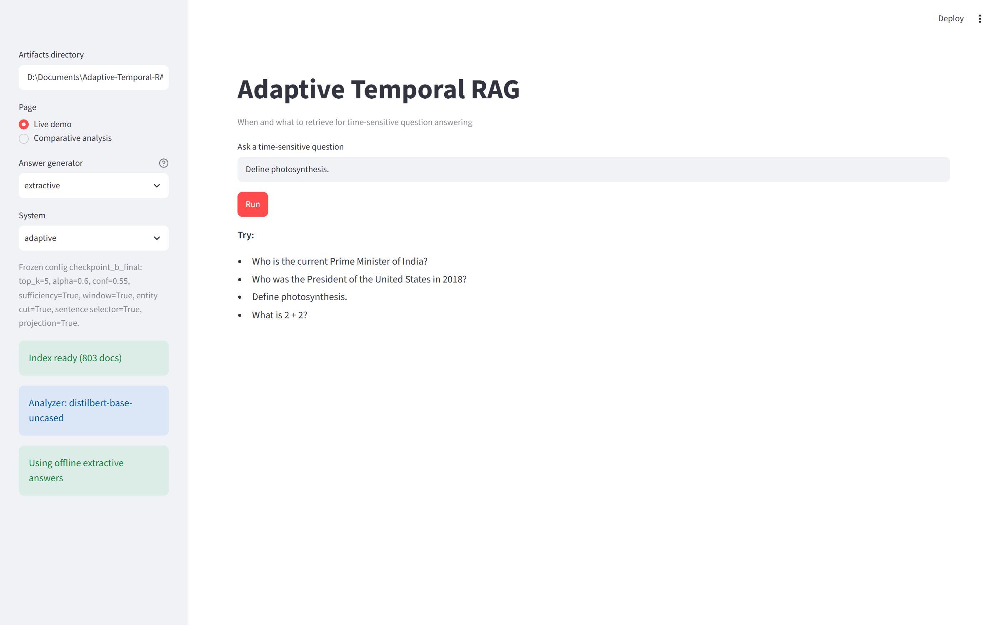
*Figure 6.1: Streamlit live demonstration, home view and sidebar, frozen configuration checkpoint_b_final*

Figure 6.1 is the home state before a question is submitted. `load_eval_config` reads `configs/final.yaml`. The sidebar names `checkpoint_b_final` and shows `top_k` 5, $\alpha = 0.6$ inside `combine_scores`, confidence 0.55, and the sufficiency loop, adaptive window, entity cut, sentence selector, and answer projection all enabled. `load_stack` reports an `EmbeddingIndex` of 803 documents and the analyser `distilbert-base-uncased`. The generator is the offline `extractive` backend (`extractive_answer`), so Groq, OpenRouter, and OpenCode are not called. The suggested questions are the three probes below. This screen is the configuration checkpoint, not a row of the 77-question test.

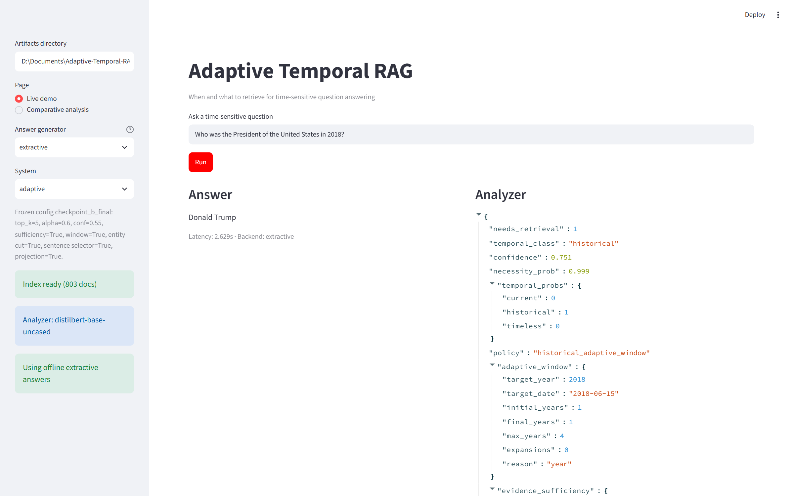
*Figure 6.2: Historical query on the Streamlit demonstration, United States President in 2018*

Figure 6.2 submits “Who was the President of the United States in 2018?” to `AdaptiveTemporalRAGPipeline.run`. `QueryAnalyzerService.predict` returns `needs_retrieval` 1, class historical, confidence 0.751, and `necessity_prob` 0.999. Confidence is above 0.55, so `resolve_adaptive_routing` selects policy `historical_adaptive_window`. `infer_adaptive_window` reads a bare year: target year 2018, target date `2018-06-15` (the 15 June midpoint), initial width 1 year, maximum 4, expansions 0, reason year. A passage already lay inside the initial band, so the growth $h \leftarrow \min(h_{\max}, 1.5h + 0.25)$ did not run. The answer is Donald Trump. Latency on this CPU call is 2.629 s.

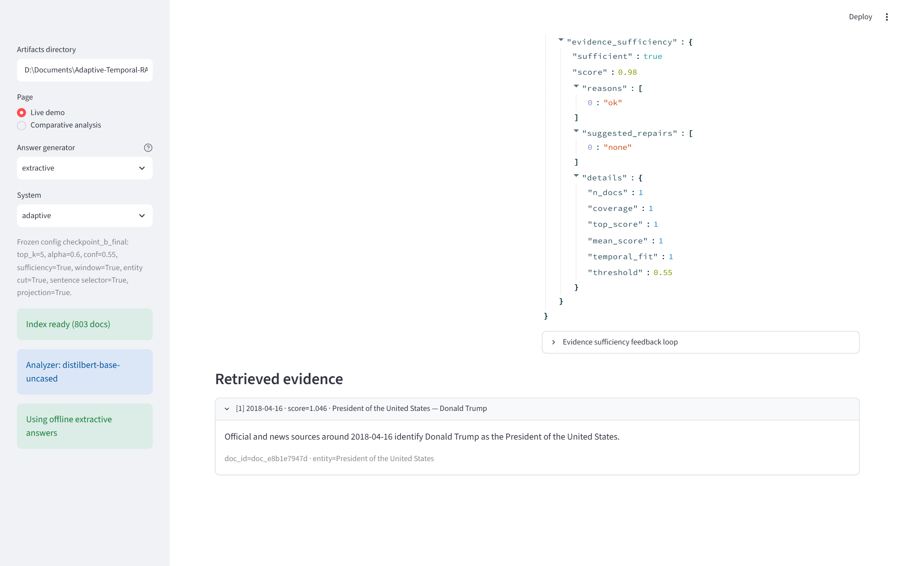
*Figure 6.3: Evidence and sufficiency for the 2018 presidential query*

Figure 6.3 is the evidence pane of the same call, from `assess_evidence_sufficiency`. Sufficient is true, score 0.98, threshold 0.55, `n_docs` 1, and coverage, top score, mean score, and temporal fit are displayed as 1. The score $S = 0.35C + 0.25\min(1,s_1) + 0.15\overline{s} + 0.15T + 0.10\min(1, b_1/0.25)$ is accepted at $S \ge 0.55$, which is why expansions stayed at 0. The passage is dated 2018-04-16, titled “President of the United States — Donald Trump”, `doc_id` `doc_e8b1e7947d`, displayed score 1.046. The score exceeds 1 because the MiniLM logit in the 0.35/0.65 blend is raw. The passage date falls inside the $\pm 1$ year window, and the extractive reader returns the office holder.

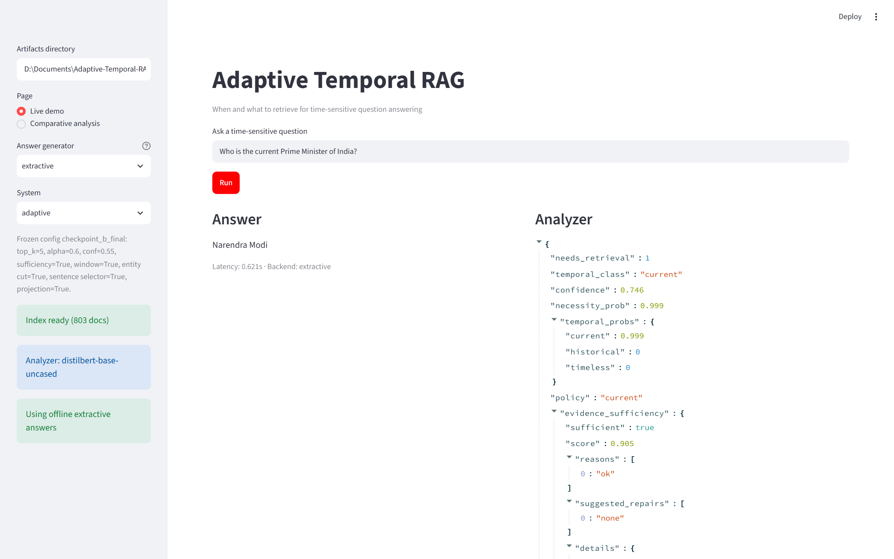
*Figure 6.4: Current query on the Streamlit demonstration, Prime Minister of India*

Figure 6.4 submits “Who is the current Prime Minister of India?”. The class is current, the current-class probability is 0.999, confidence is 0.746, and the policy is `current`. The answer is Narendra Modi. Sufficiency is 0.905 and latency is 0.621 s. Current mode does not open a year window. `rerank` keeps the strongest entity overlap and orders by timestamp, with recency $g_{\mathrm{cur}} = \max(0, 1 - \max(r - \tau, 0)/3650)$ and $r$ fixed at 1 October 2025. The 0.621 s figure is this probe. It is not the TimeQA Adaptive mean of 8.736 s. Confidence 0.746 is again the untrained blend.

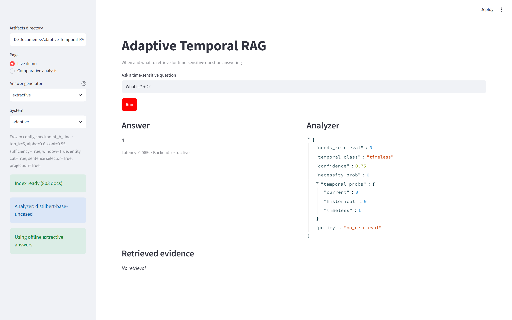
*Figure 6.5: Timeless arithmetic query taking the no-retrieval path*

Figure 6.5 submits “What is 2 + 2?”. The analyser reports `needs_retrieval` 0, class timeless, and confidence 0.75. `is_trivial_query` matches the marker `2 + 2`. `resolve_adaptive_routing` skips only when necessity is 0 and the whitelist hits. The policy is `no_retrieval`, the pane prints “No retrieval”, `_trivial_answer` returns 4, and latency is 0.065 s. A necessity of 0 on any other string still retrieves. On the templated test the retrieval rate 0.870 is 67 of 77 questions; the other 10 are this list. On the held-out file and on TimeQA the rate is 1.000, so this path does not fire there.

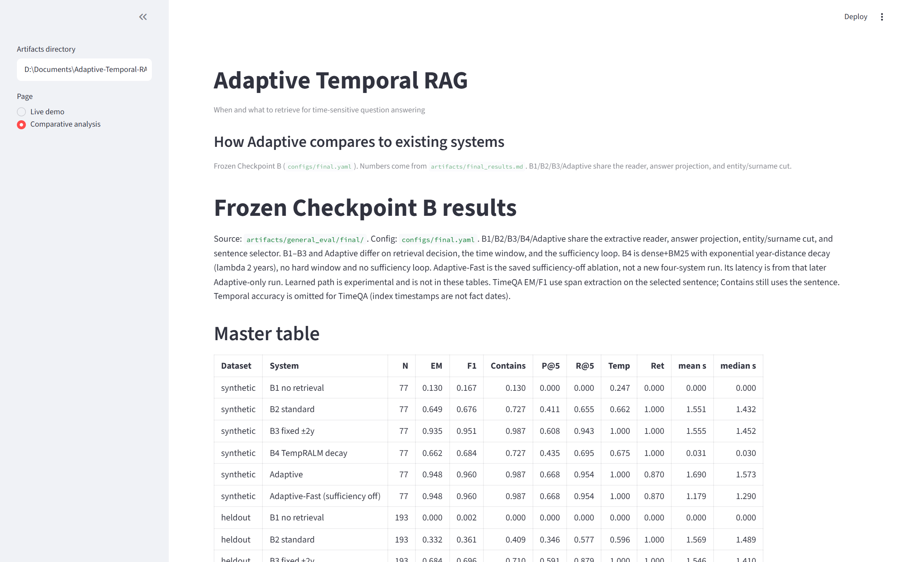
*Figure 6.6: Comparative-analysis page rendering the frozen master table*

Figure 6.6 is `render_comparative_analysis`. It renders `artifacts/final_results.md`, which `scripts/compile_final_results.py` built from `artifacts/general_eval/final/`. Each dataset block has six rows: B1, B2, B3, B4, Adaptive, and Adaptive-Fast. The blocks are the templated test ($n = 77$), the six-entity held-out file ($n = 193$), and TimeQA ($n = 500$). Temporal accuracy is blank on TimeQA because those index timestamps are not fact dates. The page is a view of the artefact. Section 6.2 reprints the cells.

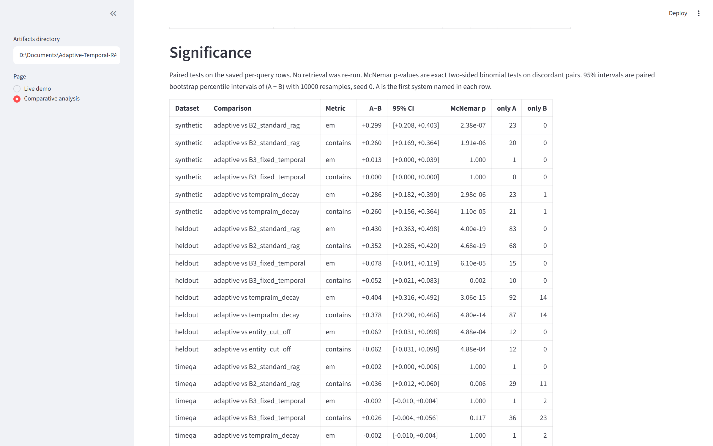
*Figure 6.7: Paired significance table inside the Streamlit application*

Figure 6.7 is the significance block, sourced from `artifacts/significance.json` and computed by `scripts/compute_significance.py`. Each row is Adaptive minus a named system. Intervals are 10,000-resample bootstraps, seed 0, and each $p$-value is an exact two-sided test on the discordant counts. The screen shows the templated comparison with B3 as a tie ($p = 1.000$), the held-out exact-match comparison with B3 as $+0.078$ $[+0.041, +0.119]$, $p = 6.10\times 10^{-5}$ (15 questions only Adaptive), and the TimeQA containment comparison with B3 as $+0.026$ $[-0.004, +0.056]$, $p = 0.117$. Table 6.3 is the full 28-row grid.

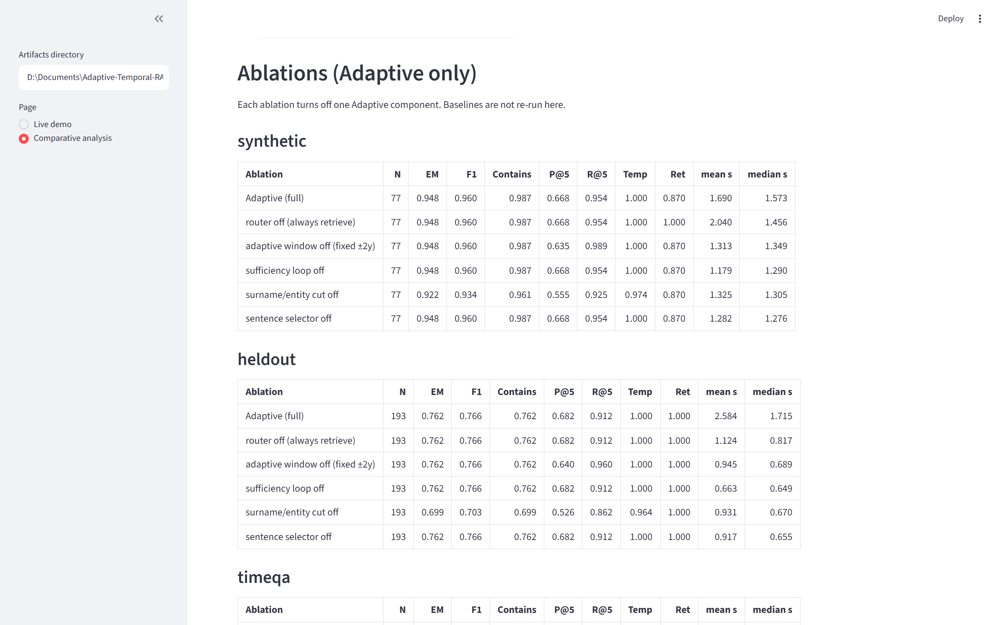
*Figure 6.8: Ablation tables inside the Streamlit application*

Figure 6.8 renders the ablation block. `EvalConfig.apply_ablation` flips one flag: `router_off`, `window_off`, `sufficiency_off`, `entity_cut_off`, or `sentence_selector_off`. Baselines are not re-run. The “Adaptive (full)” rows copy the four-system means. Ablation latencies are a later Adaptive-only run and are not paired with the B2 or B3 means. On the generated files, router, window, sufficiency, and sentence selector leave exact match and containment unchanged. The entity cut moves those answers. On TimeQA the sentence selector is the large drop. Table 6.2 holds the cells.

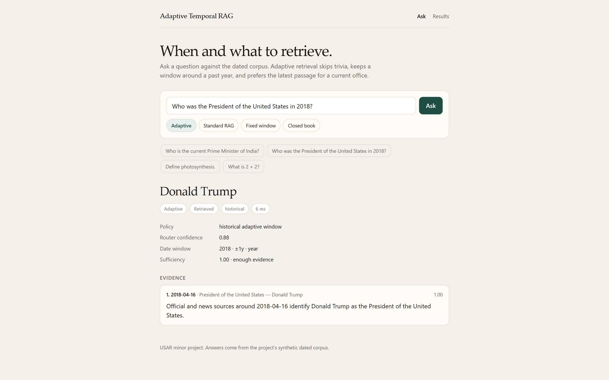
*Figure 6.9: Local Next.js interface, 2018 presidential query*

Figure 6.9 is the local Next.js port. The 2018 presidency again returns Donald Trump, under the historical adaptive window, with the date window shown as 2018 $\pm 1$ year and sufficiency 1.00. The printed confidence is 0.88, the constant `web/lib/engine.ts` assigns to a historical question, not $\gamma$ from DistilBERT. Retrieval is lexical overlap on the 803-document corpus. Agreement with Figure 6.2 on this one answer does not transfer Table 6.1 onto the port. `scripts/evaluate.py` did not score this interface.

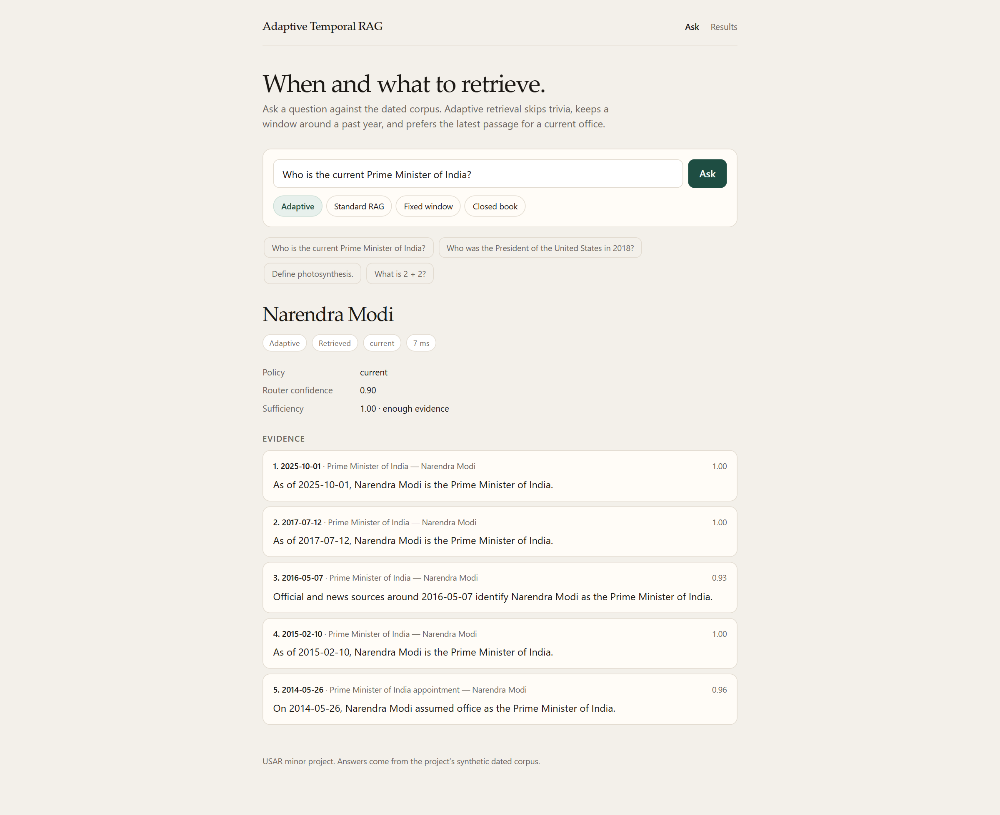
*Figure 6.10: Hosted Vercel Ask tab, current Prime Minister of India*

Figure 6.10 is the hosted Ask tab. “Who is the current Prime Minister of India?” returns Narendra Modi, policy `current`, displayed confidence 0.90 (the port’s current-class constant). Five dated passages run from 2025-10-01 to 2014-05-26. The newest stamp is the frozen reference date, which the port stores as `REFERENCE`. Current policy keeps a recency order, so a 2014 passage can sit beside a passage stamped on 1 October 2025. The corpus does not update when the wall clock moves. The page is a public view of the same 803 documents, not a live web search.

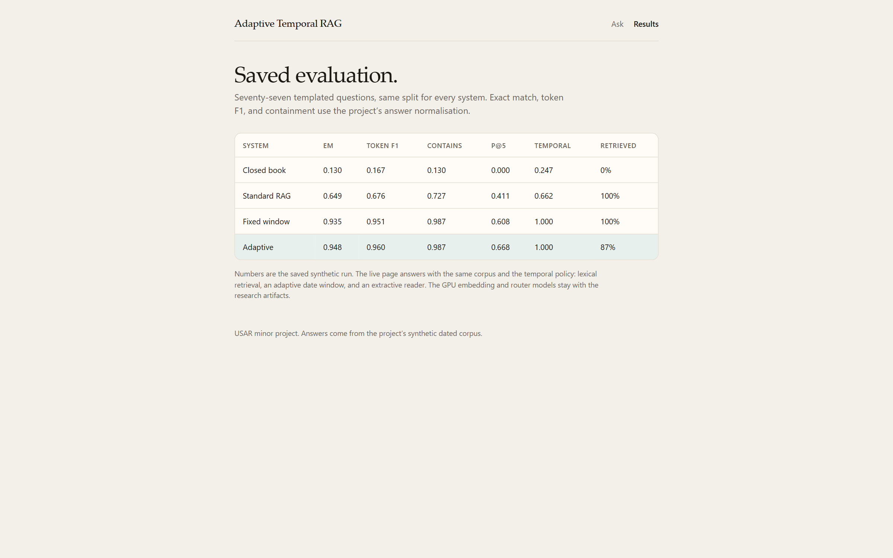
*Figure 6.11: Hosted Vercel Results tab, saved 77-question synthetic table*

Figure 6.11 is the Results tab (`web/app/results/page.tsx`), a saved slice of the 77-question file. Exact match is 0.130, 0.649, 0.935, and 0.948 for the rows labelled closed book, standard RAG, fixed window, and Adaptive. Retrieval of 87% is the rate 0.870. “Closed book” is B1: the extractive reader with an empty document list, plus the hardcoded trivia replies, which is why B1 still scores 0.130 on the templated file and 0.000 on the held-out file. B4, Adaptive-Fast, the held-out file, and TimeQA are not on this tab.

### 6.1.1 Verification of the demonstration build

`scripts/e2e_smoke_test.py` reported PASS = 72, FAIL = 0, and WARN = 2. The warnings are missing OpenRouter and OpenCode keys, so `load_provider_chain` falls through to the extractive reader, which is the frozen backend (`generator: extractive`). The local Streamlit process answered HTTP 200. The Janet Frame probe, “Janet Frame received which award in 1990?”, finished in 8.184 s after the guardrails (at most three retrieves, a 60 s timeout, and the dateutil cap on long passages). The same probe had taken 20,974.8 s before those guardrails. The smoke test checks that the tree runs. It does not replace Tables 6.1–6.3.

## 6.2 Graphs and Tables

Answer strings are normalised as in SQuAD: lower case, punctuation removed, whitespace collapsed (Rajpurkar et al., 2018). Exact match is 1 when the normalised strings are equal. Token F1 is the harmonic mean of token precision and token recall, taking the best gold string when several are listed. Containment is 1 when the gold string occurs in the prediction or the prediction occurs in the gold string. On TimeQA, exact match and token F1 use a span taken from the selected sentence (`span_extract_timeqa: true`, through `extract_factoid_span`), while containment still scores the sentence. Precision and recall at 5 use the stored gold document identifiers. On the templated data those identifiers are up to three passages of the named entity, nearest the asked date. On TimeQA a gold identifier is a chunk that contains the answer string, at most eight. Temporal accuracy reads only the timestamp of the top document. For a current question that timestamp must fall within three years of 1 October 2025. For a historical question its year must fall within two of a year written in the question. The metric does not read the answer. It is undefined on TimeQA and is left blank. For B3 the metric largely restates the filter: any document that survives a $\pm 2$ year cut has a stored year inside the band the metric checks.

**Table 6.1:** Frozen Checkpoint B master comparison from `artifacts/final_results.md`. B1–B3 and Adaptive share the extractive reader, answer projection, entity or surname cut, and sentence selector. B4 is dense retrieval union BM25 with exponential year decay and no cross-encoder. Adaptive-Fast is the saved sufficiency-off ablation; its latency is from that later run. Temporal accuracy is undefined on TimeQA.

| Dataset | System | N | EM | F1 | Contains | P@5 | R@5 | Temp | Ret | mean s | median s |
|---|---|---:|---:|---:|---:|---:|---:|---:|---:|---:|---:|
| synthetic | B1 no retrieval | 77 | 0.130 | 0.167 | 0.130 | 0.000 | 0.000 | 0.247 | 0.000 | 0.000 | 0.000 |
| synthetic | B2 standard | 77 | 0.649 | 0.676 | 0.727 | 0.411 | 0.655 | 0.662 | 1.000 | 1.551 | 1.432 |
| synthetic | B3 fixed ±2y | 77 | 0.935 | 0.951 | 0.987 | 0.608 | 0.943 | 1.000 | 1.000 | 1.555 | 1.452 |
| synthetic | B4 TempRALM decay | 77 | 0.662 | 0.684 | 0.727 | 0.435 | 0.695 | 0.675 | 1.000 | 0.031 | 0.030 |
| synthetic | Adaptive | 77 | 0.948 | 0.960 | 0.987 | 0.668 | 0.954 | 1.000 | 0.870 | 1.690 | 1.573 |
| synthetic | Adaptive-Fast (sufficiency off) | 77 | 0.948 | 0.960 | 0.987 | 0.668 | 0.954 | 1.000 | 0.870 | 1.179 | 1.290 |
| heldout | B1 no retrieval | 193 | 0.000 | 0.002 | 0.000 | 0.000 | 0.000 | 0.000 | 0.000 | 0.000 | 0.000 |
| heldout | B2 standard | 193 | 0.332 | 0.361 | 0.409 | 0.346 | 0.577 | 0.596 | 1.000 | 1.569 | 1.489 |
| heldout | B3 fixed ±2y | 193 | 0.684 | 0.696 | 0.710 | 0.591 | 0.879 | 1.000 | 1.000 | 1.546 | 1.410 |
| heldout | B4 TempRALM decay | 193 | 0.358 | 0.369 | 0.383 | 0.383 | 0.639 | 0.497 | 1.000 | 0.040 | 0.038 |
| heldout | Adaptive | 193 | 0.762 | 0.766 | 0.762 | 0.682 | 0.912 | 1.000 | 1.000 | 2.584 | 1.715 |
| heldout | Adaptive-Fast (sufficiency off) | 193 | 0.762 | 0.766 | 0.762 | 0.682 | 0.912 | 1.000 | 1.000 | 0.663 | 0.649 |
| timeqa | B1 no retrieval | 500 | 0.000 | 0.013 | 0.014 | 0.000 | 0.000 | — | 0.000 | 0.000 | 0.000 |
| timeqa | B2 standard | 500 | 0.006 | 0.077 | 0.260 | 0.235 | 0.468 | — | 1.000 | 6.056 | 6.118 |
| timeqa | B3 fixed ±2y | 500 | 0.010 | 0.089 | 0.270 | 0.237 | 0.392 | — | 1.000 | 6.074 | 6.116 |
| timeqa | B4 TempRALM decay | 500 | 0.010 | 0.084 | 0.234 | 0.174 | 0.358 | — | 1.000 | 0.062 | 0.059 |
| timeqa | Adaptive | 500 | 0.008 | 0.088 | 0.296 | 0.241 | 0.488 | — | 1.000 | 8.736 | 6.492 |
| timeqa | Adaptive-Fast (sufficiency off) | 500 | 0.008 | 0.088 | 0.298 | 0.243 | 0.491 | — | 1.000 | 3.184 | 3.160 |

**Table 6.2:** Single-component ablations of Adaptive. Each row turns off one flag in `EvalConfig.apply_ablation`. The three “Adaptive (full)” rows are the Table 6.1 Adaptive scores, repeated as the reference. Ablation latencies are from a later Adaptive-only run and are not matched to the four-system means.

| Dataset | Ablation | N | EM | F1 | Contains | P@5 | R@5 | Temp | Ret | mean s | median s |
|---|---|---:|---:|---:|---:|---:|---:|---:|---:|---:|---:|
| synthetic | Adaptive (full) | 77 | 0.948 | 0.960 | 0.987 | 0.668 | 0.954 | 1.000 | 0.870 | 1.690 | 1.573 |
| synthetic | router off (always retrieve) | 77 | 0.948 | 0.960 | 0.987 | 0.668 | 0.954 | 1.000 | 1.000 | 2.040 | 1.456 |
| synthetic | adaptive window off (fixed ±2y) | 77 | 0.948 | 0.960 | 0.987 | 0.635 | 0.989 | 1.000 | 0.870 | 1.313 | 1.349 |
| synthetic | sufficiency loop off | 77 | 0.948 | 0.960 | 0.987 | 0.668 | 0.954 | 1.000 | 0.870 | 1.179 | 1.290 |
| synthetic | surname/entity cut off | 77 | 0.922 | 0.934 | 0.961 | 0.555 | 0.925 | 0.974 | 0.870 | 1.325 | 1.305 |
| synthetic | sentence selector off | 77 | 0.948 | 0.960 | 0.987 | 0.668 | 0.954 | 1.000 | 0.870 | 1.282 | 1.276 |
| heldout | Adaptive (full) | 193 | 0.762 | 0.766 | 0.762 | 0.682 | 0.912 | 1.000 | 1.000 | 2.584 | 1.715 |
| heldout | router off (always retrieve) | 193 | 0.762 | 0.766 | 0.762 | 0.682 | 0.912 | 1.000 | 1.000 | 1.124 | 0.817 |
| heldout | adaptive window off (fixed ±2y) | 193 | 0.762 | 0.766 | 0.762 | 0.640 | 0.960 | 1.000 | 1.000 | 0.945 | 0.689 |
| heldout | sufficiency loop off | 193 | 0.762 | 0.766 | 0.762 | 0.682 | 0.912 | 1.000 | 1.000 | 0.663 | 0.649 |
| heldout | surname/entity cut off | 193 | 0.699 | 0.703 | 0.699 | 0.526 | 0.862 | 0.964 | 1.000 | 0.931 | 0.670 |
| heldout | sentence selector off | 193 | 0.762 | 0.766 | 0.762 | 0.682 | 0.912 | 1.000 | 1.000 | 0.917 | 0.655 |
| timeqa | Adaptive (full) | 500 | 0.008 | 0.088 | 0.296 | 0.241 | 0.488 | — | 1.000 | 8.736 | 6.492 |
| timeqa | router off (always retrieve) | 500 | 0.008 | 0.088 | 0.296 | 0.241 | 0.488 | — | 1.000 | 4.446 | 3.185 |
| timeqa | adaptive window off (fixed ±2y) | 500 | 0.010 | 0.089 | 0.272 | 0.236 | 0.397 | — | 1.000 | 3.333 | 3.141 |
| timeqa | sufficiency loop off | 500 | 0.008 | 0.088 | 0.298 | 0.243 | 0.491 | — | 1.000 | 3.184 | 3.160 |
| timeqa | surname/entity cut off | 500 | 0.006 | 0.076 | 0.252 | 0.167 | 0.338 | — | 1.000 | 6.650 | 5.430 |
| timeqa | sentence selector off | 500 | 0.002 | 0.048 | 0.168 | 0.241 | 0.488 | — | 1.000 | 6.551 | 4.300 |

**Table 6.3:** Paired tests from `artifacts/significance.json`. A is Adaptive. The interval is a paired bootstrap of A minus B, 10,000 resamples, seed 0. McNemar $p$ is an exact two-sided test on discordant questions. “only A” and “only B” are the discordant counts.

| Dataset | Comparison | Metric | A−B | 95% CI | McNemar p | only A | only B |
|---|---|---|---:|---|---:|---:|---:|
| synthetic | adaptive vs B2_standard_rag | em | +0.299 | [+0.208, +0.403] | 2.38e-07 | 23 | 0 |
| synthetic | adaptive vs B2_standard_rag | contains | +0.260 | [+0.169, +0.364] | 1.91e-06 | 20 | 0 |
| synthetic | adaptive vs B3_fixed_temporal | em | +0.013 | [+0.000, +0.039] | 1.000 | 1 | 0 |
| synthetic | adaptive vs B3_fixed_temporal | contains | +0.000 | [+0.000, +0.000] | 1.000 | 0 | 0 |
| synthetic | adaptive vs tempralm_decay | em | +0.286 | [+0.182, +0.390] | 2.98e-06 | 23 | 1 |
| synthetic | adaptive vs tempralm_decay | contains | +0.260 | [+0.156, +0.364] | 1.10e-05 | 21 | 1 |
| heldout | adaptive vs B2_standard_rag | em | +0.430 | [+0.363, +0.498] | 4.00e-19 | 83 | 0 |
| heldout | adaptive vs B2_standard_rag | contains | +0.352 | [+0.285, +0.420] | 4.68e-19 | 68 | 0 |
| heldout | adaptive vs B3_fixed_temporal | em | +0.078 | [+0.041, +0.119] | 6.10e-05 | 15 | 0 |
| heldout | adaptive vs B3_fixed_temporal | contains | +0.052 | [+0.021, +0.083] | 0.002 | 10 | 0 |
| heldout | adaptive vs tempralm_decay | em | +0.404 | [+0.316, +0.492] | 3.06e-15 | 92 | 14 |
| heldout | adaptive vs tempralm_decay | contains | +0.378 | [+0.290, +0.466] | 4.80e-14 | 87 | 14 |
| heldout | adaptive vs entity_cut_off | em | +0.062 | [+0.031, +0.098] | 4.88e-04 | 12 | 0 |
| heldout | adaptive vs entity_cut_off | contains | +0.062 | [+0.031, +0.098] | 4.88e-04 | 12 | 0 |
| timeqa | adaptive vs B2_standard_rag | em | +0.002 | [+0.000, +0.006] | 1.000 | 1 | 0 |
| timeqa | adaptive vs B2_standard_rag | contains | +0.036 | [+0.012, +0.060] | 0.006 | 29 | 11 |
| timeqa | adaptive vs B3_fixed_temporal | em | -0.002 | [-0.010, +0.004] | 1.000 | 1 | 2 |
| timeqa | adaptive vs B3_fixed_temporal | contains | +0.026 | [-0.004, +0.056] | 0.117 | 36 | 23 |
| timeqa | adaptive vs tempralm_decay | em | -0.002 | [-0.010, +0.004] | 1.000 | 1 | 2 |
| timeqa | adaptive vs tempralm_decay | contains | +0.062 | [+0.028, +0.096] | 5.39e-04 | 54 | 23 |
| timeqa | adaptive vs sentence_selector_off | em | +0.006 | [+0.000, +0.014] | 0.250 | 3 | 0 |
| timeqa | adaptive vs sentence_selector_off | contains | +0.128 | [+0.084, +0.172] | 2.89e-08 | 99 | 35 |
| timeqa | adaptive vs entity_cut_off | em | +0.002 | [+0.000, +0.006] | 1.000 | 1 | 0 |
| timeqa | adaptive vs entity_cut_off | contains | +0.044 | [+0.024, +0.066] | 1.13e-04 | 27 | 5 |
| timeqa | adaptive vs window_off | em | -0.002 | [-0.010, +0.004] | 1.000 | 1 | 2 |
| timeqa | adaptive vs window_off | contains | +0.024 | [-0.004, +0.052] | 0.134 | 33 | 21 |
| timeqa | adaptive vs sufficiency_off | em | +0.000 | [+0.000, +0.000] | 1.000 | 0 | 0 |
| timeqa | adaptive vs sufficiency_off | contains | -0.002 | [-0.006, +0.000] | 1.000 | 0 | 1 |

**Table 6.4:** Evaluation wall-clock time from `artifacts/eval_timings.json`, plus the Janet Frame probe before and after the Checkpoint B guardrails. The four-system block is `scripts/evaluate.py --final --config configs/final.yaml`. B4 was timed separately. Ablations were timed separately.

| Run | Wall-clock (s) | What the clock covers |
|---|---:|---|
| Synthetic, four systems | 407.2 | B1, B2, B3, Adaptive on 77 questions |
| Held-out, four systems | 1,125.4 | The same four systems on 193 questions |
| TimeQA, four systems | 10,466.8 | The same four systems on 500 questions |
| Ablations | 13,767.5 | Five Adaptive ablations across the three files |
| B4 TempRALM decay | 75.0 | Dense union BM25 decay on all three files, no cross-encoder |
| Janet Frame probe, before guardrails | 20,974.8 | “Janet Frame received which award in 1990?” |
| Janet Frame probe, after guardrails | 8.184 | At most three retrieves, 60 s timeout, long-passage date cap |

**Table 6.5:** Leak-free 100,000-row router dataset (`data/router_large/stats.json`, seed 42, labelling reference year 2026) and the Kaggle training specification for `microsoft/deberta-v3-base`. The training run is queued or in progress. No accuracy, macro-F1, or expected calibration error is available, and none is reported.

| Item | Value |
|---|---|
| Rows (train / val / test) | 100,000 (79,982 / 10,077 / 9,941) |
| Temporal class (current / historical / timeless) | 1,729 / 49,135 / 49,136 |
| needs_retrieval (1 / 0) | 50,864 / 49,136 |
| Synthetic rows after balancing | 0 (synthetic fraction 0.0) |
| Residual leaks | 0 |
| Sources retained | TriviaQA 15,827; NQ-open 26,701; SQuAD v2 22,858; CommonsenseQA 2,535; SciQ 3,174; ARC 1,906; OpenBookQA 1,407; QASC 2,013; TimeQA 16,880; SituatedQA 6,699 |
| Funnel | Labelled 313,314; after deduplication 310,977 (2,337 dropped); leak drops 10,647 template, 1,227 entity, 87 exact; after leak filter 299,016 |
| Leakage index | 6,117 forbidden questions, 226 forbidden entities, 335 forbidden templates; 6,075 official TimeQA test questions added |
| Class availability before balance | Current 1,729 (all kept); historical 89,620 available, 49,135 kept; timeless 207,667 available, 49,136 kept |
| Labelling rule | A written year is historical when the latest year is before reference year minus one, otherwise current. TimeQA defaults to historical. General QA with no time cue is timeless and needs_retrieval 0. Current and historical labels use needs_retrieval 1 |
| Model | microsoft/deberta-v3-base |
| Precision and device | fp32, single cuda:0, DataParallel off; Kaggle GPU T4 ×2, one device used |
| Optimisation | 5 epochs, patience 2, learning rate 2e-05, batch size 16, maximum length 128 |
| Schedule | 4,999 steps per epoch, checkpoint every 500 steps |
| Notebook | atrag-router-large-100k-training (private) |
| Status | Queued or in progress; no test metrics |

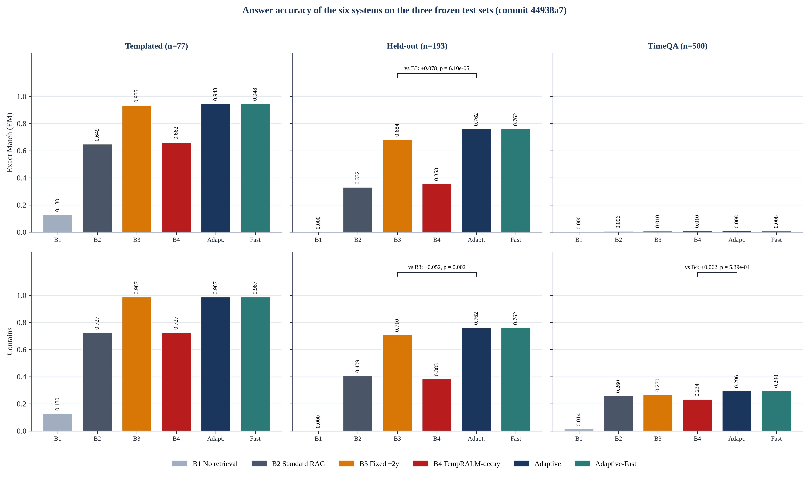
*Figure 6.12: Exact match and containment for six systems on three datasets*

Figure 6.12 plots exact match and containment from Table 6.1. On the templated test Adaptive and B3 tie on containment at 0.987 (76 of 77) and differ by one exact match (0.948 against 0.935). B2 and B4 sit together (exact match 0.649 and 0.662, containment 0.727). B1 scores 0.130 from the hardcoded trivia replies. On the held-out file the windowed systems separate: Adaptive 0.762 exact match, B3 0.684, B4 0.358, B2 0.332, B1 0.000. On TimeQA every exact-match bar lies between 0.000 and 0.010 while containment lies between 0.234 and 0.298. Adaptive-Fast copies Adaptive on the generated files and is 0.002 containment higher on TimeQA. Exact match on TimeQA does not rank the systems.

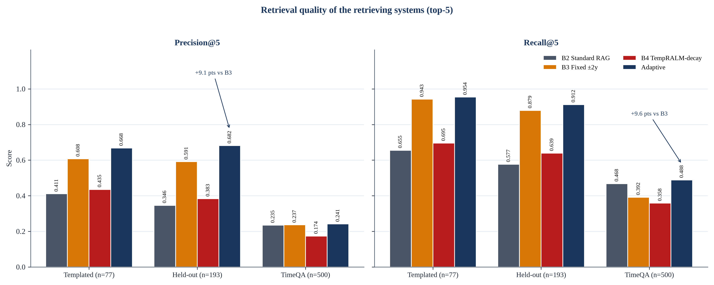
*Figure 6.13: Precision at 5 and recall at 5*

Figure 6.13 plots precision and recall at 5. No paired test on these columns is stored in `artifacts/significance.json`. On the templated test Adaptive is 0.668 and 0.954, against 0.608 and 0.943 for B3 and 0.411 and 0.655 for B2. The held-out file keeps that order: Adaptive 0.682 and 0.912, B3 0.591 and 0.879, B4 0.383 and 0.639, B2 0.346 and 0.577. On TimeQA precision is almost flat for B2, B3, and Adaptive (0.235, 0.237, 0.241), while B3 recall falls to 0.392, below B2 at 0.468, and Adaptive recall rises to 0.488. B4 recall is 0.358 with precision 0.174. The B3 drop is the birth-year and 1970-01-01 timestamp problem: the hard cut uses the index date. Adaptive’s window reads dates from the passage (`extract_dates`, `parse_temporal`). B1 is zero on both axes because it retrieves nothing.

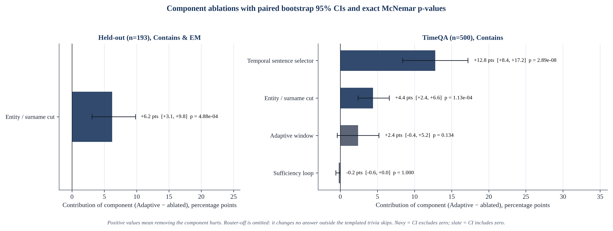
*Figure 6.14: Ablation deltas with 95% paired bootstrap intervals*

Figure 6.14 plots Adaptive minus the system with one component removed. Three intervals exclude zero. Held-out entity cut: $+0.062$ exact match and containment, $[+0.031, +0.098]$, $p = 4.88\times 10^{-4}$, 12 questions only the full system. TimeQA sentence selector: $+0.128$ containment, $[+0.084, +0.172]$, $p = 2.89\times 10^{-8}$, 99 and 35. TimeQA entity cut: $+0.044$ containment, $[+0.024, +0.066]$, $p = 1.13\times 10^{-4}$. Two intervals do not support a gain. The TimeQA window ablation is $+0.024$, $[-0.004, +0.052]$, $p = 0.134$. The TimeQA sufficiency ablation is $-0.002$, $[-0.006, +0.000]$, $p = 1.000$, one extra contained answer for the system without the loop. Subject filtering and, on TimeQA, sentence selection move answers. The repair loop does not.

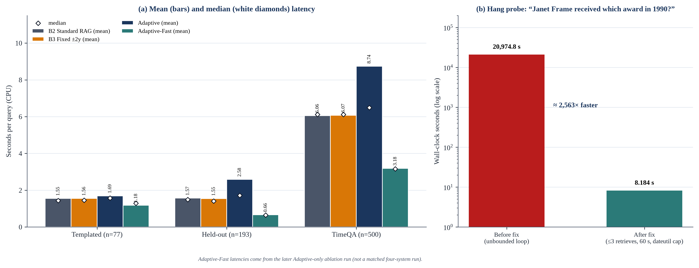
*Figure 6.15: Latency by system and the Janet Frame hang fix*

Figure 6.15 plots mean and median latency beside the hang fix. On the templated file the cross-encoder systems cluster: B2 1.551 s, B3 1.555 s, Adaptive 1.690 s. Skipping ten whitelist questions does not make Adaptive faster than B3. On the held-out file the Adaptive mean is 2.584 s against a median of 1.715 s. Adaptive-Fast, from the later run, reports 0.663 s mean with the same answers. On TimeQA the Adaptive mean is 8.736 s and the median 6.492 s; Adaptive-Fast falls to 3.184 s mean and 3.160 s median. Those clocks are different runs. The direction is that removing the loop removes the slow tail. B4 means of 0.031 s, 0.040 s, and 0.062 s, and the 75.0 s wall clock, omit the cross-encoder. The Janet Frame probe fell from 20,974.8 s to 8.184 s once retrieves were capped at three and the timeout at 60 s.

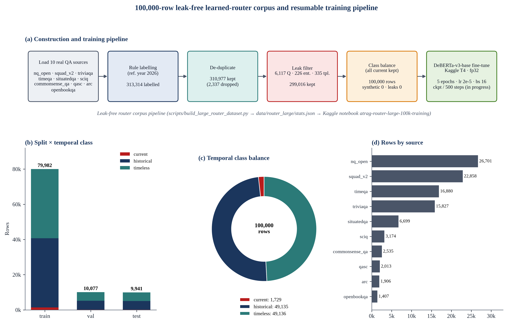
*Figure 6.16: The 100,000-row leak-free router dataset and the training pipeline*

Figure 6.16 summarises Table 6.5. `label_question`, `LeakageIndex`, and `select_balanced_rows` labelled public questions against reference year 2026, which is not the 1 October 2025 examination clock. After labelling, 313,314 rows remained; deduplication dropped 2,337; the leak filter dropped 10,647 template collisions, 1,227 entity collisions, and 87 exact collisions, leaving 299,016. Balancing kept all 1,729 current rows and down-sampled historical and timeless rows to 49,135 and 49,136. Synthetic rows selected are zero and residual leaks are zero. The drawing’s training block is `microsoft/deberta-v3-base`, fp32 on one Kaggle T4, five epochs, patience 2, learning rate $2\times 10^{-5}$, batch 16, length 128, 4,999 steps per epoch. The run is queued or in progress. `score_predictions` and `expected_calibration_error` have not been run, so no macro-F1 or calibration is stated.

## 6.3 Comparative Analysis

The frozen comparison separates three controls: whether to retrieve (the router and the whitelist), which dates to keep (the window, against a fixed band and against smooth decay), and when to stop (the sufficiency loop). The reader, the projection, and the entity cut are shared, so a surviving gap in Table 6.1 is a gap in one of those controls or in a component an ablation removes.

### 6.3.1 Adaptive versus standard RAG

B2 (`StandardRAGPipeline`) always retrieves and ranks by the 0.35/0.65 blend, with no date window and no sufficiency loop (Lewis et al., 2020; Karpukhin et al., 2020). On the templated test exact match differs by $+0.299$, $[+0.208, +0.403]$, $p = 2.38\times 10^{-7}$ (23 questions only Adaptive, none only B2), and containment by $+0.260$, $[+0.169, +0.364]$, $p = 1.91\times 10^{-6}$ (20 and 0). Precision at 5 moves from 0.411 to 0.668 and recall at 5 from 0.655 to 0.954. Neighbours of a title such as “President of the United States” include other years of the same office, and the window removes them before the reader runs.

On the held-out file the exact-match gap is $+0.430$, $[+0.363, +0.498]$, $p = 4.00\times 10^{-19}$ (83 and 0), and containment is $+0.352$, $[+0.285, +0.420]$, $p = 4.68\times 10^{-19}$ (68 and 0). B2 exact match is 0.332 against 0.762. B1 is 0.000, so that 0.762 is retrieval plus the shared reader. The six timelines still contain many years, and unconstrained retrieval has more wrong-year neighbours than on the short templated test. On TimeQA the exact-match difference is $+0.002$, $p = 1.000$. Containment is $+0.036$, $[+0.012, +0.060]$, $p = 0.006$ (29 and 11), an 18-question net gain out of 500. Recall at 5 is 0.488 against 0.468. Standard retrieval is the comparison a date policy is supposed to win. On the generated files it does. On TimeQA the win is small, and exact match does not move.

### 6.3.2 Adaptive versus the fixed window

B3 (`FixedTemporalRAGPipeline`) keeps candidates whose stored year lies within $\pm 2$ when a year is present, falls back to the unfiltered pool if that set is empty, and calls `rerank` with `prefer_time` left false. It has no sufficiency loop.

On the templated test the paired test calls the gap a tie. Containment is 0.987 for both, $p = 1.000$, with zero discordant questions. Exact match is 0.948 against 0.935, one question, $[+0.000, +0.039]$, $p = 1.000$. Precision at 5 still moves from 0.608 to 0.668, and the shared reader turns the two sets into the same containment. A $\pm 2$ year band already covers a bare-year fact whose passage sits on the fact date. Temporal accuracy is 1.000 for both, and for B3 that figure restates the filter.

On the held-out file the pipeline comparison is significant: exact match $+0.078$, $[+0.041, +0.119]$, $p = 6.10\times 10^{-5}$ (15 and 0), containment $+0.052$, $[+0.021, +0.083]$, $p = 0.002$ (10 and 0). That contrast is not the window-off ablation. Setting `enable_adaptive_window` false still calls `rerank` with `prefer_time=True`. Exact match stays 0.762, while precision at 5 falls from 0.682 to 0.640 and recall at 5 rises from 0.912 to 0.960. B3’s precision at 5 is 0.591, so the ablation does not reproduce B3. Adaptive beats this fixed-window pipeline. Replacing only the width, with time-first ranking left on, does not move the answer strings. The flag that does is the entity cut (Section 6.3.4).

On TimeQA, B3 is a weak control. Containment is $+0.026$, $[-0.004, +0.056]$, $p = 0.117$ (36 and 23). The interval includes zero. Exact match is $-0.002$, $p = 1.000$. Recall at 5 falls from 0.468 for B2 to 0.392 because stored timestamps are often a birth year or 1970-01-01. The window-off ablation lands on the same pattern (containment 0.272, recall at 5 of 0.397, exact match 0.010), and its containment interval also includes zero ($p = 0.134$).

### 6.3.3 Hard window and cross-encoder versus smooth exponential decay

B4 takes one idea from TempRALM, not the published system (Gade & Jetcheva, 2024). `TempRALMDecayPipeline` unions dense and BM25 candidates, blends the min–max scores equally, and multiplies by $\exp(-|\Delta y|/2)$. There is no hard cutoff, no sufficiency loop, and no cross-encoder, so a passage several years away is down-weighted and not deleted.

On the templated test B4 sits next to B2: exact match 0.662 against 0.649, containment 0.727 for both, against 0.987 for the windowed systems. Versus Adaptive, exact match is $+0.286$, $[+0.182, +0.390]$, $p = 2.98\times 10^{-6}$ (23 and 1). On the held-out file exact match is $+0.404$, $[+0.316, +0.492]$, $p = 3.06\times 10^{-15}$ (92 and 14), and containment is $+0.378$, $[+0.290, +0.466]$, $p = 4.80\times 10^{-14}$ (87 and 14). B4 exact match is 0.358, close to B2 and far from B3’s 0.684. Smooth decay does not replace either window. The counts are not one-sided: B4 wins 14 held-out questions that Adaptive misses, and the net is still 78.

On TimeQA, B4 exact match is 0.010, level with B3 and one question ahead of Adaptive ($p = 1.000$). Containment is $+0.062$, $[+0.028, +0.096]$, $p = 5.39\times 10^{-4}$ (54 and 23). Part of that gap is the cross-encoder, which B2, B3, and Adaptive run and B4 does not. B2 already reaches containment 0.260, above B4’s 0.234 and below Adaptive’s 0.296. B4’s means of 0.031 s, 0.040 s, and 0.062 s, and its 75.0 s wall clock, are the missing cross-encoder. They are not a matched speed result.

### 6.3.4 Component attribution from the ablations

Forcing the router on leaves every answer column unchanged. On the templated file the retrieval rate moves from 0.870 to 1.000, which is the 10 whitelist questions, and exact match stays 0.948. On the held-out file and on TimeQA the rate is already 1.000. Outside the templated trivia skips, router off changes nothing in the answers. Ablation latencies are a later run.

The window ablation uses `filter_by_year_window` at $\pm 2$ years and keeps `prefer_time=True`. Templated and held-out exact match and containment are unchanged. Precision and recall do move: templated precision at 5 falls from 0.668 to 0.635 and recall at 5 rises from 0.954 to 0.989; held-out precision at 5 falls from 0.682 to 0.640 and recall at 5 rises from 0.912 to 0.960. The shared reader absorbs that difference. On TimeQA, containment falls from 0.296 to 0.272 and recall at 5 from 0.488 to 0.397. The paired containment difference is $+0.024$, $[-0.004, +0.052]$, $p = 0.134$. The interval includes zero.

The entity or surname cut is the generated-file answer effect. Removing it drops templated exact match from 0.948 to 0.922 and held-out exact match from 0.762 to 0.699. The paired held-out difference is $+0.062$ on exact match and containment, $[+0.031, +0.098]$, $p = 4.88\times 10^{-4}$, 12 questions only the full system. Held-out precision at 5 falls from 0.682 to 0.526. On a reused title, a date window can still admit the right year of the wrong person. On TimeQA the cut is a containment effect of $+0.044$, $[+0.024, +0.066]$, $p = 1.13\times 10^{-4}$ (27 and 5). Exact match stays a one-question gap ($p = 1.000$). Precision at 5 falls from 0.241 to 0.167 and recall at 5 from 0.488 to 0.338.

The sentence selector is inert on the generated files, where the passage is already one dated fact, and decisive on TimeQA. Retrieval is unchanged (precision at 5 stays 0.241, recall at 5 stays 0.488) while containment falls from 0.296 to 0.168, $+0.128$, $[+0.084, +0.172]$, $p = 2.89\times 10^{-8}$ (99 and 35). Token F1 falls from 0.088 to 0.048. Exact match falls from 0.008 to 0.002, $p = 0.250$. The selector chooses the sentence containment sees. It does not make the projector emit the gold span.

### 6.3.5 The sufficiency loop and Adaptive-Fast

The loop accepts a pool when $S \ge 0.55$ and otherwise may repair, up to two repairs after the initial retrieve or until 60 s. Adaptive-Fast is that policy with the loop removed, taken from the ablation file so the negative result stays in Table 6.1.

On the templated test every answer cell is copied (exact match 0.948, containment 0.987, retrieval rate 0.870). The later-run mean is 1.179 s against 1.690 s. On the held-out file the copy is exact again, including exact match 0.762, and the later-run mean is 0.663 s against 2.584 s, with the median falling from 1.715 s to 0.649 s. The cost is a tail, and the tail buys no exact matches. On TimeQA the ablated system is slightly higher: containment 0.298 against 0.296, difference $-0.002$, $p = 1.000$, one question, with exact match tied at 0.008. The four-system mean is 8.736 s and the ablation-run mean is 3.184 s. The clocks are different runs. The full row is the slow row, and the loop does not buy answers on any of the three files. The Janet Frame cap remains a robustness control, not an accuracy control.

### 6.3.6 Exact match and containment on TimeQA

Adaptive containment is 0.296 (148 of 500). B3 is 0.270 (135), B2 is 0.260 (130), and B4 is 0.234. Exact match is 0.008, 0.010, 0.006, and 0.010: four, five, three, and five questions. Token F1 for every retrieving system sits between 0.077 and 0.089.

Containment scores the selected sentence, so a long sentence that contains the gold span scores 1. Exact match requires the normalised string to equal the span. With `span_extract_timeqa` on, `extract_factoid_span` and `project_answer` look for a short factoid, and a Wikipedia sentence that buries the answer in a clause often fails them. Removing the selector drops containment by 0.128 and barely moves exact match. Gold labels are chunks that contain the answer, at most eight, not character offsets. Index timestamps often default to a birth year or to 1970-01-01. The subset is 5,931 chunks and 900 questions (400 train, 500 test) from `hugosousa/TimeQA`, with no recorded easy/hard field, and the chunks are pieces of the attached page rather than open Wikipedia.

Published Fusion-in-Decoder figures are context only: 60.5 exact match on the easy test and 46.8 on the hard test, with human exact match of 87.0 on the hard test (Chen et al., 2021; Izacard & Grave, 2021). Those numbers are a different sample and a generative reader. They explain why 0.008 exact match can sit beside 0.296 containment. Closing the gap requires a span reader.

### 6.3.7 Threats to validity

The templated corpus rewards a year-and-title detector. One test question asks who was president of Brazil in 2016, and the corpus has no passage for that year, so every ranker that stays inside 2016 misses it. Adaptive and B3 both stop at containment 0.987 (76 of 77). The held-out file is 193 questions because every item naming one of six entities was dumped into test. Those names are absent from that file’s training split and present in the main file on which the analyser was trained (17,094 rows, batch size 8, 7 of 15 configured epochs logged). Validation necessity and temporal accuracy are both 1.0 on cues that are often the word “current” or a written year. The split does not hold the entities out of the router.

The confidence head is not in the loss. The October 2026 pilot saw a near-constant output near 0.75, and the Streamlit probes print 0.751, 0.746, and 0.75, so half of $\gamma$ is an untrained sigmoid. How often $\gamma$ falls below 0.55 was not counted. The web port’s 0.88 and 0.90 are separate constants. The skip is `is_trivial_query`, used on 10 of 77 templated questions and on none of the other tests, and skipping them does not improve latency (1.690 s against 1.555 s for B3). The reference date is frozen at 1 October 2025. FreshQA and RealTime QA were not run (Vu et al., 2023; Kasai et al., 2023). B4 omits the cross-encoder, Adaptive-Fast is a later run, and every timed evaluation is CPU-only. The window widths, blend weights, $\lambda$, $\alpha$, the 0.55 thresholds, the 15 June midpoint, and the two-year decay were chosen by hand. Adaptive-RAG and Self-RAG are not reimplemented (Jeong et al., 2024; Asai et al., 2024).

### 6.3.8 Status of the 100,000-row learned router

The frozen analyser remains DistilBERT. The 100,000-row file and `train_large_router` for `microsoft/deberta-v3-base` are a separate track (He et al., 2021). Synthetic fraction is 0 and residual leaks are 0. The current class is all 1,729 current rows the funnel found, against 49,135 historical and 49,136 timeless, about 1.7% of the file, so a future macro-F1 will feel that imbalance and accuracy would hide it. Mapping general QA with no time cue to timeless and to `needs_retrieval` 0 is the rule in `label_question`, not evidence that those questions need no corpus.

Training is not finished: five epochs, patience 2, learning rate $2\times 10^{-5}$, batch size 16, length 128, fp32 on one Kaggle T4, 4,999 steps per epoch, checkpoints every 500 steps, notebook `atrag-router-large-100k-training`. The run is queued or in progress. `score_predictions` and `expected_calibration_error` have not been run. No accuracy, macro-F1, or calibration figure is stated. Until a scored checkpoint replaces `load_query_analyzer`, Tables 6.1–6.3 remain DistilBERT-and-rules numbers.

# CHAPTER 7: CONCLUSION AND FUTURE SCOPE

## 7.1 Summary of Key Findings

The project froze one pipeline and varied whether to retrieve, which dates to keep, and when to stop. The reader, the projection, the sentence selector, and the entity cut were shared by B1, B2, B3, and Adaptive. B4 added an exponential decay on a dense-plus-BM25 pool and did not share the cross-encoder. The evaluation is Checkpoint B, three test files, and paired tests with 10,000 bootstrap resamples at seed 0.

On 77 templated questions, Adaptive exact match is 0.948 and containment is 0.987. A fixed $\pm 2$ year window reaches 0.935 and 0.987. Both gaps are ties ($p = 1.000$). Standard retrieval reaches 0.649 exact match and smooth decay reaches 0.662 ($p = 2.38\times 10^{-7}$ and $p = 2.98\times 10^{-6}$). Retrieval is skipped on 10 of the 77 questions by the trivia whitelist. Skipping them does not make Adaptive faster than B3 (mean 1.690 s against 1.555 s).

On 193 questions about six entity names, Adaptive exact match is 0.762 against 0.684 for the fixed window ($+0.078$, $[+0.041, +0.119]$, $p = 6.10\times 10^{-5}$) and against 0.358 for decay ($+0.404$, $p = 3.06\times 10^{-15}$). Standard retrieval is at 0.332 and the empty-document reader is at 0.000. The retrieval rate is 1. The ablation that moves held-out exact match is the entity cut ($-0.062$ when removed, $p = 4.88\times 10^{-4}$). Turning only the adaptive width off, with time-first ranking left on, leaves exact match at 0.762.

On 500 TimeQA questions, containment is 0.296, 0.270, 0.260, and 0.234 for Adaptive, B3, B2, and B4. The interval against B3 includes zero ($p = 0.117$). The interval against B4 does not ($+0.062$, $p = 5.39\times 10^{-4}$), and part of that gap is the cross-encoder B4 never runs. Exact match stays between 0.002 and 0.010. The sentence selector accounts for containment ($+0.128$, $p = 2.89\times 10^{-8}$) and not for exact match ($p = 0.250$). Birth-year and 1970-01-01 timestamps make the fixed window a weak control and pull B3 recall at 5 down to 0.392.

The sufficiency loop does not raise these scores. Adaptive-Fast matches Adaptive on the generated files and is 0.002 containment higher on TimeQA ($p = 1.000$). The full system is the slow system. The cap on the loop is a separate engineering result: the Janet Frame probe fell from 20,974.8 s to 8.184 s. The frozen router is DistilBERT with an untrained confidence head near 0.75. The 100,000-row DeBERTa file is built, with zero residual leaks. Its training run has no metrics.

## 7.2 Practical and Academic Significance

The practical object is a question-answering path that treats time as a decision. A nearest neighbour is often a true sentence about another year of the same title. On the two generated examinations, a hard window in front of a shared extractive reader is worth 0.299 exact match on the templated test and 0.430 exact match on the held-out file against unconstrained retrieval. A smooth decay that never deletes a year does not collect that gain. The hosted page at `https://adaptive-temporal-rag.vercel.app` and the Streamlit demonstration make the decision inspectable: policy name, window, sufficiency, and dated evidence sit next to the answer. “2 + 2” never touches the index. A bare year opens a one-year band centred on 15 June. A current question keeps dates back from 1 October 2025. The demonstration runs on the laptop CPU.

The academic object is the control structure. Retrieval-augmented generation supplies the corpus (Lewis et al., 2020). Dense retrieval supplies the first stage (Karpukhin et al., 2020). Adaptive-RAG, Self-RAG, and active retrieval study how much to retrieve and when to retrieve again (Jeong et al., 2024; Asai et al., 2024; Jiang et al., 2023). Time-based language models had already treated the relevant time as a ranking problem (Li & Croft, 2003; Kanhabua & Nørvåg, 2011), and TempRALM re-ranks with a temporal score (Gade & Jetcheva, 2024). This project did not reimplement those systems. It isolated three switches, shared the reader, and left the negative switch in the master table. The paired test that refuses the TimeQA containment edge over B3 is part of the same discipline. The work is submitted under the USAR ARP 455 guidelines (Guru Gobind Singh Indraprastha University, 2026).

Two engineering facts belong with the measurements. An audit on 17 November 2026 found that earlier exact-match comparisons were unfair because only Adaptive carried `answer_projection.py`. Checkpoint B, frozen on 23 November 2026, put the same reader, projection, and entity cut under B1, B2, and B3. The tables in Chapter 6 are that freeze, plus B4 and the paired tests added on 24 November 2026. An uncapped repair on one long passage was a hang. The 60 s timeout and the three-retrieve cap made the 500-question file finish in 10,466.8 s of CPU time. Robustness and accuracy came apart, and both are reported.

## 7.3 Limitations

Section 6.3.7 bounds every positive sentence above. The generated files reward a year-and-title detector. The 2016 Brazil question is a hole in the generator. The held-out entities are not held out of the DistilBERT analyser. The confidence head is an untrained sigmoid blended into $\gamma$. The skip is a whitelist of ten templated items. The reference date does not move. B4’s speed is the absent cross-encoder. Adaptive-Fast’s speed is a different run. TimeQA exact match does not rank the systems, and TimeQA temporal accuracy is undefined. The subset is not labelled easy or hard, so it cannot be placed on the published 60.5 and 46.8 figures except as a statement of what those figures measured (Chen et al., 2021).

Constants were chosen by hand, some while looking at development failures, with no untouched development split. The learned ranker and the SQuAD 2.0 reader stay outside the tables (Rajpurkar et al., 2018). Containment on this reader is close to asking whether the gold string occurred in the chosen sentence. Temporal accuracy does not read the answer. FreshQA, RealTime QA, StreamingQA, and SituatedQA were not run (Vu et al., 2023; Kasai et al., 2023; Liška et al., 2022; Zhang & Choi, 2021). The DeBERTa router has a finished training file and an unfinished run. The screenshots show that the frozen path executes. The tables show what it scores.

## 7.4 Future Scope

The next measurement is to finish the Kaggle run of `microsoft/deberta-v3-base` and to score it with `score_predictions` and `expected_calibration_error`. Macro-F1 and expected calibration error are the right summaries, because the current class has 1,729 rows. The scored router replaces DistilBERT only after that file exists, and only then is it worth asking whether retrieval rate, exact match, or containment moves. The confidence head should enter the loss and be calibrated. As it stands, half of $\gamma$ is a near-constant 0.75, and the 0.55 threshold compares the policy with an initialisation.

TimeQA exact match needs a reader that emits a span. The sentence selector already places the gold string inside the selected sentence on a substantial fraction of the 500 questions. `extract_factoid_span` does not turn that sentence into the gold span. An extractive span reader, or a small generative reader used only at the last step, is the direct experiment. The official Fusion-in-Decoder numbers remain the context for that experiment (Izacard & Grave, 2021; Izacard et al., 2023; Chen et al., 2021). The cross-encoder term in the 0.35/0.65 blend should be normalised onto the same scale as the dense score. A raw MiniLM logit dominates the written weights (Nogueira & Cho, 2019; Reimers & Gurevych, 2019).

The examination clock should become a live clock, and the current branch should be scored on a benchmark that moves. FreshQA and RealTime QA are the natural files (Vu et al., 2023; Kasai et al., 2023). SituatedQA and StreamingQA ask the related question of an answer that depends on when the question is asked (Zhang & Choi, 2021; Liška et al., 2022). Time-aware language models that condition on a timestamp are a closed-book counterpart (Dhingra et al., 2022). Published temporal retrievers should enter as their own rows, using the same projection and the same entity cut. The missing row is TempRALM itself, including the mask on passages dated after the query, rather than only $\exp(-|\Delta y|/2)$ (Gade & Jetcheva, 2024). Adaptive-RAG, scored for question complexity, is the other missing row (Jeong et al., 2024).

Two reasoning gaps sit outside the frozen switches. The policy handles one target interval. Questions that chain two times are not given a target by `parse_temporal`, and multi-hop temporal reasoning is untouched. The skip is still `is_trivial_query`. A learned skip, trained on the timeless half of the 100,000-row file and tested on questions that are not in the whitelist, is what would make the first half of the title a result beyond ten arithmetic strings. That experiment waits on the same unfinished checkpoint. The sufficiency loop, having failed as an accuracy device on these three files, should be revisited only after the reader and the confidence head change. Repeating it on the current extractive stack would reproduce Adaptive-Fast.

# CHAPTER 8: REFERENCES

Asai, A., Wu, Z., Wang, Y., Sil, A., & Hajishirzi, H. (2024). Self-RAG: Learning to retrieve, generate, and critique through self-reflection. In *International Conference on Learning Representations*.

Chen, W., Wang, X., & Wang, W. Y. (2021). A dataset for answering time-sensitive questions. In *NeurIPS Datasets and Benchmarks*. arXiv:2108.06314.

Devlin, J., Chang, M.-W., Lee, K., & Toutanova, K. (2019). BERT: Pre-training of deep bidirectional transformers for language understanding. In *Proceedings of NAACL*.

Dhingra, B., Cole, J. R., Eisenschlos, J. M., Gillick, D., Eisenstein, J., & Cohen, W. W. (2022). Time-aware language models as temporal knowledge bases. *Transactions of the Association for Computational Linguistics, 10*, 257–273.

Friedman, J. H. (2001). Greedy function approximation: A gradient boosting machine. *Annals of Statistics, 29*(5), 1189–1232.

Gade, A., & Jetcheva, J. (2024). It's about time: Incorporating temporality in retrieval augmented language models. arXiv:2401.13222.

Guru Gobind Singh Indraprastha University. (2026). *USAR ARP-455 guidelines*.

He, P., Liu, X., Gao, J., & Chen, W. (2021). DeBERTa: Decoding-enhanced BERT with disentangled attention. In *International Conference on Learning Representations*.

Izacard, G., & Grave, E. (2021). Leveraging passage retrieval with generative models for open domain question answering. In *Proceedings of EACL*.

Izacard, G., Lewis, P., Lomeli, M., Hosseini, L., Petroni, F., Schick, T., Dwivedi-Yu, J., Joulin, A., Riedel, S., & Grave, E. (2023). Atlas: Few-shot learning with retrieval augmented language models. *Journal of Machine Learning Research, 24*(251), 1–43.

Jeong, S., Baek, J., Cho, S., Hwang, S. J., & Park, J. C. (2024). Adaptive-RAG: Learning to adapt retrieval-augmented large language models through question complexity. In *Proceedings of NAACL*.

Jia, Z., Abujabal, A., Saha Roy, R., Strötgen, J., & Weikum, G. (2018). TempQuestions: A benchmark for temporal question answering. In *Companion of The Web Conference*.

Jiang, Z., Xu, F. F., Gao, L., Sun, Z., Liu, Q., Dwivedi-Yu, J., Yang, Y., Callan, J., & Neubig, G. (2023). Active retrieval augmented generation. In *Proceedings of EMNLP*.

Johnson, J., Douze, M., & Jégou, H. (2019). Billion-scale similarity search with GPUs. *IEEE Transactions on Big Data, 7*(3), 535–547.

Kanhabua, N., & Nørvåg, K. (2011). A comparison of time-aware ranking methods. In *Proceedings of SIGIR*.

Karpukhin, V., Oguz, B., Min, S., Lewis, P., Wu, L., Edunov, S., Chen, D., & Yih, W. (2020). Dense passage retrieval for open-domain question answering. In *Proceedings of EMNLP*.

Kasai, J., Sakaguchi, K., Takahashi, Y., Le Bras, R., Asai, A., Yu, X., Radev, D., Smith, N. A., Choi, Y., & Inui, K. (2023). RealTime QA: What's the answer right now? In *NeurIPS Datasets and Benchmarks*.

Lewis, P., Perez, E., Piktus, A., Petroni, F., Karpukhin, V., Goyal, N., Küttler, H., Lewis, M., Yih, W., Rocktäschel, T., Riedel, S., & Kiela, D. (2020). Retrieval-augmented generation for knowledge-intensive NLP tasks. In *Advances in Neural Information Processing Systems*.

Li, X., & Croft, W. B. (2003). Time-based language models. In *Proceedings of CIKM* (pp. 469–475).

Liška, A., Kočiský, T., Gribovskaya, E., Terzi, E., Sezener, E., Agrawal, D., de Masson d'Autume, C., Scholtes, T., Zaheer, M., Young, S., Gilsenan-McMahon, E., Austin, S., Blunsom, P., & Lazaridou, A. (2022). StreamingQA: A benchmark for adaptation to new knowledge over time in question answering models. In *Proceedings of ICML*.

Nguyen, T., Rosenberg, M., Song, X., Gao, J., Tiwary, S., Majumder, R., & Deng, L. (2016). MS MARCO: A human generated machine reading comprehension dataset. In *CoCo@NeurIPS*.

Nogueira, R., & Cho, K. (2019). Passage re-ranking with BERT. arXiv:1901.04085.

Rajpurkar, P., Jia, R., & Liang, P. (2018). Know what you don't know: Unanswerable questions for SQuAD. In *Proceedings of ACL*.

Reimers, N., & Gurevych, I. (2019). Sentence-BERT: Sentence embeddings using Siamese BERT-networks. In *Proceedings of EMNLP*.

Sanh, V., Debut, L., Chaumond, J., & Wolf, T. (2019). DistilBERT, a distilled version of BERT: Smaller, faster, cheaper and lighter. arXiv:1910.01108.

Vu, T., Iyyer, M., Wang, X., Constant, N., Wei, Jerry, Wei, Jason, Tar, C., Sung, Y.-H., Zhou, D., Le, Q., & Luong, T. (2023). FreshLLMs: Refreshing large language models with search engine augmentation. arXiv:2310.03214.

Wang, W., Wei, F., Dong, L., Bao, H., Yang, N., & Zhou, M. (2020). MiniLM: Deep self-attention distillation for task-agnostic compression of pre-trained transformers. In *International Conference on Learning Representations*.

Xiao, S., Liu, Z., Zhang, P., Muennighoff, N., Lian, D., & Nie, J.-Y. (2024). C-Pack: Packaged resources to advance general Chinese embedding. In *Proceedings of SIGIR*. arXiv:2309.07597.

Zhang, M. J. Q., & Choi, E. (2021). SituatedQA: Incorporating extra-linguistic contexts into QA. In *Proceedings of EMNLP*.
